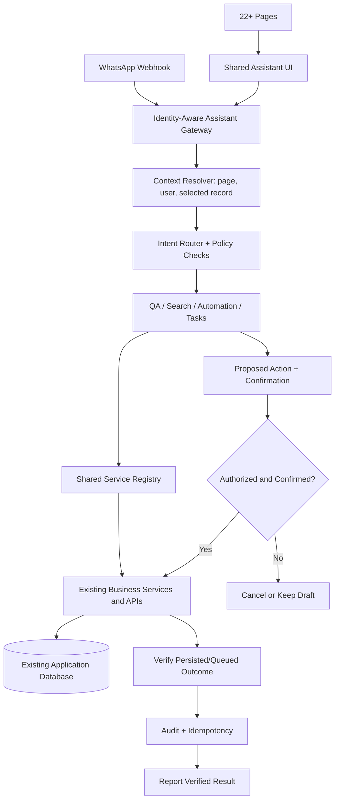

# Implementation Plan — Unified QA & Automation Assistant Across All Pages

**Repository:** `loki94in/AI-PHARMACY-V3`  
**Plan file:** `IMPLEMENTATION_PLAN_UNIFIED_AI_ASSISTANT_ALL_PAGES.md`  
**Status:** Plan only — implementation not started  
**Safety mode:** Read-only audit first; no source/config/runtime changes until the audit and plan are reviewed and implementation is explicitly authorized.

## 1. Objective

Provide one page-aware QA and automation assistant across all 22+ application pages and supported entry points, including the in-app assistant and WhatsApp Business. The assistant must operate on real, authorized users and production-shaped application records, reuse existing business workflows, and report only outcomes that the application verifies.

Do **not** create 22 separate bots, duplicate business logic, fake users, fake medicines, synthetic production records, hardcoded fallback phone numbers, or simulated success messages.

## 2. Non-negotiable requirements

1. **Real records only:** Read and write through the application's existing database/services. If a record cannot be found, say so; do not invent one.
2. **Shared assistant brain:** Route supported requests through a shared intent/context/permission layer. Page adapters provide context; they do not duplicate business rules.
3. **Reuse existing workflows:** Use existing APIs and service handlers for CRM, refills, Live Cart, inventory, purchases, Reorder Hub, OCR, tasks, enquiries, and WhatsApp.
4. **Identity and authorization:** Resolve the authenticated app user or verified WhatsApp contact. Apply server-side role and record-level permissions on every request and action.
5. **Explicit action states:** Distinguish `read`, `draft/prepared`, `awaiting_confirmation`, `executing`, `succeeded`, `failed`, and `cancelled`. Preparing a refill is not proof that it was added to Live Cart; preparing an order is not proof that it was placed.
6. **Confirmation gates:** Require confirmation for externally visible or consequential actions, including sending WhatsApp messages and placing official distributor orders. Confirmation must bind to the exact proposed action and its current data.
7. **No silent fallback:** Remove or block unsafe production fallbacks (including placeholder phone numbers). Missing identity, service, or data must fail closed with a clear explanation.
8. **Idempotency:** Duplicate webhooks, retries, and repeated clicks must not create duplicate messages, refills, cart additions, tasks, or official orders.
9. **Auditability:** Record actor, channel, action type, target record, confirmation, outcome, and correlation/idempotency key without logging unnecessary sensitive message content.
10. **Backward compatibility:** Preserve current page workflows and APIs unless a separately reviewed migration is required.

## 3. Target architecture

The diagram is a target design, not a claim that all connections already exist. Actual route, service, database and page names must be verified during Phase 0.

## 4. Phase 0 — Read-only repository audit (required before implementation)

Do not edit source files during this phase.

- Inventory all frontend routes/pages, shared layouts, current assistant UI, QA panel, and any existing chat components.
- Inventory backend routes, assistant orchestrator(s), intent services, service registry/dispatchers, authentication middleware, permission checks, and confirmation endpoints.
- Trace WhatsApp ingress → webhook validation → contact identity/role resolution → message persistence → assistant dispatch → response queue → delivery/status handling.
- Trace refill paths from website/CRM/WhatsApp through patient validation, refill preparation, Live Cart insertion, and final status.
- Trace Reorder Hub through supplier/distributor selection, purchase history, draft preparation, confirmation, official order placement, and duplicate-send prevention.
- Trace medicine search/QA actions and existing Add to Cart handlers.
- Trace OCR/image upload → extraction → review/correction → persistence.
- Trace task/reminder/enquiry creation, updates, completion and notification delivery.
- Identify all production fallbacks, mock data, placeholder contacts, demo-only code paths, swallowed errors, direct database writes that bypass services, and unverified success messages.
- Map every discovered page to supported read intents, write intents, permissions, existing service/API, and test coverage.
- Record uncertainties explicitly. Do not infer missing implementations from UI labels or documentation alone.

**Phase 0 deliverables**
- Page and route inventory (all discovered pages; do not assume the count is exactly 22).
- Page-to-capability integration matrix.
- Existing workflow/data-flow diagrams.
- Risk register and findings with file paths and evidence.
- Revised implementation sequence and test plan.
- Confirmation that the audit made zero source/config/runtime changes.

## 5. Phase 1 — Shared assistant foundation

Only begin after Phase 0 review and explicit authorization.

- Establish one shared assistant gateway for in-app entry points and supported WhatsApp flows.
- Add a typed capability registry describing each supported intent, required context, input schema, permission policy, existing handler, confirmation requirement, and result verifier.
- Add page context adapters for current route/page, selected record identifiers, and permitted actions. Treat client context as a hint; re-check all access on the server.
- Normalize responses and action states so all pages show consistent results and errors.
- Keep business logic in existing services; adapters and the assistant must call those services rather than reproduce the logic.

## 6. Phase 2 — Connect capabilities incrementally

Integrate only capabilities confirmed to exist during the audit. Prefer small, reviewable increments.

1. **Read-only QA and search:** explain the current page, search authorized records, summarize pending work, and cite record identifiers or links where appropriate.
2. **CRM and patient refills:** reuse the canonical refill workflow; verify patient identity and medicine details; ensure the actual existing Live Cart operation is used when required.
3. **Medicine search and QA panel:** reuse the existing medicine search and Add to Cart handler, including pack/quantity validation.
4. **Inventory and purchases:** read stock, batches, expiry and purchase records using existing business rules and authorization.
5. **Reorder Hub and distributors:** reuse supplier mappings, purchase history, draft order logic, and official-order workflow; never report placement until the official order result is verified.
6. **OCR and images:** use existing upload/OCR/review pipeline; never automatically treat unreviewed OCR as confirmed prescription or purchase data.
7. **Tasks, reminders and enquiries:** create/update existing task and enquiry records through their canonical handlers; prevent duplicate reminders.
8. **WhatsApp conversations:** route verified real contacts through the shared gateway; keep patient, staff, and distributor capabilities isolated; use the existing outbound queue and delivery status.
9. **Remaining pages:** add adapters only after their routes and services have been inventoried. Unsupported actions must be clearly unavailable rather than simulated.

## 7. Phase 3 — Safety, persistence and failure handling

- Bind confirmation to a specific action proposal, target record, normalized parameters, actor, expiry and one-time token or equivalent server-side state.
- Revalidate permissions and critical data at execution time to avoid stale approvals.
- Use transaction boundaries for database mutations where supported.
- Use durable idempotency keys for inbound webhook events and externally visible actions.
- Distinguish queued, sent, delivered, rejected, timed out, and unknown outcomes where the provider exposes those states.
- Do not retry non-idempotent external actions blindly; reconcile status before retrying.
- Return actionable errors without exposing secrets, private patient data, internal rates, or stack traces.
- Ensure logs do not store credentials, access tokens, or unnecessary sensitive content.
- Keep existing rollback/recovery paths; use migrations only when necessary, with backups and verified restore procedures.

## 8. Phase 4 — Regression and integration tests

Use isolated test fixtures only in test environments. Never create dummy users or fake records in production.

### Core assistant
- Every page context resolves to the correct route and selected record.
- Unsupported intents do not call mutation handlers.
- Unknown records produce a truthful not-found response.
- Server-side authorization is enforced even if the client submits a forged record ID or role.
- Existing page APIs and manual workflows remain functional.

### Real-user and WhatsApp flows
- Verified patient, authorized staff and registered distributor contacts are routed to the correct capability set.
- Unknown/unverified contacts cannot access private records or perform protected actions.
- Invalid webhook signatures are rejected.
- Duplicate webhook delivery does not repeat side effects.
- No placeholder phone number is ever used as a real recipient.
- Queue/provider failures are surfaced as failures or unknown states, not success.

### Refill and Live Cart
- A prepared refill remains distinct from a refill actually added to the cart.
- Successful cart additions persist the expected medicine, pack size and quantity.
- Failed or partially processed items are reported accurately.
- Repeated requests do not duplicate cart lines or refills unless the established workflow explicitly allows it.

### Distributor orders and messages
- Drafting an order never places it.
- Cancellation sends no message and places no order.
- Confirmation authorizes only the displayed proposal.
- Official order placement is reported only after verification from the existing order workflow.
- Duplicate retries do not send a distributor order/message twice.

### OCR, tasks and data protection
- OCR results require the existing review/approval steps.
- Task and enquiry retries do not create duplicates.
- Patient data and internal purchase rates are hidden from unauthorized roles.
- Audit records are written for successful and failed consequential actions.

### Acceptance gate
- All relevant existing tests pass.
- New regression tests pass.
- No unresolved critical/high-severity privacy, authorization, duplicate-action or data-loss issue remains.
- Manual verification confirms real persisted results in a controlled environment.
- The implementation diff contains only reviewed, in-scope changes.

## 9. Phase 5 — Controlled rollout and rollback

- Enable read-only QA first.
- Enable write actions behind explicit feature flags or equivalent controlled configuration.
- Start with internal authorized staff and a limited set of capabilities.
- Monitor errors, duplicate-event detection, queue/provider outcomes and authorization denials.
- Expand page-by-page only after acceptance gates pass.
- Disable the relevant capability/feature flag if integrity or privacy checks fail; preserve queued events for reconciliation rather than discarding them.
- Roll back schema changes only through a tested recovery plan. Never delete or overwrite production data as a quick rollback.

## 10. Definition of done

- All discovered pages are present in the integration matrix with explicit supported/unsupported capabilities.
- One shared assistant gateway serves the intended in-app and WhatsApp entry points.
- All mutations call canonical existing business services.
- Real identity, record-level permissions, confirmation and idempotency are enforced server-side.
- Actual database/queue/provider outcomes are verified before success is reported.
- No dummy production data or hardcoded fallback identities remain in the enabled paths.
- Regression, integration, security and rollback checks pass.
- A final change report lists modified files, tests run, known limitations, and the evidence for each acceptance criterion.

## 11. Change-control rule

This document is an implementation plan only. Creating or saving this plan does not authorize source-code edits, database migrations, production messages, or official orders. Complete the read-only audit and review its findings before implementing Phase 1.
