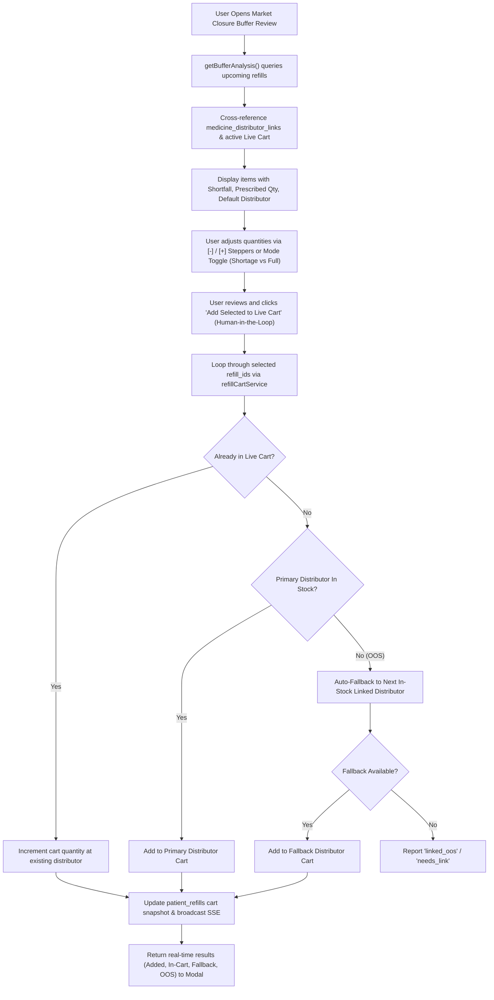

# Implementation Plan: Market Closure Stock Buffer Live Cart Integration, Distributor Fallback & Quantity Stepper UX

**Plan File:** `MARKET_CLOSURE_STOCK_BUFFER_LIVE_CART_INTEGRATION_PLAN.md`  
**Tracking File:** `implementation.md`  
**Date:** 2026-11-04  
**Status:** In Discussion / Awaiting User "IMPLEMENT" Command  

---

## 1. Problem Diagnosis & Root Causes

1. **Unable to Add to Live Cart**:
   - In `frontend/src/components/ClosureStockBufferModal.tsx`, clicking "Add Selected to Cart" calls `POST /api/pharmarack/add-closure-buffer-to-cart`.
   - In `src/services/marketClosureService.ts:addBufferItemsToCart`, the backend merely executes `INSERT INTO special_orders ... (status='Pending', pharmarack_mapped=0)`.
   - **Root Cause**: It never called the Pharmarack Live Cart API (`addItemsToPharmarackCart` / `processRefillCartItem`). The medicines were written only as offline pending rows in SQLite and never reached the live cart.

2. **Default Distributor in Cart & Auto-Sync**:
   - In `getBufferAnalysis`, the distributor is queried as `COALESCE(m.last_distributor_name, '') AS distributor_name`, ignoring:
     - Active live cart lines (`loadLiveCartCore`).
     - Pharmacist priority order in `distributor_priority`.
     - Explicit links in `medicine_distributor_links`.
   - As a result, the modal cannot auto-group medicines into the distributor already active in the cart.

3. **Intelligent Out-of-Stock Fallback (Like CRM Refills)**:
   - In CRM Refills (`src/services/refillCartService.ts:processRefillCartItem`), the app already possesses an advanced distributor fallback engine:
     - Reads live cart to check if an item is already present at a distributor.
     - Reads linked distributors ordered by `pick_order` and `distributor_priority`.
     - Queries live stock in real time.
     - If the primary/default distributor is Out of Stock (OOS) or below minimum threshold, it automatically falls back to the next linked distributor that is in stock.
     - Adds the item to the live cart and updates `patient_refills` cart metadata (`cart_store_id`, `cart_store_name`, `cart_product_code`, `cart_qty`).

4. **Order Quantity Stepper & Usability Issues**:
   - In `ClosureStockBufferModal.tsx`, the order quantity is a bare `<input type="number">` without quick `[-]` and `[+]` steppers.
   - Users struggle to quickly tweak quantities or backspace without fighting immediate `Math.max(1, ...)` resets.
   - Missing quick mode toggles: Users want the same clean ergonomics as `RefillOrderModal` (quick switch between "Shortage Only" vs "Full Refill Demand", plus snappy `[-]` `[input]` `[+]` stepper buttons).

---

## 2. Proposed Architecture & Solution Design

### Detailed Component Enhancements:
1. **Frontend Quantity UX (`frontend/src/components/ClosureStockBufferModal.tsx`)**:
   - **Quantity Stepper**: Replace the plain input with the ergonomic CRM Refill stepper:
     - Decrement button `[-]` (stops at 1).
     - Direct numeric input with smooth typing support and focus isolation (`e.stopPropagation()`).
     - Increment button `[+]`.
   - **Quantity Mode Toggle in Header/Toolbar**:
     - Mode 1: **Shortage Only** (recommended order qty = `shortfall_packs`).
     - Mode 2: **Full Refill Demand** (order qty = `quantity_needed`).
   - **Total Summary Updates**: Selected count and total packs react instantly to stepper and toggle changes.

2. **Backend Live Cart & Fallback Integration (`src/services/marketClosureService.ts` & `src/routes/pharmarack.ts`)**:
   - In `getBufferAnalysis`: Fetch linked distributors from `medicine_distributor_links` and check active cart lines (`loadLiveCartCore`), so the modal displays whether an item is already in cart or which distributor is primary.
   - In `addBufferItemsToCart`: Call `processRefillCartItem(it.refill_id, { qty })` for each selected item.
   - Leverage `refillCartService`'s built-in OOS fallback loop:
     - Automatically checks live stock.
     - Falls back to secondary/tertiary linked distributors when primary is OOS.
     - Directly adds into Pharmarack live cart (`addItemsToPharmarackCart`).
     - Sets `cart_store_id`, `cart_store_name`, `cart_product_code`, `cart_qty`, and marks refill status.

3. **Status Feedback & Link Shortcut**:
   - Show live status per row: "Added to [Distributor]", "In Live Cart", "Fallback to [Distributor B]", or "Needs Link".
   - Provide an inline link button if a medicine has no distributor linked yet.

---

## 3. Human-in-the-Loop Governance (Rule 6)

- Nothing is auto-added to the live cart without explicit user review.
- The pharmacist selects/deselects medicines, toggles modes, uses steppers to fine-tune quantities, and clicks "Add Selected to Live Cart".
- Full feedback is presented with confirmation of which distributor accepted each line.

---

## 4. Execution Tasks & Verification Checklist

- [ ] **Task 1: Backend Service Upgrade (`src/services/marketClosureService.ts`)**
  - Enrich `getBufferAnalysis` with `medicine_distributor_links` priority and active cart status.
  - Wire `addBufferItemsToCart` to call `processRefillCartItem` for genuine live cart execution with automated distributor OOS fallback.
- [ ] **Task 2: API Route Updates (`src/routes/pharmarack.ts`)**
  - Return rich item outcome status: `added`, `in_cart`, `fallback_added`, `linked_oos`, `needs_link`.
- [ ] **Task 3: Frontend Quantity Stepper & Modal Enhancements (`ClosureStockBufferModal.tsx`)**
  - Implement `[-]` `[input]` `[+]` quantity stepper matching `RefillOrderModal`.
  - Add "Shortage Only" vs "Full Demand" mode toggle.
  - Display active cart distributor badges and OOS fallback indicators.
  - Integrate live execution state and progress feedback.
  - Provide inline distributor linking shortcut for unlinked medicines.
- [ ] **Task 4: Zero-Bugs Gate & Guardrails Verification**
  - Run `npm run guardrails` (`node scripts/performance-guardrails.mjs`).
  - Run `npm run build` to confirm zero TypeScript compilation errors.
  - Run `node scripts/quick-update.mjs` to synchronize the knowledge graph.
- [ ] **Task 5: Human-in-the-Loop Final Verification**
  - Verify with the user that the quantity editing, cart addition, and fallback behaviors work smoothly.
