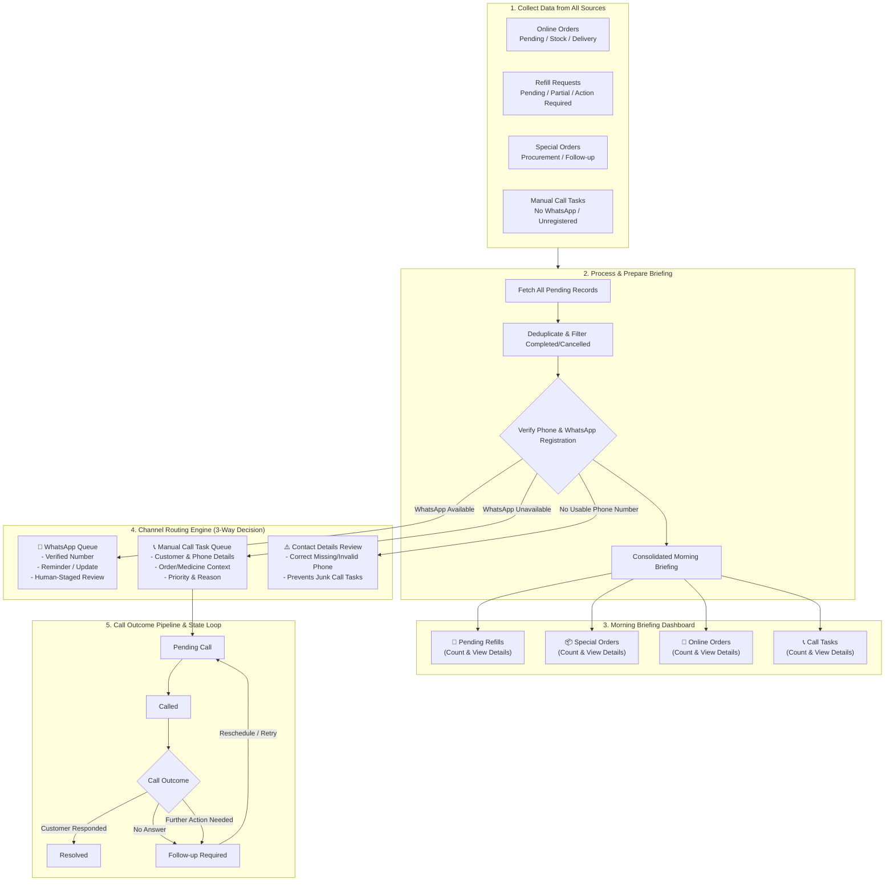

# Morning Briefing & Reorder Hub Flow Architecture Plan

## 1. Flowchart Specification

## 2. Core Pillars & Decision Gates

1. **Source Aggregation**:
   - `Online Orders`: from `website_orders` / `online_orders` where status in pending, processing, awaiting_stock, not_delivered.
   - `Refill Requests`: from `patient_refills` where status in pending, partially_fulfilled, or `approval_status = 'required'` in `refill_batches`.
   - `Special Orders`: from `special_orders` where status in pending, procurement_needed, supplier_follow_up.
   - `Manual Call Tasks`: from `patient_call_tasks` where status in pending, rescheduled, called.

2. **Deduplication & Hygiene**:
   - Filter completed, cancelled, or duplicate entries.
   - Validate phone format: 10 digits valid Indian mobile.

3. **3-Way Routing Engine**:
   - **WhatsApp Available**: Valid phone + WhatsApp registered $\rightarrow$ Stage in `automation_notifications` (Human-in-the-loop review).
   - **WhatsApp Unavailable**: Valid phone but unregistered/unreachable on WhatsApp $\rightarrow$ Add to `patient_call_tasks` queue with order/medicine context.
   - **No Usable Phone Number**: Empty, null, or invalid phone $\rightarrow$ Flag for `Contact Details Review` (avoids creating uncallable call tasks).

4. **Call Outcome Pipeline**:
   - `Pending Call` $\rightarrow$ `Called` $\rightarrow$ `Customer Responded` ($\rightarrow$ `Resolved`) OR `No Answer` / `Further Action Needed` ($\rightarrow$ `Follow-up Required` $\rightarrow$ loops back into `Pending Call` with reschedule date).

5. **Human-in-the-loop & Performance Contracts**:
   - Staged messaging queue in `automation_notifications`.
   - Semantic Tailwind variables only (`bg-bg`, `bg-bg2`, `bg-bg3`, `text-text`, `text-muted`).
   - Event-driven SSE refresh on `morning_briefing_updated`, `refill_updated`, `call_tasks_updated`, `website_orders_updated`.
