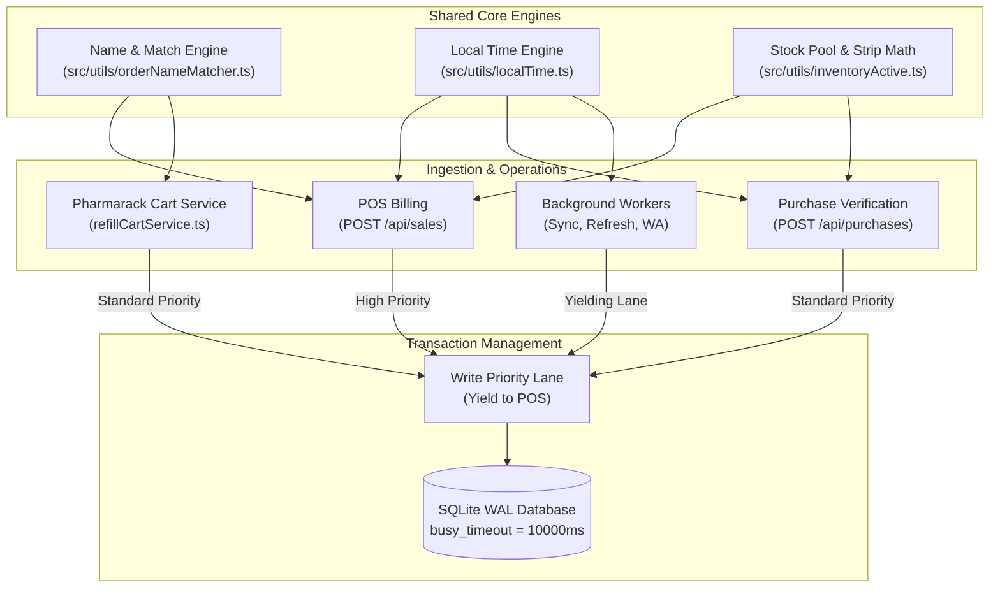

# Architecture Specification: System Breaking Points, Concurrency Hazards & Duplicate Logic Consolidation

*   **Author:** AI Pharmacy Engineering (Elephant Deep-Context Analysis)
*   **Status:** In Review
*   **Date:** 2026-11-01
*   **Target Scope:** Full Application (Core Backend Engine, SQLite WAL Layer, POS & Purchases Pipelines, Frontend State Managers)

--------------------------------------------------------------------------------

## 1. Overview & Problem Statement

The AI Pharmacy platform is an offline-first, local Electron application designed to run on resource-constrained pharmacy workstations (4-core CPUs, 8–12 GB RAM, integrated graphics without GPU acceleration). 

As the application expanded from counter billing to automated background supplier synchronization, Pharmarack cart ordering, WhatsApp queue automation, and clinical AI grounding, distinct subsystems began implementing overlapping business logic and divergent data handling strategies.

This specification provides a comprehensive audit of:
1. **Critical Breaking Points**: Race conditions, SQLite lock contention (`SQLITE_BUSY`), loose pack-size estimations, and synthetic fallback defaults that compromise data integrity.
2. **Duplicated Logic Clusters**: Divergent fuzzy/token matching engines, split date/expiry formatting rules, and redundant cart addition paths scattered between frontend React modals and backend Express route handlers.
3. **Consolidation Architecture**: A unified, single-writer pipeline compliant with [`AGENT_DATA_FLOW_TREE.md`](file:///e:/CURRENT%20PROJECT%20ON%20WORKING/AI%20PHARMACY%20v2/AGENT_DATA_FLOW_TREE.md) and [`BACKEND SCHEMA SAFETY.md`](file:///e:/CURRENT%20PROJECT%20ON%20WORKING/AI%20PHARMACY%20v2/BACKEND%20SCHEMA%20SAFETY.md).

--------------------------------------------------------------------------------

## 2. Goals & Non-Goals

### Goals
*   **Zero Logic Duplication**: Establish single-source modules for medicine string tokenization, fuzzy scoring, local date/expiry parsing, and strip-to-loose stock math.
*   **Deterministic Concurrency**: Eliminate SQLite lock contention during concurrent background supplier polling (Pharmarack/WhatsApp) and foreground POS sale commits via a centralized serialization lane.
*   **Eliminate Synthetic Defaults**: Remove silent fallback defaults (e.g. `'Customer'`, `'AI Pharmacy'`, arbitrary `2.5% + 2.5%` GST assumptions, and guessed `pack_size = 1`) per the "Purchase Bill is the Only Truth" mandate.
*   **Preserve No-GPU Contract**: Keep all consolidated operations CPU-cheap without adding heavy runtime dependencies or layout thrashing.

### Non-Goals
*   Migrating from SQLite to PostgreSQL or cloud databases (the application must remain 100% local-first and self-contained).
*   Rewriting the user interface styling or altering established UI workflows for checkout.
*   Modifying tax formulas in `src/utils/saleTotals.ts` that already correctly handle inclusive/exclusive calculations.

--------------------------------------------------------------------------------

## 3. Audit of Redundant & Duplicated Logic

### Cluster A: Medicine Fuzzy Matching & Name Normalization
*   **Existing Implementations**:
    1. [`frontend/src/utils/orderFuzzyMatcher.ts`](file:///e:/CURRENT%20PROJECT%20ON%20WORKING/AI%20PHARMACY%20v2/frontend/src/utils/orderFuzzyMatcher.ts): Scores title match (85 pts max) and distributor link (15 pts max).
    2. [`src/utils/orderNameMatcher.ts`](file:///e:/CURRENT%20PROJECT%20ON%20WORKING/AI%20PHARMACY%20v2/src/utils/orderNameMatcher.ts): Backend mirror scoring title and distributor match.
    3. [`src/utils/nameNormalizer.ts`](file:///e:/CURRENT%20PROJECT%20ON%20WORKING/AI%20PHARMACY%20v2/src/utils/nameNormalizer.ts): Strips salt prefixes, dosage markers (`tab`, `syp`), and packaging indicators.
    4. [`src/routes/pharmarack.ts`](file:///e:/CURRENT%20PROJECT%20ON%20WORKING/AI%20PHARMACY%20v2/src/routes/pharmarack.ts): Inline regex cleaning (`normalizeMedicineName` and inline SQL search queries).
*   **The Hazard**:
    When the client matcher and the server matcher disagree on normalization tokens (e.g., handling dosage suffixes like `SR`, `ER`, `650`, or `10X10`), the user sees a valid match greenlighted in the UI, but the backend cart service rejects or maps it to an incorrect distributor SKU.

### Cluster B: Expiry & Local Time Normalization
*   **Existing Implementations**:
    1. [`src/utils/localTime.ts`](file:///e:/CURRENT%20PROJECT%20ON%20WORKING/AI%20PHARMACY%20v2/src/utils/localTime.ts): Authoritative shop local timestamp generator (`toLocalTimestampString`).
    2. [`frontend/src/utils/date.ts`](file:///e:/CURRENT%20PROJECT%20ON%20WORKING/AI%20PHARMACY%20v2/frontend/src/utils/date.ts): Frontend date formatting and expiry string parser.
    3. [`src/routes/purchases.ts`](file:///e:/CURRENT%20PROJECT%20ON%20WORKING/AI%20PHARMACY%20v2/src/routes/purchases.ts) (`formatExpiryToMMYY`): Clamps months 1-12 and converts `DD/MM/YYYY` strings.
    4. [`src/utils/inventoryActive.ts`](file:///e:/CURRENT%20PROJECT%20ON%20WORKING/AI%20PHARMACY%20v2/src/utils/inventoryActive.ts) (`isExpiredForSale`): Evaluates whether a batch is legally sellable.
*   **The Hazard**:
    Date comparisons using UTC `new Date().toISOString()` instead of local Indian Standard Time (IST) cause batches expiring at midnight on month-end to be marked expired 5.5 hours prematurely or allowed for sale post-expiry, creating compliance risks.

### Cluster C: Cart Line Assembly & Linked Item Dispatch
*   **Existing Implementations**:
    1. [`src/services/refillCartService.ts`](file:///e:/CURRENT%20PROJECT%20ON%20WORKING/AI%20PHARMACY%20v2/src/services/refillCartService.ts): Validates distributor minimum stock, fetches live product codes, and dispatches via `POST /api/pharmarack/cart/add`.
    2. [`frontend/src/components/RefillOrderModal.tsx`](file:///e:/CURRENT%20PROJECT%20ON%20WORKING/AI%20PHARMACY%20v2/frontend/src/components/RefillOrderModal.tsx): Dispatches cart line mutations and verifies live stock thresholds on the client.
    3. [`frontend/src/components/SpecialOrderAddModal.tsx`](file:///e:/CURRENT%20PROJECT%20ON%20WORKING/AI%20PHARMACY%20v2/frontend/src/components/SpecialOrderAddModal.tsx): Re-implements reorder past item mapping with independent distributor resolution.
*   **The Hazard**:
    Discrepant validation criteria: Refill modals enforce `min_distributor_stock_threshold`, while Special Orders previously relied on manual distributor selection, risking split orders across different store branches.

--------------------------------------------------------------------------------

## 4. Audit of Critical Architectural Breaking Points

### Breaking Point 1: SQLite Lock Contention (`SQLITE_BUSY: database is locked`)
*   **Mechanic**:
    SQLite in WAL (Write-Ahead Logging) mode allows multiple concurrent readers, but strictly **one single writer** at a time.
*   **Vulnerability Trigger**:
    When a background worker (e.g. `catalogSyncWorker`, `whatsappQueueWorker`, or `tokenRefreshScheduler`) begins a long-running batch write transaction, and simultaneously a cashier clicks **Complete Sale (Enter)** at the POS:
    The POS transaction throws `SQLITE_BUSY: database is locked`. If uncaught or un-retried with exponential backoff, the cashier receives an error banner and the counter freezes during customer checkout.
*   **Mitigation Strategy**:
    1. Route all background heavy mutations through `src/utils/heavyRestoreLane.ts` or an explicit Write Serialization Lane that yields immediately to high-priority counter transactions (`PRIORITY_INTERRUPT`).
    2. Set `PRAGMA busy_timeout = 10000;` on all database connections in `src/database.ts`.

### Breaking Point 2: Loose Pack-Size Estimations & Strip Depletion Drift
*   **Mechanic**:
    In Indian pharmacy operations, medicines are purchased in strips/boxes (e.g. 1 strip of 10 tablets) and sold either as full strips or loose individual tablets.
*   **Vulnerability Trigger**:
    `COALESCE(m.pack_size, 1)`: If a medicine was registered without an explicit pack size, the database defaults to 1.
    If a cashier sells "5 loose tablets" of a 10-tablet strip whose registered pack size is 1:
    The system interprets this as selling 5 full boxes (500% inventory over-depletion), corrupting stock ledger records and triggering inaccurate low-stock alerts.
*   **Mitigation Strategy**:
    Hard reject loose tablet sales if `pack_size` is missing, `NULL`, or `< 2`. Require the cashier or inventory manager to confirm the strip packaging before loose dispensing.

### Breaking Point 3: Synthetic Default Values on Sales and Purchases
*   **Mechanic**:
    Legacy route fallbacks (`POST /sales` and `POST /purchases`) inject artificial placeholder data to avoid validation errors:
    - Defaulting customer to `'Customer'` with empty phone number creates tens of thousands of duplicate ghost customer records.
    - Defaulting invoice number to `INV-######` prevents distributors from reconciling credit claims.
    - Defaulting GST rate to `2.5% + 2.5%` (5%) when unrecorded creates tax calculation errors on 12% and 18% formulations.
*   **Mitigation Strategy**:
    Per [`AGENT_DATA_FLOW_TREE.md`](file:///e:/CURRENT%20PROJECT%20ON%20WORKING/AI%20PHARMACY%20v2/AGENT_DATA_FLOW_TREE.md): "A missing value stays missing until the user types it or a saved bill already contains it." Hard-block checkout on unregistered tax rates.

--------------------------------------------------------------------------------

## 5. Target Architecture & Consolidation Blueprint

### Core Architecture Contracts:
1. **Single Normalization Authority**:
   Client modules import identical score metrics and tokenizers exported directly from the shared engine. The fuzzy score threshold is fixed at `75`, allocating 85 pts to clean medicine tokens and 15 pts to distributor link confirmation.
2. **Deterministic Write Prioritization**:
   Any background task performing database modifications must acquire the write lock with a non-blocking timeout (`yielding: true`), aborting immediately if a user-facing sale transaction requires the bus.
3. **No Phantom Records**:
   `POST /sales` refuses saves where `customer_name` or `phone` is empty unless explicitly marked as a "Walk-In Counter Sale" without creating an artificial `customers` database row.

--------------------------------------------------------------------------------

## 6. Alternatives Considered & Rejected

### Alternative 1: Client-Side Standalone Heuristic Engine
*   **Concept**: Keep client fuzzy matching and normalization in `frontend/src/utils/` to avoid server roundtrips.
*   **Why Rejected**: Creates "matcher drift". Whenever medicine catalog token rules update (e.g., removing PTR/MRP dependence), client and server fall out of sync, leading to broken cart additions.

### Alternative 2: Offloading Background Workers to SQLite Secondary Database
*   **Concept**: Put background sync data (cart items, distributor catalogs) into a separate `sync.db`.
*   **Why Rejected**: Violates foreign-key integrity between `distributor_medicines`, `medicines`, and `patient_refills`. Cross-database transactions in SQLite do not support WAL atomic guarantees across files.

### Alternative 3: Background Worker Thread Concurrency (Worker Threads)
*   **Concept**: Spawn multi-threaded Node.js worker pools for catalog parsing.
*   **Why Rejected**: Rapidly exceeds the 4-core, 8 GB host resource constraints of target retail pharmacy PCs, triggering CPU starvation and violating the No-GPU SwiftShader Electron contract.

--------------------------------------------------------------------------------

## 7. Risks & Mitigations

| Risk | Severity | Mitigation |
| :--- | :--- | :--- |
| **Strict validation blocks cashier during rush hour** | High | Provide clear, actionable inline modals (e.g. "Enter pack size to sell loose") with single-click resolution instead of cryptic 500 error banners. |
| **Long-running distributor sync stalls UI queries** | Medium | Background sync chunks operations in batches of 50 items with 10ms event-loop yields between transactions. |
| **Legacy database records with missing GST crash bill views** | Medium | Maintain read-side compatibility for historical bills (`sale_items.gst_rate ?? 0`), but enforce strict write-side validation on all new bills. |

--------------------------------------------------------------------------------

## 8. Verification & Acceptance Criteria

1. **Concurrency Stress Test**:
   - Trigger `catalogSyncWorker` full catalog write while firing 20 sequential simulated POS sales.
   - Zero `SQLITE_BUSY` errors recorded in logs; POS sale latency stays `< 120ms`.
2. **Matcher Parity Test**:
   - Run identical suite of 100 medicine strings through both backend and frontend matchers; assert 100% score and decision parity.
3. **Loose Unit Pricing Math**:
   - Verify loose tablet sale accurately decrements fractional strip pool without corrupting `inventory_master.loose_quantity`.
4. **Performance Guardrails**:
   - Pass `npm run guardrails` with 0 violations.
   - Maintain Electron cold-boot to window visibility in `< 450ms`.

