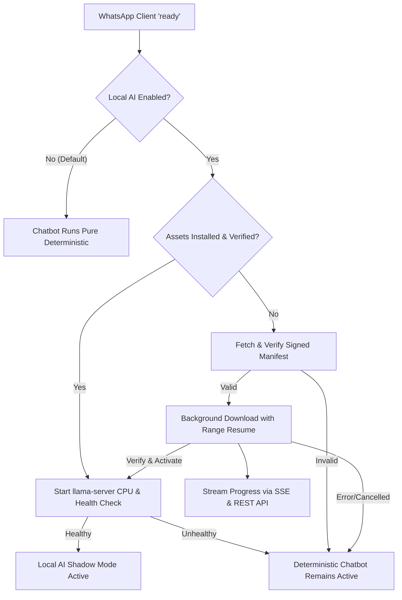

# Cloud-Hosted Local AI Model Installation & Lifecycle Guide
**Application**: AI Pharmacy OS (AI-PHARMACY-V3)  
**Model**: Qwen3-1.7B Q4_K_M (GGUF)  
**Runtime**: llama.cpp HTTP server (`llama-server.exe`)  
**Execution Mode**: Local-only CPU inference (`-ngl 0`); Cloud hosting is for asset distribution only.

---

## 1. Architectural Philosophy & Zero-Business-Action Guarantee

1. **Local Inference Execution**: The quantized model weights execute entirely on the local PC CPU. Cloud hosting is used solely for downloading verified release assets. No prompt text or message inferences are ever sent to the cloud.
2. **Passive Shadow Mode Only**: Inbound WhatsApp messages are evaluated in passive shadow mode exclusively for ambiguous text.
3. **Deterministic Workflows Authoritative**: The deterministic parser, rule-based catalog matchers, and human pharmacist confirmation flows remain 100% authoritative.
4. **Zero Business Impact**:
   > [!IMPORTANT]
   > No customer orders, live carts, POS transactions, inventory balances, CRM tickets, or pricing entries are driven by model output.
5. **Privacy Guarantee**: No customer conversations, phone numbers, or pharmacy records are ever uploaded to the asset distribution server.

---

## 2. Cloud Asset Distribution Architecture

Release assets are published to a secure, versioned HTTPS endpoint (configurable via `LOCAL_AI_ASSET_BASE_URL` or `LOCAL_AI_MANIFEST_URL`).

### Release Manifest Schema (`manifest.json`)
```json
{
  "schemaVersion": "1.0",
  "releaseTag": "v1.0.0",
  "model": {
    "name": "qwen3-1.7b-q4_k_m",
    "family": "Qwen3",
    "parameterSize": "1.7B",
    "quantization": "Q4_K_M",
    "contextLength": 2048,
    "artifact": {
      "filename": "qwen3-1.7b-q4_k_m.gguf",
      "sha256": "4a8e2b... (64-char lowercase hex)",
      "sizeBytes": 1150428160,
      "url": "https://assets.aipharmacy.internal/releases/local-ai/qwen3-1.7b-q4_k_m.gguf"
    }
  },
  "runtime": {
    "name": "llama-server",
    "version": "b4500",
    "platform": "win32-x64",
    "artifact": {
      "filename": "llama-server.exe",
      "sha256": "9f3c1d... (64-char lowercase hex)",
      "sizeBytes": 18452480,
      "url": "https://assets.aipharmacy.internal/releases/local-ai/llama-server.exe",
      "executable": true
    }
  },
  "license": {
    "artifact": {
      "filename": "LICENSE.txt",
      "sha256": "1d8b3a...",
      "sizeBytes": 11358,
      "url": "https://assets.aipharmacy.internal/releases/local-ai/LICENSE.txt"
    }
  },
  "metadata": {
    "artifact": {
      "filename": "metadata.json",
      "sha256": "7c4e2f...",
      "sizeBytes": 842,
      "url": "https://assets.aipharmacy.internal/releases/local-ai/metadata.json"
    }
  },
  "signature": "<ECDSA or HMAC signature of the manifest>",
  "publishedAt": "2026-10-29T00:00:00Z"
}
```

---

## 3. Security & Validation Standards

1. **Manifest Authenticity**:
   - The manifest signature is verified using ECDSA (with `LOCAL_AI_PUBLIC_KEY`) or HMAC-SHA256 before any download URLs or checksums are trusted.
   - Unverified, tampered, or malformed manifests are rejected immediately.
2. **Path Traversal Protection**:
   - All manifest artifact filenames are strictly sanitized using `path.basename()`.
   - File paths containing directory separators (`/`, `\`), `..`, null bytes (`\0`), or drive letters are instantly rejected.
3. **Artifact Integrity Check**:
   - Streamed downloads calculate running SHA-256 checksums.
   - Any checksum mismatch or truncated size causes the temporary staging file to be deleted and flagged as an integrity failure.
4. **Execution Safety**:
   - Unverified binaries are never executed. `llama-server.exe` is only launched after SHA-256 verification and atomic activation.
5. **Disk Space Pre-Checks**:
   - Before downloading multi-gigabyte models, available storage is checked via `fs.statfs` with a 250 MB safety buffer.

---

## 4. WhatsApp Connection Lifecycle

When WhatsApp reaches the `ready` state:



### Lifecycle Guarantees:
- **Non-blocking**: The entire verification and download process runs in the background. WhatsApp authentication and inbound message handling are never delayed.
- **Byte-Range Resume**: Interrupted downloads resume from existing `.part` files using HTTP `Range: bytes=N-` headers.
- **Deduplication**: If the active directory already contains verified assets matching the manifest release tag and checksums, no network downloads occur.

---

## 5. REST API & Telemetry

### Endpoints (`/api/local-ai`)

| Method | Endpoint | Description |
|--------|----------|-------------|
| `GET` | `/api/local-ai/status` | Returns system status, installation state, download progress, and runtime health |
| `POST` | `/api/local-ai/download` | Initiates background download from configured manifest |
| `POST` | `/api/local-ai/cancel` | Aborts active download |
| `POST` | `/api/local-ai/retry` | Retries a failed or cancelled download |
| `POST` | `/api/local-ai/toggle` | Enables or disables Local AI shadow mode (`enabled: boolean`) |

### Server-Sent Events (SSE)
- `local_ai_download_progress`: `{ status, progress, downloadedBytes, totalBytes, currentArtifact }`
- `local_ai_status_changed`: `{ status, runtimeHealthy, error }`

---

## 6. Build Modes

1. **Offline Bundled Mode (`BUNDLE_LOCAL_AI=1`)**:
   - Requires `llama-server.exe`, `qwen3-1.7b-q4_k_m.gguf`, `LICENSE.txt`, and `metadata.json` to exist under `models/local-ai/`.
   - The build script (`scripts/buildSea.cjs`) strictly fails if any asset is missing.
2. **Cloud-Download Mode (Default)**:
   - Packages the application and download manager without the large model binary.
   - Installer size remains lightweight (~50 MB).
   - Downloads occur on-demand when WhatsApp connects and the user opts in.

---

## 7. Troubleshooting & Rollback

- **Corrupted Downloads**: Staged `.part` files are automatically cleared upon SHA-256 verification failure.
- **Rollback Protection**: In `activateStagedAssets()`, previous active assets are moved to `.backup/` and restored automatically if activation encounters an I/O error.
- **Diagnostic Log**: Shadow classifications and intent discrepancies are recorded to `data/shadow_intent.log`.

