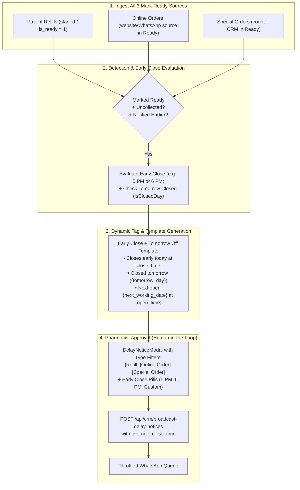

# Early Close & Tomorrow Off Unified Reminder Implementation Plan

## Overview
Implement an intelligent early closing (e.g., 5:00 PM / 6:00 PM) and tomorrow-closed reminder flow covering all three operational sources of "Ready" orders:
1. **Patient Refills** (`patient_refills` in `staged` or `is_ready = 1`)
2. **Online Orders** (`special_orders` with remote/web sources in `Ready` or `ready_for_pickup`)
3. **Special Orders** (`special_orders` walk-in/counter requests in `Ready`)

The system enables pharmacists to select an early closing time override (e.g., 5:00 PM, 6:00 PM), calculates the next verified open working day, and dispatches calm, polite follow-up messages across Marathi, Hindi, and English to patients who were notified earlier today but haven't collected their medicines yet.

---

## Architecture & Flow

---

## Proposed Changes

### 1. Backend Route Updates (`src/routes/crm.ts`)
- In `GET /api/crm/delay-notice-candidates`:
  - Fetch online orders in `Ready` separately so they carry `type: 'online_order'` and `category: 'ready_pickup'`.
  - Fetch special orders in `Ready` with `type: 'special_order'` and `category: 'ready_pickup'`.
  - Fetch refills in `staged` / `is_ready = 1` with `type: 'refill'` and `category: 'ready_pickup'`.
  - Capture `notified_earlier: boolean` (using `notified = 1` or tracking event).
  - Return `early_close_options: ['05:00 PM', '06:00 PM', '07:00 PM']` in `calendar_context`.
- In `POST /api/crm/broadcast-delay-notices`:
  - Accept `override_close_time` (e.g., `"05:00 PM"` or `"06:00 PM"`).
  - Use `override_close_time` for `{close_time}` tag replacement when provided.

### 2. Frontend Modal Updates (`frontend/src/components/DelayNoticeModal.tsx`)
- Add preset: `early_close_tomorrow_off`:
  - Marathi, Hindi, English templates for Early Close Today (5 PM/6 PM) + Tomorrow Shop Closed.
- Add **Early Close Today Selector**:
  - Toggle & pills for `05:00 PM`, `06:00 PM`, `07:00 PM`, or `Custom`.
  - Automatically updates the preview template with the selected early close time.
- Update Type Filters:
  - `All`, `Special Requests`, `Refills`, `Online Orders`.
- Update Table Badges:
  - Distinguish `[Special Order]`, `[Refill]`, and `[Online Order]`.
  - Render an `Already Notified` badge if the customer was notified earlier today.

### 3. Automated Verification Tests (`tests/marketAndShopClosurePipeline.test.ts`)
- Add test case verifying all 3 sources (`refill`, `special_order`, `online_order`) are properly classified and returned.
- Add test case verifying `override_close_time` replaces `{close_time}` with the early closing hour (e.g. `05:00 PM`).
- Verify with `npm test`, `npm run guardrails`, and `node scripts/quick-update.mjs`.

---

## Verification Plan

### Automated Tests
1. `npm test -- tests/marketAndShopClosurePipeline.test.ts`
2. `npm run guardrails`
3. `node scripts/quick-update.mjs`

---

## Task Completion Log

1. **All 3 Mark-Ready Sources Unified**:
   - Refactored `GET /api/crm/delay-notice-candidates` in `src/routes/crm.ts` to separate and categorize:
     - **Patient Refills** (`type: 'refill'`)
     - **Online Orders** (`type: 'online_order'`)
     - **Special Orders** (`type: 'special_order'`)
   - Added `notified_earlier: boolean` flag so the pharmacist sees who was already notified today.

2. **Early Close Today Override (5 PM / 6 PM)**:
   - Added `override_close_time` support to `POST /api/crm/broadcast-delay-notices` so selecting early close (e.g. `05:00 PM` or `06:00 PM`) dynamically overrides the standard close time for `{close_time}` in all messages.
   - Added early close options (`05:00 PM`, `06:00 PM`, `07:00 PM`) to `calendar_context`.

3. **Frontend Modal UI (`DelayNoticeModal.tsx`)**:
   - Added Early Close toggle & pills (`05:00 PM`, `06:00 PM`, `07:00 PM`) in the message composer.
   - Added new preset `early_close_tomorrow_off` ("🕒 Early Close (5/6 PM) + Tomorrow Off") in Marathi, Hindi, and English.
   - Added Type Filter tab for `Online Orders` alongside `Special Requests` and `Refills`.
   - Added table badges for `[Online Order]`, `[Special Order]`, `[Refill]`, and `[Notified Earlier]`.

4. **Automated Verification & DOX Guardrails**:
   - Extended `tests/marketAndShopClosurePipeline.test.ts` to test all 3 order sources and verify `05:00 PM` early closing override tag replacement. All 4 tests passed.
   - Passed `npm run guardrails` with 0 violations.
   - Updated knowledge graph via `node scripts/quick-update.mjs` (1507 nodes, 891 edges).

