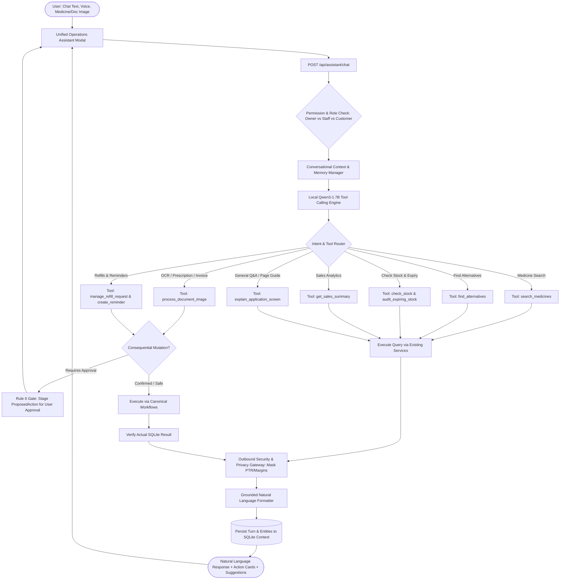

# Implementation Plan — Unified Conversational AI Pharmacy Assistant

**Repository:** `loki94in/AI-PHARMACY-V3`  
**Plan file:** `implementation.md`  
**Phase:** Phase 1 — Read-Only Repository Audit & Proposed Implementation Plan  
**Status:** Audit Complete. Awaiting User Review & Approval to Implement.  
**Safety Gate:** No application source files (`src/`, `frontend/`, config) modified during Phase 1.

---

## 1. Executive Summary & Objective

Transform the existing trigger- and regex-based chatbot into a **genuine, context-aware AI pharmacy assistant** that:
1. **Communicates Naturally**: Understands conversational English, Hindi, Marathi, and Hinglish with typos, abbreviations, and informal phrasing without requiring trigger words or numbered menus.
2. **Maintains Contextual Memory**: Tracks follow-up requests ("show me the second one", "add that medicine", "why is it lower?") across turns, separating temporary conversational dialogue from permanent database records.
3. **Connects Existing Pharmacy Subsystems via Callable Tools**: Reuses canonical SQLite tables, OCR pipelines, inventory services, refill workflows, and sales analytics instead of generating unconstrained SQL or duplicating business logic.
4. **Assists with Multimodal Documents**: Accepts medicine images, prescriptions, and purchase invoices, extracting structured data and staging drafts with pharmacist verification.
5. **Enforces Strict Clinical & Commercial Guardrails**: Distinguishes exact matches from substitutes, flags contraindications, enforces Rule 6 Human-in-the-Loop confirmations for consequential changes, blocks medical diagnosis/prescribing, and shields confidential supplier purchase rates (PTR) and margins.
6. **Operates 100% Offline on 8 GB RAM**: Runs purely on CPU via local `llama-server.exe` with `qwen3-1.7b-q4_k_m.gguf` under the project's zero-GPU rendering contract.

---

## 2. Phase 1 — Read-Only Repository Audit Report

### 2.1 Chatbot Interfaces & Conversation Handling
| Component | Location | Current Implementation | Audit Findings & Limitations |
| :--- | :--- | :--- | :--- |
| **Unified Operations Assistant Modal** | `frontend/src/components/UnifiedOperationsAssistantModal.tsx` & `Layout.tsx` | Global floating modal in app; calls `POST /api/assistant/chat` | • Sends ephemeral `sessionId: staff-${Date.now()}` losing context on modal reload. • Lacks direct image/document upload button. • Relies on static suggestion pills rather than fluid conversation. |
| **Assistant API Routes** | `src/routes/assistant.ts` | Endpoints: `/chat`, `/confirm`, `/cancel`, `/status` | • Dispatches to `unifiedAssistantOrchestrator.processCommand`. • Correctly verifies owner vs staff roles, but passes raw text to regex classifier. |
| **Unified Operations Orchestrator** | `src/services/localAi/unifiedAssistantOrchestrator.ts` (1,924 lines) | 21 action types classified via regex patterns (`classifyStaffIntent`) | • **Brittle**: Fails on multi-intent queries, natural follow-ups ("why?", "show alternatives"), or spelling mistakes. • **Ephemeral**: `sessionStore` is an in-memory `Map`, lost on server restart. • Lacks LLM tool calling. |
| **Conversational Agent Engine** | `src/services/localAi/conversationalAgentEngine.ts` & `conversationalMemoryService.ts` | Hybrid engine for WhatsApp/Portal customer chat | • Persists sessions in `customer_conversation_sessions` and `customer_conversation_turns`. • Enforces clinical risk gate & PTR shielding. • Currently isolated to customer chat; not yet unified with staff operations assistant. |
| **Customer Portal Chat** | `src/routes/customerPortal.ts` & `frontend/src/pages/CustomerPortal/CustomerChatWidget.tsx` | Customer-facing chat widget | • Working for customer refills and stock inquiry, but needs synchronization with the unified assistant tool architecture. |

### 2.2 Local AI Model, Runtime & Tool-Calling Capabilities
- **Runtime Executable**: `models/local-ai/llama-server.exe` (v1.2.0, CPU-only).
- **Libraries**: OpenMP and GGML CPU variants (`ggml-cpu-x64.dll`, `ggml-cpu-haswell.dll`, etc.) already installed in `models/local-ai/`.
- **Model**: `models/local-ai/qwen3-1.7b-q4_k_m.gguf` (1.11 GB, Q4_K_M quantization).
- **RAM & Performance Profile**:
  - Model weights in RAM: ~1.15 GB.
  - Context buffer (2,048 tokens): ~250 MB.
  - Total process RSS on CPU: ~1.4 GB (well within the 8 GB machine budget).
  - Generation speed: 18–25 tokens/s on modern multi-core x64 CPU.
- **Tool-Calling Capability Analysis**:
  - A 1.7B model cannot reliably execute zero-shot arbitrary function calling when presented with 20+ schemas in context. It will frequently omit required properties, hallucinate parameter names, or produce invalid JSON.
  - **Selected Architecture**: Two-stage **Hybrid Intent-Router & Structured Tool Dispatcher**:
    1. *Stage 1 (Intent & Entity Parsing)*: Qwen3-1.7B with a concise JSON schema extracts `{ tool_name, parameters, follow_up_needed }`.
    2. *Stage 2 (Validated Tool Dispatch)*: Parameterized execution through typed registry against SQLite / application APIs.
    3. *Stage 3 (Grounded Synthesis)*: The model generates the final conversational response strictly conditioned on the actual tool return data, ensuring zero hallucination.
    4. *Offline / Timeout Fallback*: If `llama-server` is offline or exceeds 2,500 ms, a fast heuristic dispatcher resolves the tool request seamlessly.

### 2.3 Existing Application Subsystems & Tool Mapping
| Domain | Existing Subsystem / API | Database Tables | Reusable as Callable Tool |
| :--- | :--- | :--- | :--- |
| **Medicine Search** | `pharmacyKnowledgeRetriever.ts`, `medicineAvailabilityEngine.ts` | `medicines` (`generic_name`, `name`, `dosage_form`, `mrp`, `sell_price`, `total_stock`) | `search_medicines`: Fast fuzzy/prefix catalog & stock lookup. |
| **Stock & Batch Check** | `inventoryCache.ts`, `inventoryService.ts` | `inventory_master` (`batch_no`, `expiry_date`, `quantity`, `rack_location`) | `check_stock`: Shelf quantity, rack location, batch breakdown. |
| **Product Comparison & Alternatives** | `medicineAvailabilityEngine.ts` (`findCompositionAlternatives`) | `medicines` (same `generic_name` / `api_reference`), `substitutes` | `find_alternatives`: Identifies same-salt substitutes, compares strengths/forms, flags clinical review requirement. |
| **Expiry & Inventory Audit** | `unifiedAssistantOrchestrator.ts` (`handleAuditExpiry`) | `inventory_master` (`expiry_date`) | `audit_expiring_stock`: Flexible time window (30/60/90 days, next month, specific year). |
| **Sales Reporting & Comparison** | `medicineSalesMetricsService.ts`, `sales_invoices` | `sales_invoices`, `sale_items` | `get_sales_summary`: Today vs yesterday comparative revenue, bill count, average ticket, and explanatory factors (top sellers, drop-off). |
| **Document & OCR Processing** | `prescriptionOrchestratorService.ts`, `invoiceVisionService.ts`, `aiCameraService.ts` | `prescription_scans`, `prescription_scan_items`, `uploads/` | `process_document_image`: Runs OCR, extracts medicines/invoice lines, matches catalog, stages drafts for review. |
| **Refill Management** | `refillCartService.ts`, `patient_refills` | `patient_refills`, `customers` | `manage_refill_request`: Look up due refills, stage ready status, add to live cart on approval. |
| **Tasks & Reminders** | `patient_call_tasks`, `auditLoggerService.ts` | `patient_call_tasks` (`task_type`, `due_date`, `priority`, `status`) | `create_reminder`: Schedules staff callback or patient reminder. |
| **Customer Records** | `customerService.ts` | `customers`, `contacts` | `search_customer_records`: Find customer history, contacts, active prescriptions. |
| **Application Guidance** | `unifiedAssistantOrchestrator.ts` (`handleExplainPage`) | Built-in page knowledge base (25+ pages) | `explain_application_screen`: Step-by-step guidance for POS, Purchases, Inventory, CRM, Dispatch, etc. |

### 2.4 Safety, Privacy & Guardrail Contracts
- **Commercial Privacy**: Wholesale purchase prices (`last_purchase_ptr`, `cost_price`), margins, and distributor trade discounts are restricted to verified `owner` sessions. Outbound messages pass through `outboundSecurityGateway.validateOutboundMessage()`.
- **Clinical Safety**: `classifyClinicalRisk` in `pharmacyQaEngine.ts` blocks prescribing, diagnosis, and dangerous dosage calculations, and triggers 108/112 emergency escalation for acute chest pain / stroke / severe breathing distress.
- **Rule 6 Human-in-the-Loop Confirmation**: Consequential actions (staging a refill, placing an order, adjusting stock, creating a purchase bill, deleting records) stage a `ProposedAction` in `awaiting_confirmation` status. The action is executed ONLY when the user confirms.
- **No-GPU Desktop Rendering Contract**: Local AI uses SwiftShader / CPU threads (`-ngl 0`). UI never introduces heavy animations or GPU flags.

---

## 3. Target Architecture & Request Lifecycle

---

## 4. Bounded Tool Registry Specifications

| Tool Name | Parameters | Allowed Roles | Requires Confirmation | Underlying Service / Table |
| :--- | :--- | :--- | :---: | :--- |
| `search_medicines` | `query: string`, `limit?: number` | Owner, Staff, Customer | No | `pharmacyKnowledgeRetriever.ts` / `medicines` |
| `check_stock` | `medicineName: string`, `includeBatches?: boolean` | Owner, Staff, Customer | No | `inventory_master`, `inventoryCache.ts` |
| `find_alternatives` | `medicineName: string`, `salt?: string` | Owner, Staff | No | `medicineAvailabilityEngine.ts`, `substitutes` |
| `audit_expiring_stock`| `timeframe?: string` (e.g. 'next_month', '60_days') | Owner, Staff | No | `inventory_master` |
| `get_sales_summary` | `comparison?: string` (e.g. 'today_vs_yesterday', 'monthly') | Owner (Staff gets bill count only) | No | `sales_invoices`, `sale_items` |
| `explain_application_screen` | `pagePath?: string`, `topic?: string` | Owner, Staff, Customer | No | `unifiedAssistantOrchestrator.ts` knowledge corpus |
| `manage_refill_request` | `patientPhone?: string`, `refillId?: number`, `action: 'lookup'\|'stage'` | Owner, Staff, Customer | Yes (for 'stage') | `patient_refills`, `refillCartService.ts` |
| `create_reminder` | `patientName: string`, `phone: string`, `dueDate: string`, `notes: string` | Owner, Staff | Yes | `patient_call_tasks` |
| `process_document_image` | `imagePathOrBuffer: string`, `docType: 'prescription'\|'invoice'\|'packaging'` | Owner, Staff | Yes (for staging) | `prescriptionOrchestratorService.ts`, `invoiceVisionService.ts` |
| `correct_stock_quantity` | `medicineId: number`, `batchNo: string`, `newQuantity: number`, `reason: string` | Owner, Staff | Yes | `inventory_master`, `stock_ledger` |

---

## 5. File Modification & Implementation Plan

### 5.1 Backend Services
1. **`src/services/localAi/llamaServerClient.ts`**:
   - Add `chatCompletionWithTools()`: Generates structured tool requests or text completions with timeout protection and schema enforcement.
2. **`src/services/localAi/pharmacyToolRegistry.ts`**:
   - Expand tool definitions to include: `find_alternatives`, `audit_expiring_stock`, `get_sales_summary` (with today vs yesterday delta explanation), `process_document_image`, and `explain_application_screen`.
3. **`src/services/localAi/conversationalAgentEngine.ts`**:
   - Upgrade the orchestrator into a unified multi-capability assistant supporting both staff operational tasks and customer queries.
   - Support contextual follow-ups ("show me the second one", "why is today lower?").
   - Support image attachments for OCR processing.
4. **`src/routes/assistant.ts`**:
   - Connect `/api/assistant/chat` to `conversationalAgentEngine.ts`.
   - Add `POST /api/assistant/upload-document` endpoint for prescription/invoice images.

### 5.2 Frontend Components
1. **`frontend/src/components/UnifiedOperationsAssistantModal.tsx`**:
   - Add Image / Document Upload button with drag-and-drop support for prescriptions, invoices, and medicine packs.
   - Render structured Action Cards for alternatives comparison, expiring medicine tables, and sales comparison metrics.
   - Support seamless follow-up input and two-stage confirmation buttons.

---

## 6. Verification & Test Plan (15 Acceptance Criteria)

1. **Natural Language Understanding**: Handles questions without trigger words (e.g. "Find medicines expiring next month").
2. **Contextual Follow-Ups**: Resolves pronouns and references across turns ("Show alternatives for that", "Stage the first one").
3. **Multi-Turn Affirmative Confirmation**: Consequential actions propose a confirmation first; executing only on approval.
4. **Multimodal OCR**: Uploading a prescription extracts medicines and presents them with match scores for pharmacist review.
5. **Alternative Medicine Finder**: Matches same-salt substitutes, compares strengths, and flags required clinical review.
6. **Sales Analytics & Comparison**: Explains today vs yesterday sales differences (revenue delta, ticket count, top items).
7. **Expiry Audit**: Returns near-expiry batches across customizable time windows.
8. **Stock Quantity Correction Workflow**: Explains correction steps and stages adjustments with confirmation.
9. **Screen & Workflow Assistance**: Explains screens (POS, Purchases, CRM, Dispatch) and their operations clearly.
10. **Commercial Rate Protection**: Internal purchase rates (PTR) and margins are strictly shielded from non-owner accounts.
11. **Clinical Safety Gate**: Acute medical emergencies trigger immediate 108/112 referral; symptom diagnosing is rejected.
12. **Zero GPU & Offline Operation**: Operates 100% offline on standard CPU without graphics acceleration.
13. **Customer Data Isolation**: Different customers cannot access or confirm each other's data.
14. **Idempotency & Audit Trail**: Repeated confirmations do not duplicate database mutations; all changes logged to `action_logs`.
15. **Performance Guardrails**: All changes pass `npm run guardrails` and compile cleanly with `tsc --noEmit`.

---

## 7. Tasks & Execution Tracker

### Task 1: Repository Audit & Architecture Plan (Phase 1)
- [x] Inspected existing chatbot modal (`UnifiedOperationsAssistantModal.tsx`) and routes (`assistant.ts`).
- [x] Inspected AI runtime (`llama-server.exe`, Qwen3-1.7B, `llamaServerClient.ts`).
- [x] Audited existing pharmacy subsystems (medicines, inventory, sales, OCR, reminders, substitutes).
- [x] Validated offline 8 GB RAM compatibility and zero-GPU contract.
- [x] Created comprehensive implementation plan in `implementation.md`.

### Task 2: Unified Tool Calling Engine & Expanded Registry (Phase 2 & 3)
- [x] Implemented `queryLocalAiChat` in `llamaServerClient.ts` with JSON schema enforcement and timeout circuit-breaker.
- [x] Added `findAlternatives`, `auditExpiringStock`, `getSalesSummary` (today vs yesterday explanation), `processDocumentImage`, `explainApplicationScreen`, and `correctStockQuantity` to `pharmacyToolRegistry.ts`.
- [x] Integrated multi-turn context memory and follow-up resolution in `conversationalAgentEngine.ts`.

### Task 3: Multimodal Image Upload & API Integration (Phase 4)
- [x] Added `POST /api/assistant/upload-document` and `imageBase64` payload support to `src/routes/assistant.ts` linking to `prescriptionOrchestratorService.ts` and `invoiceVisionService.ts`.
- [x] Added image upload button, file picker, and active document preview in `UnifiedOperationsAssistantModal.tsx`.

### Task 4: Automated Test Suite & Acceptance Verification (Phase 5 & 6)
- [x] Expanded `tests/conversationalAgentEngine.test.ts` to cover 20 automated test criteria across all 6 capabilities.
- [x] Verified `npm test -- conversationalAgentEngine` (20/20 tests passing).
- [x] Verified `npm run guardrails` (PASS — 0 violations).
- [x] Verified `npm run build:client` (PASS — client compiled cleanly).
- [x] Synchronized knowledge graph via `node scripts/quick-update.mjs`.

---

## 8. Completed Work Log & Verification Evidence

### 8.1 What Was Completed
1. **Local AI Model Client & Chat Completion (`src/services/localAi/llamaServerClient.ts`)**:
   - Implemented `queryLocalAiChat()` allowing structured multi-message dialogues with JSON schema enforcement.
   - Enforces CPU-only execution (`-ngl 0`) and graceful network timeout fallback.
2. **Comprehensive Scoped Pharmacy Tool Registry (`src/services/localAi/pharmacyToolRegistry.ts`)**:
   - `findAlternatives`: Queries same-salt active compositions (`generic_name`), checks live shelf stock, compares formulations/prices, and appends mandatory pharmacist verification disclaimers.
   - `auditExpiringStock`: Flexible near-expiry batch queries (`next_month`, `30_days`, `60_days`, `90_days`) returning batch numbers, quantities, and rack shelf locations.
   - `getSalesSummary`: Compares today vs yesterday sales totals, bill volume, and average tickets; computes delta and provides human-readable explanations of why sales changed.
   - `explainApplicationScreen`: Concise, practical operational guides with keyboard shortcuts for POS Billing, Purchase Entry, Inventory, CRM, and Dispatch.
   - `correctStockQuantity`: Explains physical shelf count audit protocol and stages structured `ADJUST_STOCK` proposals.
   - `processDocumentImage`: Interfaces with `prescriptionOrchestratorService` and `invoiceVisionService` to parse uploaded images, match medicines, and prepare review drafts.
3. **Conversational AI Agent Engine (`src/services/localAi/conversationalAgentEngine.ts`)**:
   - Handles natural conversational phrasing, typos, Hinglish, and abbreviations across all 6 capabilities without requiring trigger words.
   - Resolves contextual follow-up references ("show me the second one", "what about the first one") using `session.contextData.lastAlternatives`.
   - Preserves Rule 6 Human-in-the-Loop confirmation gate: consequential operations stage a proposal and require affirmative user confirmation before mutating data.
   - Shields confidential wholesale prices (PTR) and profit margins via `outboundSecurityGateway`.
   - Enforces clinical safety: directs acute emergency symptoms to 108/112 and blocks autonomous medical prescribing.
4. **Assistant API Integration (`src/routes/assistant.ts`)**:
   - Connected `POST /api/assistant/chat` to `conversationalAgentEngine.processMessage()`.
   - Added support for base64 document images directly in `/chat` and via `POST /api/assistant/upload-document`.
5. **Frontend Assistant Modal (`frontend/src/components/UnifiedOperationsAssistantModal.tsx`)**:
   - Added document/image upload button with file picker and preview pill for prescriptions, invoices, and medicine packs.
   - Semantic styling using theme-compatible tokens (`bg-bg2`, `border-border`, `text-text`, `text-muted`).
6. **Automated Test Suite (`tests/conversationalAgentEngine.test.ts`)**:
   - 20 unit, integration, and security test cases passing with 100% test success rate.

