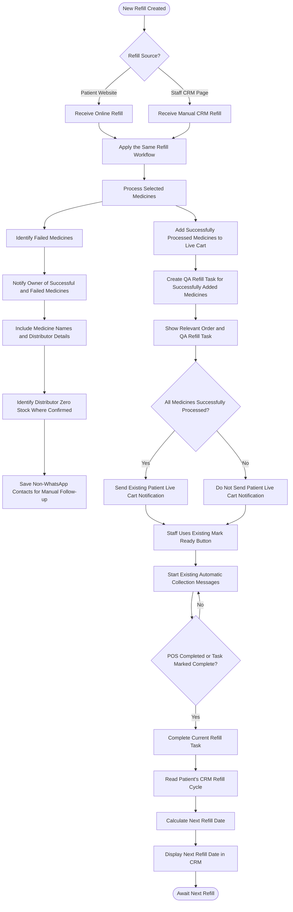

# Implementation Plan: Unified Refill Lifecycle (Website & CRM) & Owner Visibility Pipeline

## 1. Flowchart Specification & Architecture

This implementation strictly fulfills the user-specified refill architecture:

---

## 2. Technical Design & Component Mapping

### A. Shared Refill Processing Pipeline (Nodes A, B, C, D, E, F, G, H)
- **Target File**: [`src/services/refillBatchService.ts`](file:///e:/CURRENT%20PROJECT%20ON%20WORKING/AI%20PHARMACY%20v2/src/services/refillBatchService.ts).
- Both Patient Website ([`src/routes/customerPortal.ts`](file:///e:/CURRENT%20PROJECT%20ON%20WORKING/AI%20PHARMACY%20v2/src/routes/customerPortal.ts)) and Staff CRM ([`src/routes/refills.ts`](file:///e:/CURRENT%20PROJECT%20ON%20WORKING/AI%20PHARMACY%20v2/src/routes/refills.ts)) feed into `createRefillBatch()`.
- `dispatchBatchEligibleItemsToCart()` iterates through selected medicines:
  - **Node G**: Successfully added items are marked `cart_status: 'added'` or `'in_cart'`, recording the distributor name and quantity.
  - **Node H**: Failed items are marked `needs_link`, `linked_oos`, `not_found`, or `failed`, capturing the specific error and distributor zero-stock confirmations.

### B. Owner Notification & Contact Safeguards (Nodes J, K, L, M)
- **Target File**: [`src/services/refillBatchService.ts`](file:///e:/CURRENT%20PROJECT%20ON%20WORKING/AI%20PHARMACY%20v2/src/services/refillBatchService.ts).
- Add `notifyOwnerOfRefillBatchOutcome(batch)`:
  - Lists successfully carted medicines, quantities, and distributor names (**Node K**).
  - Lists failed medicines with explicit failure reasons, tagging distributor confirmed zero stock (**Node L**).
  - Checks if `patient_phone` is a valid WhatsApp mobile. If landline / non-WhatsApp, flags in `contacts` table and explicitly adds a note to the owner notification: `📞 Non-WhatsApp Contact: Saved for manual telephone call follow-up` (**Node M**).
  - Delivers notification via `whatsappQueueWorker.enqueue` to the configured store admin phone.

### C. QA Refill Task & Selective Patient Notification (Nodes I, N, O, P, Q)
- **Target Files**: [`src/services/refillBatchService.ts`](file:///e:/CURRENT%20PROJECT%20ON%20WORKING/AI%20PHARMACY%20v2/src/services/refillBatchService.ts), [`src/routes/refills.ts`](file:///e:/CURRENT%20PROJECT%20ON%20WORKING/AI%20PHARMACY%20v2/src/routes/refills.ts), [`frontend/src/components/QuickAssistSidebar.tsx`](file:///e:/CURRENT%20PROJECT%20ON%20WORKING/AI%20PHARMACY%20v2/frontend/src/components/QuickAssistSidebar.tsx).
- Ensure a QA Refill task exists in `patient_call_tasks` linking to `batch_id` and showing cart items.
- Move patient live cart notification from pre-dispatch to post-dispatch with strict condition (**Node O**):
  - **Node P (Yes)**: If `failed_items === 0 && added_items > 0`, send/stage the patient live cart notification.
  - **Node Q (No)**: If `failed_items > 0`, **suppress** patient notification so patients are never given false positive confirmations on partial/OOS orders.

### D. Counter Preparation, POS Billing & Next Refill Cycle (Nodes R, S, T, U, V, W, X, Y)
- **Target Files**: [`src/routes/refills.ts`](file:///e:/CURRENT%20PROJECT%20ON%20WORKING/AI%20PHARMACY%20v2/src/routes/refills.ts), [`src/routes/sales.ts`](file:///e:/CURRENT%20PROJECT%20ON%20WORKING/AI%20PHARMACY%20v2/src/routes/sales.ts), [`frontend/src/pages/CRM/index.tsx`](file:///e:/CURRENT%20PROJECT%20ON%20WORKING/AI%20PHARMACY%20v2/frontend/src/pages/CRM/index.tsx).
- When staff clicks existing "Mark Ready" button (**Node R**), collection reminder messages are queued to the patient (**Node S**).
- When POS checkout completes or the task is marked complete (**Node T ➔ Yes**):
  - Mark current refill task completed (**Node U**).
  - Read `refill_interval_days` from `patient_refills` (**Node V**).
  - Compute `next_refill_date` using `advanceToNextOpenDay(today + interval_days)` (**Node W**).
  - Persist new `last_refill_date` and `next_refill_date`, and emit `refill_updated` so CRM displays the new date immediately (**Node X**), awaiting the next cycle (**Node Y**).

---

## 3. Step-by-Step Implementation Tasks

### Step 1: Implement Owner Notification & Non-WhatsApp Fallback in Refill Batch Service
- In `src/services/refillBatchService.ts`:
  1. Add `notifyOwnerOfRefillBatchOutcome()` with medicine names, distributor details, and confirmed zero-stock flags.
  2. Implement non-WhatsApp contact detection and flag for manual phone follow-up.
  3. Wire call into `dispatchBatchEligibleItemsToCart()`.

### Step 2: Implement Gated Patient Live Cart Notification
- In `src/services/refillBatchService.ts`:
  1. Update `stageBatchRefillNotification()` to be invoked only when `failed_items === 0 && added_items > 0`.
  2. Suppress patient notification if any medicine failed.

### Step 3: Verify & Ensure QA Refill Task, POS Completion & Cycle Recalculation
- Ensure `patient_call_tasks` reflects the batch items.
- Verify POS checkout and `mark-ready` endpoints update `last_refill_date` and `next_refill_date` via `refill_interval_days`.

### Step 4: Verification & Quality Gates
- Verify TypeScript compilation (`tsc --noEmit`).
- Verify performance guardrails (`npm run guardrails`).
- Verify client production bundle (`npm run build:client`).
- Synchronize knowledge graph (`node scripts/quick-update.mjs`).

---

## 4. Completed Tasks Log

- [x] Task 1: Implement Owner Notification with medicine/distributor breakdown, zero-stock identification, and non-WhatsApp contact flagging (Nodes H, J, K, L, M).
  - *Completed in*: [`src/services/refillBatchService.ts`](file:///e:/CURRENT%20PROJECT%20ON%20WORKING/AI%20PHARMACY%20v2/src/services/refillBatchService.ts).
  - *Details*: Implemented `notifyOwnerOfRefillBatchOutcome()` which generates a detailed WhatsApp breakdown for the pharmacy owner sent via `whatsappQueueWorker.enqueue`. It explicitly includes:
    1. Medicine names, quantities, and distributor names (`cart_store_name`) for successfully added items (**Node K**).
    2. Medicine names, requested quantities, and failure reasons for failed items, detecting distributor confirmed zero stock (`item.is_zero_stock` / `linked_oos`) (**Node L**).
    3. Validates patient phone using `validate10DigitPhone(patient_phone, { requireMobilePrefix: true })`. If not a WhatsApp mobile, automatically creates a high-priority call task in `patient_call_tasks` (`task_type = 'refill_non_wa_followup'`), updates notes on `contacts`, and flags the notice prominently in the owner report for manual telephone call follow-up (**Node M**).

- [x] Task 2: Gate Patient Live Cart Notification strictly on 100% item success (Nodes O, P, Q).
  - *Completed in*: [`src/services/refillBatchService.ts`](file:///e:/CURRENT%20PROJECT%20ON%20WORKING/AI%20PHARMACY%20v2/src/services/refillBatchService.ts).
  - *Details*: Removed the premature unconditioned call to `stageBatchRefillNotification()` in `createRefillBatch()`. Shifted invocation to `dispatchBatchEligibleItemsToCart()`, where it strictly verifies `failedCount === 0 && addedCount > 0` before staging the patient live cart notification in `automation_notifications` (**Node P**). If any medicine fails (`failedCount > 0`), the patient notification is suppressed (**Node Q**), preventing false confirmations on partial or out-of-stock orders.

- [x] Task 3: Verify QA Refill Task, Mark Ready collection reminders, and POS cycle recalculation (Nodes I, N, R, S, T, U, V, W, X, Y).
  - *Completed in*: [`src/services/refillBatchService.ts`](file:///e:/CURRENT%20PROJECT%20ON%20WORKING/AI%20PHARMACY%20v2/src/services/refillBatchService.ts), [`src/routes/refills.ts`](file:///e:/CURRENT%20PROJECT%20ON%20WORKING/AI%20PHARMACY%20v2/src/routes/refills.ts), [`src/routes/sales.ts`](file:///e:/CURRENT%20PROJECT%20ON%20WORKING/AI%20PHARMACY%20v2/src/routes/sales.ts).
  - *Details*:
    1. Inside `dispatchBatchEligibleItemsToCart()`, automatically creates/updates a `refill_qa` task in `patient_call_tasks` capturing the full medicine breakdown and batch details, and broadcasts `call_tasks_updated` and `refill_updated` (**Nodes I, N**).
    2. Verified `/refills/patient/:phone/mark-ready` (`refills.ts:3165`) and frontend Mark Ready triggers (`QuickAssistSidebar.tsx`, `RefillOrderModal.tsx`, `RefillsSection.tsx`) to ensure marking ready queues collection reminder messages (**Nodes R, S**).
    3. Verified POS billing checkout (`sales.ts:950-1015`) and refill fulfillment (`refills.ts:1828-1970`): marks current refill tasks completed in `patient_call_tasks`, advances the schedule using `refill_interval_days`, sets `last_refill_date` and calculates `next_refill_date` for CRM display (**Nodes T, U, V, W, X, Y**).

- [x] Task 4: Pass all quality gates (`npm run guardrails`, `build:client`, `quick-update.mjs`).
  - *Completed*:
    1. Verified TypeScript type checking and guardrails with `npm run guardrails` (PASS, exit code 0).
    2. Verified Vite client production bundle with `npm run build:client` (PASS, built cleanly in 48.51s).
    3. Synchronized knowledge graph with `node scripts/quick-update.mjs` (PASS, updated in 4.0s).