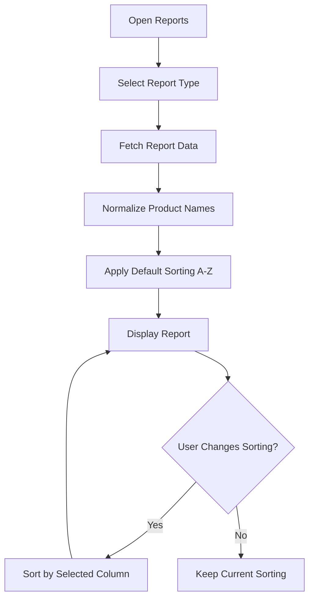

# Implementation Plan: Reports Product Name Normalization & Interactive Column Sorting Pipeline

## 1. Flowchart Specification & Context

This implementation follows the user's specification flowchart:



---

## 2. Technical Architecture & Component Mapping

### A. Core View (`A` & `B`)
- Target File: `frontend/src/pages/Reports/index.tsx`.
- Supported Report Tabs (`B`):
  1. **Inventory Status** (`inventory`): Contains `medicine_name`, `batch_no`, `stock`, `cost_price`, `mrp`, `value`.
  2. **Expiry Warning Forecast** (`expiry`): Contains `medicine_name`, `batch_no`, `quantity`, `cost_price`, `expiry_date`, `value`.
  3. **Non-Moving Inventory** (`nonMoving`): Contains `medicineName`, `batchNo`, `daysSinceLastTransaction`, `quantity`, `costPrice`, `totalCostValue`, `mrp`, `totalValue`, `expiryDate`.
  4. **Sales Invoices** (`sales`): Contains `date`, `invoice_no`, `total_amount`.
  5. **Purchase Log Bills** (`purchases`): Contains `date`, `invoice_no`, `distributor`, `total_amount`.
  6. **Product Trace** (`trace`): Contains purchases and sales ledger rows per product.

### B. Product Name Normalization (`D`)
- Implement a dedicated normalization utility: `normalizeProductName(name?: string | null): string`:
  - Trims leading and trailing whitespace.
  - Replaces irregular consecutive whitespaces with a single space (`\s+` -> `' '`).
  - Gracefully handles missing/null/undefined names with clean standard fallback (`'—'`).
  - Provides a normalized key for case-insensitive and diacritic-insensitive sorting via `localeCompare(..., undefined, { sensitivity: 'base', numeric: true })`.

### C. Default Sorting A-Z (`E`)
- When a report type tab is selected or new data is fetched (`C`):
  - For tabs with product names (**Inventory**, **Expiry**, **Non-Moving**):
    - Default sort column: `medicine_name` / `medicineName`.
    - Default sort direction: **`asc` (A to Z)**.
  - For transactional reports (**Sales**, **Purchases**):
    - Default sort column: `date` (`desc` for recency or `asc` for chronological) or primary text field.
- Tab-specific default sort state resets smoothly on tab change.

### D. Interactive Column Sorting Engine (`F`, `G`, `H`, `I`)
- Sort State:
  ```typescript
  interface SortConfig {
    key: string;
    direction: 'asc' | 'desc';
  }
  ```
- **User Changes Sorting?** (`G`):
  - Clicking any table header triggers `handleSort(columnKey)`:
    - If clicked column is already active: toggles `direction` (`asc` <-> `desc`).
    - If clicked column is new: activates that column with `direction = 'asc'` (or `'desc'` for numerical values).
  - Sort Comparator:
    - Strings (e.g. `medicine_name`, `distributor`, `batch_no`): localized natural sort (`a.localeCompare(b, undefined, { numeric: true, sensitivity: 'base' })`).
    - Numbers (e.g. `stock`, `cost_price`, `mrp`, `value`, `total_amount`, `daysSinceLastTransaction`): numerical subtraction (`valA - valB`).
    - Dates (e.g. `date`, `expiry_date`, `purchaseDate`): timestamp parsing and comparison.
- **Header Visual Indicators**:
  - Interactive headers with pointer cursor, hover highlight, and clear sort icons (`ChevronUp`, `ChevronDown`, or `ArrowUpDown`).
  - Active sorted column highlighted using semantic Tailwind classes (`text-primary`, `bg-bg3`).
- **Export Consistency & PDF Column Requirements**:
  - Ensure exported reports (CSV & PDF) respect the currently sorted and normalized dataset.
  - When exporting PDF reports, the PDF document must explicitly include the four essential inventory tracking columns:
    1. **Medicine Name** (`medicine_name` / `name`)
    2. **Batch Number** (`batch_no`)
    3. **Expiry Date** (`expiry_date`)
    4. **Quantity** (`stock` / `quantity`)
  - Ensure `im.expiry_date` is queried in backend `/reports/data` for inventory status so the UI table and client-side split PDF export also retain the expiry date alongside batch and quantity.

---

## 3. Step-by-Step Implementation Plan

### Step 1: Implement Normalization & Sorting Utilities
1. Add `normalizeProductName(name?: string | null): string` helper.
2. Add generic `sortReportRows<T>(rows: T[], sortConfig: SortConfig): T[]` supporting text, numeric, and date fields.

### Step 2: Integrate Sort State & Normalization in `Reports/index.tsx`
1. Add `sortConfig` state with tab-aware default:
   - For `inventory`, `expiry`, `nonMoving`: `{ key: 'medicine_name', direction: 'asc' }`.
   - For `sales`, `purchases`: `{ key: 'date', direction: 'desc' }`.
2. Normalize product names in `reportData.records` and `nonMovingData.items` via a `useMemo` transformation pipeline:
   - `rawRecords` -> `normalizedRecords` -> `sortedRecords`.
3. Provide `handleSort(key)` function that updates sort state.

### Step 3: Upgrade Table Headers in All Report Tabs
1. Update `inventory` table headers to be clickable with sort indicators.
2. Update `expiry` table headers to be clickable with sort indicators.
3. Update `nonMoving` table headers to be clickable with sort indicators.
4. Update `sales` and `purchases` table headers to be clickable with sort indicators.

### Step 4: Verification & Quality Gates
1. Run TypeScript check & client production build: `npm run build:client`.
2. Run performance guardrails scanner: `npm run guardrails`.
3. Update knowledge graph: `node scripts/quick-update.mjs`.

---

## 4. Completed Tasks Log

- [x] Task 1: Create product name normalization and robust column sorting utilities in `Reports/index.tsx`.
  - Added `normalizeProductName(name?: string | null): string` to clean excess whitespace and fall back cleanly to `'—'`.
  - Added `sortReportData<T>(items: T[], sortConfig: SortConfig): T[]` handling string normalization, numeric values, and dates.
- [x] Task 2: Implement default A-Z product name sorting and interactive sort state across all report types.
  - Added `getDefaultSortForTab(tab)` defaulting to `medicine_name` / `medicineName` ascending (A-Z) for inventory, expiry, and non-moving reports, and `date` descending for sales/purchases.
  - Integrated tab change listener resetting sort to defaults on tab switches.
  - Memoized datasets via `displayRecords` and `sortedAndNormalizedNonMovingItems`.
- [x] Task 3: Upgrade table headers with clickable sort controls, active column indicators, and hover styling.
  - Created reusable `renderSortTh` helper rendering accessible sort indicators (`▲` / `▼` / `⇅`).
  - Added Expiry Date column to Inventory Status table.
  - Applied interactive column sorting across Sales, Purchases, Inventory, Expiry, and Non-Moving tables.
- [x] Task 4: Ensure PDF/CSV export uses the normalized, sorted dataset, and guarantees PDF exports include Medicine Name, Batch No, Expiry Date, and Stock Qty.
  - Updated backend query in `src/routes/reports.ts` for `/reports/data` (`type=inventory`) to select `im.expiry_date`.
  - Configured client-side `exportToPDF` and `exportToCSV` in `handleDownloadExport` to export sorted, normalized rows directly with all 4 required columns (Medicine Name, Batch, Expiry Date, Quantity) plus valuation.
- [x] Task 5: Pass all quality gates (`npm run build:client`, `npm run guardrails`, `node scripts/quick-update.mjs`).
  - `npm run build:client` passed with 0 errors (47.58s build time).
  - `npm run guardrails` passed with 0 violations.
  - `node scripts/quick-update.mjs` synchronized knowledge graph (1311 nodes, 859 edges).