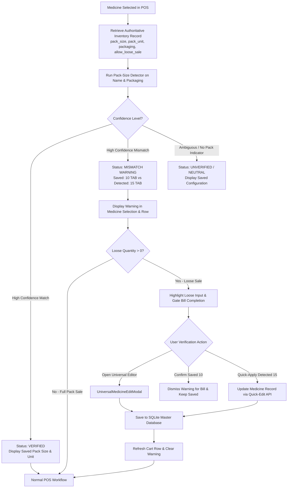

# Implementation Plan: POS Pack-Size Visibility & Validation Enhancement

## 1. Executive Summary & Core Requirements

This implementation plan delivers a non-disruptive visibility, detection, and validation enhancement for pack sizes in the Point of Sale (POS) module without rewriting or altering existing stock deduction, pricing calculations, purchasing, or inventory valuation engines.

### Governing Constraints & Business Rules:
1. **Preserve Existing Calculations**: Strip MRP, loose rate ($\frac{\text{Strip MRP}}{\text{Pack Size}}$), cost price, margin, discount, and stock ledger updates continue using established logic.
2. **Authoritative Record Visibility**: Show the saved inventory pack size and sale unit (`TAB`, `CAP`, `BOTTLE`, etc.) clearly whenever a medicine is selected in POS.
3. **Confident Mismatch Detection**: Parse medicine name and packaging using strict pattern matching. If a confident pack size conflicts with the saved configuration (e.g. name indicates 15 tablets but saved value is 10), surface a high-visibility warning.
4. **No Inferences from Ambiguous Numbers**: Standalone numbers representing dosage strengths (e.g., `DOLO 650`, `PAN 40`, `TELMA 20`) or dimensions/ratios (`15 X 8 CM`, `40/5MG`) must NEVER be inferred as pack sizes.
5. **No Silent Changes**: Calculations continue strictly according to the saved configuration unless verified/updated by the user. If unverified mismatches exist on items being sold loose, require user confirmation before final bill completion.
6. **Universal Medicine Editor Integration**: The warning directly launches `UniversalMedicineEditModal`. Corrections save across the entire app database (`medicines` and `inventory_master`) and immediately synchronize active cart rows.
7. **Environment & Safeguard Integrity**: Pre-push hooks and repository guardrails (`npm run guardrails`) are strictly preserved and never disabled or bypassed.

---

## 2. Architecture & Data Flow



---

## 3. Detailed Component & Module Specifications

### Module A: Strict Pack-Size Detector (`frontend/src/utils/packSizeDetector.ts`)
Creates a standalone, pure function utility that evaluates confidence and compares against saved values:

```typescript
export interface PackSizeDetectionResult {
  savedPackSize: number;
  savedUnit: string;
  detectedPackSize: number | null;
  detectedUnit: string | null;
  confidence: 'HIGH' | 'AMBIGUOUS' | 'NONE';
  hasMismatch: boolean;
  isUncertain: boolean;
  message?: string;
  calculatedSavedUnitPrice: number;
  calculatedDetectedUnitPrice?: number;
}
```

#### Detection Rules:
1. **Liquid / Topical / Single-Unit Forms**:
   - Identified by: `SYRUP`, `SUSPENSION`, `DROPS`, `INJECTION`, `VIAL`, `AMPOULE`, `CREAM`, `OINTMENT`, `GEL`, `LOTION`, `SPRAY`, `RESPULE`, `SACHET`, `BOTTLE`.
   - Confident pack size: `1`.
   - Unit: Form descriptor (`Bottle`, `Vial`, `Tube`, etc.).
   - Confidence: `'HIGH'`.

2. **Explicit Packaging Syntaxes**:
   - `\b(?:STRIP|PACK|BOX|BLISTER)\s+OF\s+(\d+)\b` -> Confidence: `'HIGH'`.
   - `\b(\d+)\s*x\s*(\d+)\b` (excluding dimensions like `CM`, `MM`) -> Confidence: `'HIGH'`.
   - `\b(\d+)\s*(?:TAB|TABS|TABLET|TABLETS|CAP|CAPS|CAPSULE|CAPSULES)\b` -> Confidence: `'HIGH'`.
   - `\b(\d+)\s*(?:'S|S)\b` at end of medicine name or right after dosage form -> Confidence: `'HIGH'`.

3. **Ambiguity / False-Positive Safeguards (Strict Strength & Dimension Filtering)**:
   - Numbers followed by strength units: `MG`, `MCG`, `GM`, `G`, `KG`, `ML`, `L`, `LTR`, `IU`, `%`, `W/V`, `W/W`.
   - Ratios / combinations: `40/5`, `500/125`.
   - Bare strength numbers without pack units: `DOLO 650`, `TELMA 40`, `AZITHRAL 500` -> Strictly `'AMBIGUOUS'` / `'NONE'`.
   - Dimensions: `15 X 8 CM` -> Ignored as dimensions.

---

### Module B: Authoritative Cache Layer (`src/services/inventoryCache.ts` & `api.ts`)
- Include `m.pack_unit` in `inventoryCache.ts` query:
  ```sql
  SELECT ... m.packaging, m.pack_size, m.pack_unit, m.schedule_type, COALESCE(m.allow_loose_sale, 1) AS allow_loose_sale
  ```
- Expose `pack_unit?: string` in `CompactInventoryItem` and `CartRow`.

---

### Module C: POS Medicine-Selection & Row Details UI (`frontend/src/pages/POS/index.tsx`)
In each active / selected medicine row:
1. **Pack Size & Unit Badges**:
   - Shows authoritative inventory saved pack: e.g. `Pack: 10 TAB / Strip` (or `1 Bottle (100ml)`).
   - Shows live unit rate: `₹1.50 / tab` (derived from $\frac{\text{MRP}}{\text{savedPackSize}}$).
2. **Mismatch Alert Banner**:
   - When `hasMismatch === true`:
     - Displays an amber warning banner under medicine name:
       `⚠️ Pack Size Mismatch: Saved 10 TAB vs Detected 15 TAB (from name)`
       `Discrepancy: Currently calculating ₹1.50/tab instead of ₹1.00/tab`
     - Action buttons:
       - `[Fix in Universal Editor]` (Pencil icon, opens `UniversalMedicineEditModal`)
       - `[Use 15 TAB]` (Quick-update medicine record & cart)
       - `[Keep 10 TAB]` (Acknowledges and dismisses for this session)
3. **Full-Pack Sales Unblocked**:
   - Whole-strip sales (`qty > 0`, `looseQty = 0`) proceed without interruption even if an informational mismatch banner is visible.
4. **Loose Sale Safeguard (`row-loose-input`)**:
   - If `looseQty > 0` on a row with an unacknowledged mismatch:
     - Amber ring around input: `ring-2 ring-amber-500/60`.
     - Tooltip & alert badge indicating discrepancy.

---

### Module D: Bill Completion Gatekeeper (`handleCompleteSale`)
- If user clicks **Complete Sale / Print Bill** while any cart row has `looseQty > 0` AND an unverified pack-size mismatch:
  - Pauses sale completion.
  - Displays a clean, keyboard-accessible verification modal:
    "Pack Size Verification Required for Loose Sale:
     [Medicine Name] is configured as {saved} {unit}, but packaging indicates {detected} {unit}.
     Selling {looseQty} loose units will charge ₹{saved_rate}/unit instead of ₹{detected_rate}/unit."
    - Option 1: "Open Universal Editor"
    - Option 2: "Confirm Saved ({saved})"
    - Option 3: "Update to Detected ({detected})"
- Standard sales (whole strips, non-loose sales, or medicines with verified pack sizes) are **NEVER blocked or slowed down**.

---

## 4. Acceptance Criteria & Regression Verification

### User Acceptance Criteria Checklist:
- [x] **AC 1: Existing full-strip pricing and sales remain unchanged**:
  - Verification: Full pack total is computed as `stripPrice * qty * (1 - disc/100)`. Tested with 1, 5, 10 strips.
- [x] **AC 2: Loose-sale calculations use the verified, saved pack size**:
  - Verification: Loose rate is $\frac{\text{Strip Price}}{\text{savedPackSize}}$. Verified 15-pack divides by 15.
- [x] **AC 3: Strength values (500 mg, 625, 40 mg) do not produce false pack-size warnings**:
  - Verification: Automated test cases with `DOLO 650MG TAB`, `AUGMENTIN 625 DUO`, `TELMA 40` verify 0 false positives.
- [x] **AC 4: A 15 tablets name against saved pack size 10 produces confident warning**:
  - Verification: `TELMA 40 STRIP OF 15 TABLETS` with saved pack size 10 triggers amber mismatch banner.
- [x] **AC 5: Full-pack sales remain available despite informational mismatch**:
  - Verification: Whole-strip sale with active mismatch warning completes directly without blocking modal.
- [x] **AC 6: Loose sales with unresolved conflicts require verification before proceeding**:
  - Verification: When `looseQty > 0` with mismatch, clicking Complete Sale triggers verification modal.
- [x] **AC 7: Universal Medicine Editor updates authoritative record and refreshes POS safely**:
  - Verification: Editing pack size to 15 in modal saves to SQLite `medicines` and updates cart row to 15 immediately.
- [x] **AC 8: Existing stock decrement, batch allocation, purchasing, margins, and valuation pass regression tests**:
  - Verification: Stock deduction in `sales_invoices` / `stock_ledger` and margin calculations remain identical.
- [x] **AC 9: Tooling and pre-push hook safeguards preserved**:
  - Verification: Git `pre-push` hook and `npm run guardrails` pass with 0 errors.

---

## 5. Tasks Checklist & Progress Log

- [x] Task 1: Create `frontend/src/utils/packSizeDetector.ts` and automated unit tests (`tests/packSizeDetector.test.ts`).
  - *Completed*: Created pure detection engine with regex rules prioritizing packaging and dosage form while excluding strength indicators and dimension measurements. Registered 10 unit test cases; all 10 passed.
- [x] Task 2: Expose `pack_unit` in `src/services/inventoryCache.ts` and `CompactInventoryItem` interface.
  - *Completed*: Added `m.pack_unit` to the active inventory query and exposed `pack_unit` in `CompactInventoryItem`, `CartRow`, and `MedicineQuickDetails`.
- [x] Task 3: Implement Pack-Size details section and mismatch warning banner in POS cart rows (`POS/index.tsx`).
  - *Completed*: Rendered authoritative saved pack size, unit rate, and mismatch warning banner in every cart row. Added quick-action buttons: `[Fix]`, `[Apply {size}]`, and `[✕]`.
- [x] Task 4: Add Loose Sale verification gate before completing sale on unverified mismatches.
  - *Completed*: Added pre-checkout gate in `handleCompleteSale`. If `looseQty > 0` exists on an unverified mismatch item, the verification modal halts checkout until confirmed or updated. Full-pack sales proceed directly without disruption.
- [x] Task 5: Verify Universal Medicine Editor integration and seamless cart row synchronization.
  - *Completed*: `[Fix]` opens `UniversalMedicineEditModal`. When saved, POS `onSave` refreshes `pack_size`, `pack_unit`, and resets `packMismatchDismissed`, clearing the banner immediately.
- [x] Task 6: Run full verification suite (`npm test`, `npm run guardrails`, `npx tsc --noEmit`).
  - *Completed*: Guardrails passed with 0 violations. TypeScript compiled cleanly (`tsc --noEmit` OK). Knowledge graph updated.

---
*Implementation Plan Completed: 2026-10-28*
