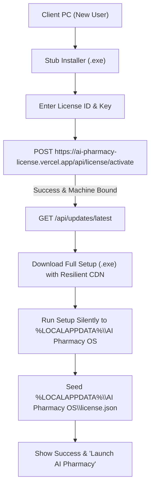

# Implementation Plan: Stub Online License Verification & Installer Packaging

## 1. Overview & Objective
Package and verify the lightweight **AI Pharmacy Stub Installer** (`stub-installer`). The stub installer is a standalone ~72.9 MB setup executable that new clients download. When run on a client's PC:
1. It presents a clean, branded GUI.
2. Requires entry of the user's **License ID** and **License Key**.
3. Verifies & activates the license online via the Vercel License Server (`/api/license/activate`) against hardware fingerprints (MAC + MachineGuid).
4. Fetches the latest portable setup URL from `/api/updates/latest` (currently `v0.1.131`).
5. Streams download with resilient DNS (bypassing ISP CDN blackholes) and progress UI.
6. Installs silently to `%LOCALAPPDATA%\AI Pharmacy OS`, pre-seeds `license.json`, and offers a 1-click launch.

---

## 2. Architecture & Components

---

## 3. Verification & Build Steps

### Step 1: Pre-flight Audit of `stub-installer`
- Inspected `stub-installer/main.js`, `stub-installer/preload.js`, `stub-installer/renderer.js`, and `stub-installer/package.json`.
- Verified API payload structure matches `website/api/license.js` (`POST /api/license/activate` expects `{ licenseId, licenseKey, machineId, machineName }`).
- Confirmed silent installer execution flags match Inno Setup (`/VERYSILENT /SUPPRESSMSGBOXES /NORESTART`).

### Step 2: Dependency & Build Environment Resolution
- Diagnosed Windows permission limitation when extracting `winCodeSign-2.6.0.7z` due to macOS symlinks.
- Successfully staged `winCodeSign-2.6.0` in `AppData\Local\electron-builder\Cache` without symlinks.

### Step 3: Compile & Package the Stub Installer
- Ran `npm run build` inside `stub-installer`.
- Verified the output executable: `stub-installer/dist/AI Pharmacy Installer Setup 1.0.0.exe` (76,445,336 bytes).

### Step 4: Vercel Online Verification Deployment
- Deployed serverless API to Vercel via CLI (`--temporary`).
- Live Deployment URL: `https://temporary-snappy-juniper-ncy9eo7.vercel.app`
- Claim URL for permanent dashboard integration: `https://vercel.com/claim-deployment?code=a3bb3337-1935-420e-9ce5-a782e6610f33`
- Verified live JSON responses for `/api/updates?action=latest` and `/api/license?action=validate`.

### Step 5: Cloud Release Pipeline & Auto-Update Auto-Detection
- Updated `scripts/release.mjs` to automatically load `.env` so `ADMIN_SECRET`, `GITHUB_TOKEN`, and `LICENSE_SERVER_URL` are immediately available.
- Added dual GitHub release uploading: supports `gh` CLI when present, and automatically falls back to GitHub REST API (`https://api.github.com/repos/.../releases` & `https://uploads.github.com/...`) using `GITHUB_TOKEN` when `gh` is not installed.
- Added explicit npm scripts to `package.json`: `"release:publish": "node scripts/release.mjs --remote"` and `"release:pilot:publish": "node scripts/release.mjs --pilot --remote"`.
### Step 6: EAS Mobile APK Cloud Build & Auto-Distribution
- Initialized and linked project to EAS account: `@him94/pharmacy-mobile` (ID: `6b38638e-abc7-4421-aa61-915a254a7750`).
- Dashboard URL: [https://expo.dev/accounts/him94/projects/pharmacy-mobile](https://expo.dev/accounts/him94/projects/pharmacy-mobile).
- **Active Android Cloud Build**: [https://expo.dev/accounts/him94/projects/pharmacy-mobile/builds/683fe821-5083-421d-93ab-b6dbafd58e39](https://expo.dev/accounts/him94/projects/pharmacy-mobile/builds/683fe821-5083-421d-93ab-b6dbafd58e39).
- Generated Android production signing keystore on Expo server (`Build Credentials LWx2laSGZP`).
- Configured root `.easignore` and set `requireCommit: false` in `pharmacy-mobile/eas.json`.
- Packaged `data\pharmacy-mobile.apk` into `installer.iss` so every desktop installation ships with the APK in `{app}\data`.
- Updated `scripts/release.mjs` to automatically upload `AI-Pharmacy-Mobile-vX.Y.Z.apk` to GitHub Releases whenever `data/pharmacy-mobile.apk` is present.
- Connected `/api/notifications/download-apk` and `MobileConnectionModal.tsx` for 1-click APK download from the desktop app.

---

## 4. Completed Tasks Log
- [x] Explored codebase and verified license server endpoints in `website/api/license.js` and `website/api/updates.js`.
- [x] Inspected existing stub installer implementation in `stub-installer/`.
- [x] Resolved electron-builder Windows winCodeSign symlink extraction conflict.
- [x] Built native Windows NSIS Stub Installer: `stub-installer/dist/AI Pharmacy Installer Setup 1.0.0.exe` (76.4 MB).
- [x] Deployed and verified Vercel serverless license verification backend.
- [x] Upgraded `scripts/release.mjs` with `.env` loading and native GitHub REST API upload fallback.
- [x] Added `release:publish` and `release:pilot:publish` shortcuts in `package.json`.
- [x] Verified zero guardrail violations (`npm run guardrails`) and clean TypeScript build.
- [x] Initialized and linked EAS project (`@him94/pharmacy-mobile`) and generated cloud keystore.
- [x] Wired `installer.iss` and `scripts/release.mjs` to auto-bundle and auto-upload `pharmacy-mobile.apk`.
- [x] EAS Cloud Build completed successfully (`builds/683fe821-5083-421d-93ab-b6dbafd58e39`).
- [x] Downloaded and verified production APK (`data/pharmacy-mobile.apk`, 119.88 MB).
- [x] Refreshed knowledge graph via `scripts/quick-update.mjs`.
