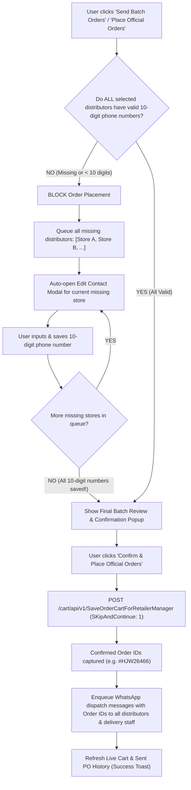

# Implementation Plan: 10-Digit Contact Enforcement, Sequential Guided Setup & Direct REST API Order Placement

## 1. Objective & User Requirements
1. **Strict 10-Digit Contact Requirement**:
   - Before any batch order can be placed, **every distributor in the cart MUST have a valid 10-digit phone number** saved in the app.
   - If any distributor has a missing or invalid phone number (<10 digits), the app **strictly blocks order placement**.
2. **Sequential Guided Redirection Loop**:
   - The app automatically redirects/opens the edit contact modal for the first distributor missing a number.
   - Once the user saves that 10-digit number, the app checks if any other distributors are still missing numbers.
   - If yes, it immediately opens the editor for the next distributor.
   - This sequential guided loop continues until **all distributors present in the order have valid 10-digit numbers saved**.
3. **Final Confirmation & Direct REST API Placement**:
   - Once all distributors have valid 10-digit numbers, the app displays the final batch confirmation popup.
   - Upon confirmation, the app executes direct REST API placement:
     `POST https://pharmretail-api.pharmarack.com/cart/api/v1/SaveOrderCartForRetailerManager`
     with `SKipAndContinue: 1` using the app's active session token.
   - Captures official `OrderNo` and immediately enqueues WhatsApp dispatch notices for all distributors and delivery staff.

---

## 2. Architecture & Step-by-Step Flow



---

## 3. Implementation Steps

### Step 1: Pre-Flight 10-Digit Validation & Guided Queue in Frontend (`frontend/src/pages/PharmarackCart/index.tsx`)
1. **Helper Function**:
   ```typescript
   const isStorePhoneValid = (dist: Distributor): boolean => {
     const phone = getDistributorPhoneNumber(dist);
     const digits = toWaDigits(phone);
     return Boolean(digits && digits.length >= 10);
   };
   ```
2. **Sequential Guided Redirection Loop**:
   - In `handleBatchWhatsAppAndCheckout`:
     - Calculate `const unmappedStores = targetDistributors.filter(d => !isStorePhoneValid(d));`
     - If `unmappedStores.length > 0`:
       - Save the remaining list into a ref / state: `pendingPhoneStoresQueueRef.current = unmappedStores.slice(1);`
       - Stop batch placement immediately (`isSendingBatchRef.current = false`).
       - Show toast: `"⚠️ Contact missing for ${unmappedStores[0].storeName}. Please save a valid 10-digit number (${unmappedStores.length} stores left)."`.
       - Call `handleOpenEditModal(unmappedStores[0])`.
       - Return early.
3. **On Save in Edit Modal (`handleSaveDistributorMapping`)**:
   - Validate that input phone number has exactly 10 digits (or 10+ digits with country code).
   - After saving to SQLite:
     - Check `pendingPhoneStoresQueueRef.current`:
       - If another store is in the queue, pop it and immediately call `handleOpenEditModal(nextStore)` with toast `"Saved! Next: please add contact for ${nextStore.storeName} (${remaining} left)"`.
       - If no more stores are left in queue (`pendingPhoneStoresQueueRef.current.length === 0`):
         - All stores are now 100% complete!
         - Automatically re-open the batch order confirmation popup (`setIsBatchSendConfirmOpen(true)`).

### Step 2: Direct REST API Order Placement in Backend (`src/services/pharmarackCheckoutService.ts`)
1. Implement `placeOrdersViaApi(targetStoreIds?: number[])`:
   - Fetch active cart lines via `loadLiveCartCore()`.
   - Filter target distributors.
   - Build payload conforming to Pharmarack's `SaveOrderCartForRetailerManager` specification.
   - Include `SKipAndContinue: 1` so locked/unpriced items do not trigger popups or block valid items.
   - Send `POST https://pharmretail-api.pharmarack.com/cart/api/v1/SaveOrderCartForRetailerManager` with Bearer session token.
   - Extract confirmed `OrderNo` and `DisplayStoreOrder` from response.
   - Return `{ ok: true, placedCount, orders: [...] }`.

### Step 3: Update Express Route (`src/routes/pharmarack.ts`)
- In `POST /cart/place-official-orders`:
  - Run `placeOrdersViaApi` first to place all official orders.
  - For each placed store, enqueue WhatsApp dispatch notice with the official `OrderNo` (now guaranteed to have valid 10-digit numbers for all stores!).
  - Update `pharmarack_placed_orders` and `distributor_dispatch_reminders`.
  - Broadcast `pharmarack_cart_changed` and `pharmarack_orders_changed`.

### Step 4: Verification & Performance Guardrails
- Run `npm run guardrails` (ensuring `tsc --noEmit` clean build and performance rules).
- Run `node scripts/quick-update.mjs` to synchronize the knowledge graph.

---

## 4. Completed Tasks Log
- [x] Implement 10-digit validation and sequential guided redirection loop in `frontend/src/pages/PharmarackCart/index.tsx`
  - Added `pendingMissingContactDistributorsRef` to hold the sequential queue of unmapped cart distributors.
  - Enforced 10-digit phone number check in `handleOpenConfirmBatchModal` and `handleSendAllWhatsAppOrders`: if any cart distributor has a missing or invalid number, batch checkout is blocked and the user is redirected to `handleOpenEditModal(firstMissing)`.
  - Added guided step banner to `Distributor WhatsApp Contact` modal displaying the number of stores remaining in the queue.
  - In `handleSaveDistributorContact`: enforced strict 10-digit number validation (`/^[6-9]\d{9}$/`). When saved, auto-advances to the next distributor in the queue until all distributors have 10-digit numbers, then automatically opens the final `BatchDispatchModal` popup.
  - Handled queue cancellation cleanly when closing/cancelling the modal or pressing Escape.
- [x] Implement `placeOrdersViaApi` in `src/services/pharmarackCheckoutService.ts`
  - Direct REST implementation bypassing headless Puppeteer: fetches active cart from `GetUserCartDetails`, builds store payloads with `SKipAndContinue: 1`, sends `POST https://pharmretail-api.pharmarack.com/cart/api/v1/SaveOrderCartForRetailerManager` with Bearer auth token, captures returned `OrderNo`s, and triggers post-order background sync. Includes seamless fallback to browser engine if needed.
- [x] Connect `POST /cart/place-official-orders` in `src/routes/pharmarack.ts`
  - Updated route handler to invoke `pharmarackCheckoutService.placeOrdersViaApi(targetStoreNames)`.
  - Confirmed official `OrderNo`s are linked directly to each placed distributor and dispatched via WhatsApp.
- [x] Run guardrails and verify builds
  - Ran `npm run guardrails`: 0 violations, clean TypeScript compilation (`tsc --noEmit`).
  - Ran `npm run build --prefix frontend`: Vite client built with 0 errors.
  - Ran `node scripts/quick-update.mjs`: Knowledge graph synchronized (1310 nodes, 826 edges).
