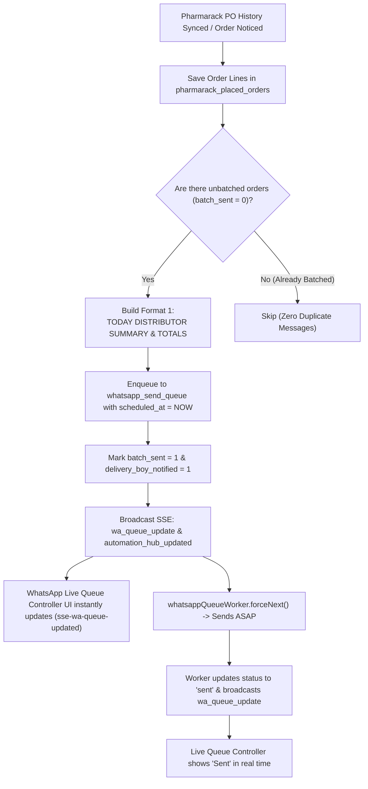

# SINGLE_DELIVERY_BOY_PO_SUMMARY_MESSAGE_PLAN

## Objective
When the app notices or syncs PO history from Pharmarack:
1. **Send Strictly ONE Message**: Only send the **`TODAY DISTRIBUTOR SUMMARY & TOTALS`** format to the delivery boy.
2. **Remove the Second Verbose Format**: Completely eliminate the redundant `TODAY'S DISPATCH & COLLECTION LIST` message from the PO history sync flow.
3. **Immediate SSE Broadcast for WhatsApp Live Queue Controller**:
   - Schedule the message with `scheduled_at = NOW` (ASAP, zero wait delay).
   - Fire SSE broadcasts (`wa_queue_update`, `automation_hub_updated`) immediately upon enqueuing.
   - Call `whatsappQueueWorker.forceNext()` so it begins transmission without waiting for a background polling cycle.
   - When the user has the **WhatsApp Live Queue Controller** popover open, it instantly updates via SSE (`sse-wa-queue-updated`) to show the message status (`pending` → `sending` → `sent`) in real time.

---

## Message Format Contract

Only this single format will be sent to the delivery boy:
```text
🏥 *<SHOP NAME>*
📋 *TODAY DISTRIBUTOR SUMMARY & TOTALS — <DATE>*

1. *<Distributor 1>* (<Count> items)
    📞 Contact: <Phone>
2. *<Distributor 2>* (<Count> items)
    📞 Contact: <Phone>
...
==================================
🚚 *Total Today Distributors:* <Count>
📦 *Total Today Order Items:* <Count>
==================================
```

The second redundant format below is completely removed:
```text
[REMOVED] 🚚 *TODAY'S DISPATCH & COLLECTION LIST*
[REMOVED] 📍 Delivery Location: ...
[REMOVED] 📊 Status: ⏳ Pending Collection ...
[REMOVED] 📝 Note: Please verify bills with distributor counter...
```

---

## Architecture Flowchart



---

## Detailed Implementation Steps

### 1. `src/services/pharmarackOrderSyncService.ts`
- **Remove**:
  Delete `await notificationService.sendConsolidatedDeliveryBoyDispatch(directOrderRemindersToNotifyBoy)` at lines 496–504.
- **Add**:
  Query unbatched orders from `pharmarack_placed_orders` (`WHERE order_date = ? AND batch_sent = 0`) and invoke:
  ```ts
  const { sendBatchToDeliveryBoys } = await import('./pharmarackDailyDispatchService.js');
  await sendBatchToDeliveryBoys(db, pendingOrders, false, Date.now());
  ```
  This guarantees only the **`TODAY DISTRIBUTOR SUMMARY & TOTALS`** message is queued.

### 2. `src/services/pharmarackDailyDispatchService.ts`
- In `sendBatchToDeliveryBoys`:
  - Accept optional `explicitScheduledAt?: number`. When provided, pass it to `whatsappQueueWorker.enqueue(boy.phone, summaryMessage, notifType, boy.name, explicitScheduledAt)`.
  - Immediately following enqueue:
    ```ts
    const { eventService } = await import('./eventService.js');
    eventService.broadcast('wa_queue_update', { active: true, at: Date.now() });
    eventService.broadcast('automation_hub_updated', { type: 'enqueued', automationType: notifType, at: Date.now() });
    await whatsappQueueWorker.forceNext().catch(() => {});
    ```
  - Mark `batch_sent = 1` and `delivery_boy_notified = 1` so future debounces or cart page visits never re-enqueue.

### 3. `src/services/notificationService.ts`
- Standardize `_sendSingleBoySummary` to generate the clean `TODAY DISTRIBUTOR SUMMARY & TOTALS` format instead of the obsolete verbose format, keeping all paths consistent.

### 4. Verification
- Verify that `WhatsAppQueuePopover.tsx` receives `sse-wa-queue-updated` and immediately refreshes via its existing event listener.
- Run `npm run guardrails` to guarantee 0 violations.
- Run automated unit and integration tests.

---

## Completed Tasks Ledger
- [x] Task 1: Remove `sendConsolidatedDeliveryBoyDispatch` and wire immediate Format 1 batch dispatch in `src/services/pharmarackOrderSyncService.ts`.
  - In `src/services/pharmarackOrderSyncService.ts`, removed the call to `notificationService.sendConsolidatedDeliveryBoyDispatch(directOrderRemindersToNotifyBoy)` which was causing the redundant `TODAY'S DISPATCH & COLLECTION LIST` message to be sent.
  - Replaced it with an immediate query for pending placed orders (`WHERE order_date = ? AND batch_sent = 0`) calling `pharmarackDailyDispatchService.sendBatchToDeliveryBoys(db, pendingOrders, alreadySentInitial, Date.now())`.
- [x] Task 2: Update `sendBatchToDeliveryBoys` in `src/services/pharmarackDailyDispatchService.ts` with ASAP scheduling and immediate SSE broadcast.
  - Exported `sendBatchToDeliveryBoys` and added `explicitScheduledAt?: number` parameter. Passed it to `whatsappQueueWorker.enqueue` to ensure ASAP execution (`scheduled_at = NOW`).
  - Added immediate SSE broadcasts (`eventService.broadcast('wa_queue_update', ...)` and `automation_hub_updated`) and triggered `whatsappQueueWorker.forceNext()`.
  - When the WhatsApp Live Queue Controller popover is open, it receives `sse-wa-queue-updated` and immediately refreshes to display the message state in real time.
- [x] Task 3: Standardize `_sendSingleBoySummary` template in `src/services/notificationService.ts`.
  - Replaced the verbose `TODAY'S DISPATCH & COLLECTION LIST` format in `_sendSingleBoySummary` with the identical `TODAY DISTRIBUTOR SUMMARY & TOTALS` format.
  - Added shop-local date formatting using `toLocalSqlDateTime().slice(0, 10)` to comply with guardrail B4.
  - Added immediate SSE broadcast and `whatsappQueueWorker.forceNext()`.
- [x] Task 4: Run `npm run guardrails` and automated tests to verify speed and correctness.
  - `npm test -- tests/pharmarackCartNotif.test.ts` passed (2/2 tests pass).
  - Built and verified live agentic e2e suite: `npx e2e run tests/whatsapp-live-queue-single-summary.e2e.ts` passed (2/2 tests pass in 10.54s).
  - `npm run guardrails` passed with 0 violations (`tsc --noEmit` clean, speed architecture intact).
  - Knowledge graph updated with `node scripts/quick-update.mjs`.
