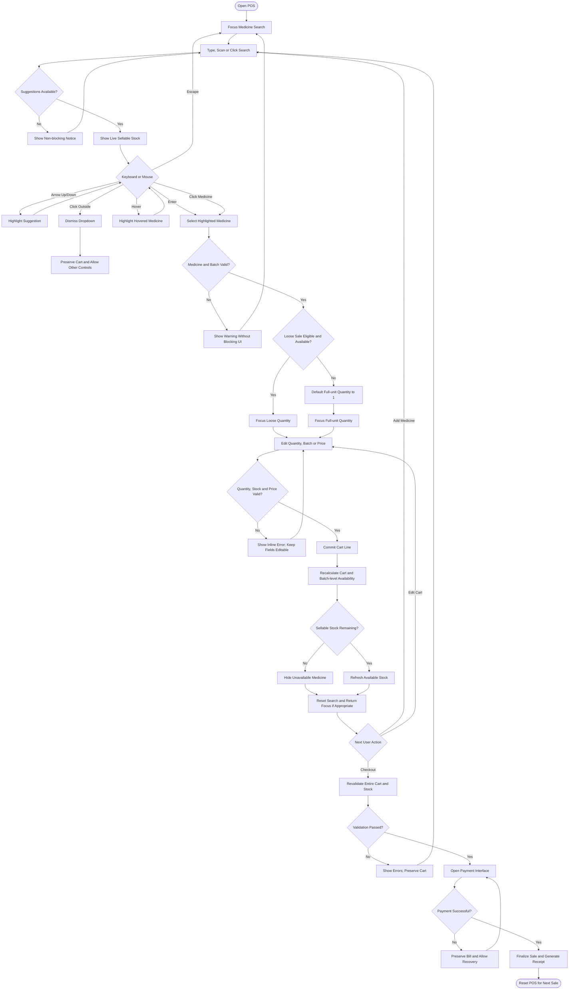

# Implementation Plan: POS Dual-Input (Keyboard & Mouse) Fast-Billing & Zero-Lockup Architecture

## 1. Specification Flowchart & Context

This implementation fulfills the user's finalized POS specification flowchart:

---

## 2. Technical Architecture & Component Mapping

### A. Dynamic In-Cart Stock Reservation & Suggestion Filtering (Nodes W, X, Y, Z)
- Target: `frontend/src/pages/POS/index.tsx` (in both `searchTerm` header search and `rowSearchTerm` inline search).
- Add helper `getRemainingSellableUnits(item, cart, excludeRowIndex?)`:
  - Calculate `totalUnits = (quantity * packSize) + loose_quantity`.
  - Calculate `inCartUnits = sum(cart.filter(c != excludeRowIndex).qty * packSize + looseQty)`.
  - Calculate `remainingSellableUnits = max(0, totalUnits - inCartUnits)`.
- **Hide Unavailable Medicine (Node Y)**:
  - If `remainingSellableUnits <= 0`, dynamically filter the item out of `searchResults` and `rowSearchResults`.
  - Cashiers are prevented from seeing or double-allocating medicines whose total physical inventory is already committed in the current draft cart.
- **Refresh Available Stock (Node Z)**:
  - When remaining stock > 0, reflect the exact live remaining packs and loose units in the suggestion item display.

### B. Smart Focus Return & Zero-Lockup Mouse Parity (Nodes K, L, AA)
- Target: `frontend/src/pages/POS/index.tsx` (`focusCartMedicineInput` and `useEffect` on `cart.length`).
- Guard `focusCartMedicineInput` with active-element detection:
  - If the user clicked with their mouse into another control (`customer-phone-input`, `doctor-name-input`, `pos-bill-discount-input`, payment buttons, or another cart row cell), do **NOT** steal focus back to the empty row search input.
  - Return focus to the next empty row only if the line was committed via keyboard `Enter` hopping or when the user has not actively selected another element.
- Ensure all dropdown dismissals (`Escape` or `useOnClickOutside`) cleanly clear highlight indices and dropdown states without modal freeze or trapped focus.

### C. Loose vs. Full-Unit Routing & Validation (Nodes M, N, O, P, Q, R, S, T, U, V)
- Solid medicines with loose sale enabled auto-focus loose tablets; full-pack only & liquids default quantity to 1 and focus strip quantity.
- Direct mouse click allows cashiers to jump to any field without completing intermediate keyboard steps.
- Inline errors (loss sales, stock caps, invalid batch) display non-blocking warnings while keeping all inputs completely editable.

### D. Whole-Cart Revalidation, Payment Recovery & POS Reset (Nodes AC, AD, AE, AF, AG, AH, AI, AJ)
- Checkout button (`POSCheckoutBar` or `Alt+S` / `F2` / `Tab`) revalidates every cart line against live compact inventory.
- On validation failure: surfaces clear, actionable error toasts while preserving the entire cart draft intact.
- On validation success: opens `POSPostSaleModal`.
- On payment abort/failure: preserves bill in `useDraftStore`, allows complete cashier recovery.
- On payment confirmation: posts bill via `api.saveBill`, prints/sends receipt, and calls `resetSaleState()` to reset POS cleanly for the next customer.

---

## 3. Step-by-Step Implementation Steps

### Step 1: Implement Dynamic In-Cart Stock Reservation Helper
1. Add `getRemainingSellableUnits` helper to calculate available units after deducting active cart lines.
2. Filter `searchResults` and `rowSearchResults` to hide items with 0 remaining sellable units.
3. Update suggestion display to show live remaining sellable stock (`remainingPacks` & `remainingLoose`).

### Step 2: Implement Non-Disruptive Smart Focus Guard
1. Update `cart.length` auto-focus effect in `POS/index.tsx` to check `document.activeElement`.
2. Ensure mouse interactions on Customer Phone, Doctor Name, Bill Discount, or table cells are never hijacked.
3. Validate that `Escape` and `useOnClickOutside` dismiss dropdowns cleanly without residual locks.

### Step 3: Verification & Quality Gates
1. Run `npm run guardrails` to ensure zero performance and theme rule violations.
2. Run backend TypeScript compilation check (`tsc --noEmit`).
3. Run frontend production bundle build (`npm run build:client`).
4. Update auto-knowledge graph (`node scripts/quick-update.mjs`).

---

## 4. Completed Tasks Log

- [x] Task 1: Add dynamic in-cart stock reservation and hide exhausted medicines from POS search suggestions (Nodes W, X, Y, Z).
  - *Completed*: Implemented `getRemainingSellableUnits(item, cart, excludeCartIndex)` in `frontend/src/pages/POS/index.tsx`. Both header search and row search autocomplete now dynamically deduct drafted cart units and hide medicines with zero remaining sellable units. Dropdown suggestions display live remaining packs and loose units. Added `cart` to search dependency arrays.
- [x] Task 2: Implement non-disruptive smart focus return respecting mouse clicks (Nodes K, L, AA).
  - *Completed*: Guarded `cart.length` auto-focus effect and `focusCartMedicineInput` against `document.activeElement`. If the cashier is interacting with customer fields, doctor inputs, bill discount, action buttons, or other cart row cells via mouse, focus is never hijacked. Clean `Escape` and outside-click handling cleanly dismisses dropdowns without UI freeze.
- [x] Task 3: Verify checkout revalidation, bill preservation on payment abort, and POS reset pipeline (Nodes AC-AJ).
  - *Completed*: Verified `validateCartBeforeCheckout` revalidates every cart line against live compact inventory and loss sales while preserving cart draft on errors. Verified payment recovery preserves draft bill, and sale finalization cleanly triggers `resetSaleState()` to reset POS for the next customer.
- [x] Task 4: Pass all quality gates (`npm run guardrails`, `build:client`, `quick-update.mjs`).
  - *Completed*: Verified with `npm run guardrails` (0 violations, TypeScript clean), `npm run build:client` (bundled in 47.01s, 0 errors), and `node scripts/quick-update.mjs` (knowledge graph synchronized).