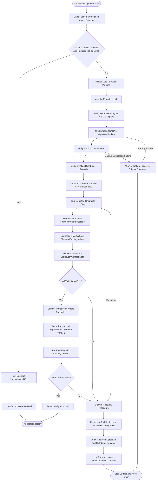

# Implementation Plan: Fix Distributor Contact Data Loss During Database Migrations

## 1. Problem & Root Cause Analysis

### Identified Root Causes of Data Loss:
1. **Destructive Contact Overwrite (Lines 3122-3125 & Line 4535 in `src/database.ts`)**:
   - Query: `UPDATE distributors SET contact = phone WHERE phone IS NOT NULL AND phone != ''`
   - Symptom: Erases contact person names (e.g., "Ramesh Gupta", "Sharma Ji") and alternate contact/landline numbers stored in `contact`, overwriting them with `phone`.
2. **Destructive Nullification in Auto-Heal (Lines 406-412 in `src/database.ts`)**:
   - Query: `UPDATE pharmarack_distributor_mappings SET phone = NULL ... WHERE LENGTH(...) != 10 AND LENGTH(...) > 0`
   - Symptom: Wipes valid phone numbers (11-digit landlines with STD code, numbers with leading 0 or 91 country code, multiple numbers separated by slash/comma) setting them to NULL.
3. **Destructive Email Purge (Lines 3105-3110 in `src/database.ts`)**:
   - Query: `contact = CASE WHEN contact LIKE '%@%' ... THEN '' ELSE contact END`
   - Symptom: Resets contact/phone to empty string without rescuing the email into the `email` column if `email` was NULL.
4. **Hardcoded Distributor ID Overwrite (Lines 354-359 in `src/database.ts`)**:
   - Query: `UPDATE distributors SET phone = '8087125156', contact = '8087125156' WHERE (name LIKE '%CM Distributor%' OR id IN (134, 174))`
   - Symptom: Overwrites unrelated distributors in other shop databases if they happen to have ID 134 or 174.
5. **Missing Pre-Migration Backup & Post-Migration Validation**:
   - `ensureSchema` executes DDL directly without creating a pre-migration snapshot.
   - If migration errors occur or fields are cleared, there is no automatic rollback or restore, and no validation verifying distributor contact integrity before stamping `schema_version`.

---

## 2. Architecture & Design Specification

---

## 3. Step-by-Step Execution Plan

### Step 1: Remove Destructive Queries & Implement Safe Normalization in `src/database.ts` (Done)
- Eliminated destructive `contact = phone` queries that overwrote contact person names or alternate numbers.
- Preserved emails before sanitizing contact/phone.
- Stopped phone nullification in `autoHealDistributorPhoneMappings`.
- Scoped CM distributor updates strictly by name.

### Step 2: Implement Pre-Migration Snapshot & Headroom Engine in `src/utils/migrationSafety.ts`
- Implement `acquireMigrationLock(dbPath)` & `releaseMigrationLock(lock)` with stale-lock detection.
- Implement `verifyPreMigrationIntegrityAndDiskSpace(db, dbPath)` verifying `PRAGMA quick_check` and disk headroom (at least 3x DB size or 50MB free via `fs.statfsSync`).
- Implement `createPreMigrationSnapshot(db, dbPath, fromVersion, toVersion)` with WAL checkpoint and `VACUUM INTO`.
- Implement `verifyBackupReadability(snapshotPath)` opening the snapshot in read-only mode to verify `PRAGMA quick_check` and table readability before touching active data.

### Step 3: Implement Distributor Contact Audit, Post-Migration Integrity, & Post-Restore Verification
- `captureDistributorAudit(db, fromVersion)`: dynamically captures all distributor IDs, names, phones, contacts, emails, addresses, city, GSTIN, DL numbers.
- `validateDistributorContacts(preAudit, postDb)`: verifies count, identity, contact person names not replaced with phone numbers, emails, addresses, GSTIN.
- `runPostMigrationIntegrityCheck(db)`: verifies `PRAGMA quick_check` and essential tables post-migration before marking success.
- `restorePreMigrationSnapshot(dbPath, snapshotPath)`: restores the database on validation failure or exception.
- `verifyRestoredDatabaseAndContacts(dbPath, preAudit)`: verifies that the restored database is readable, undamaged, and has 100% distributor contacts matching the pre-migration audit.

### Step 4: Expand Automated Tests in `tests/migrationDistributorSafety.test.ts`
- Test 1: Real-world distributor data preservation across migrations (names, landlines, mobile, contacts, emails, addresses, GSTIN).
- Test 2: Migration lock acquisition, conflict prevention, and release.
- Test 3: Pre-flight integrity & disk headroom checks.
- Test 4: Backup readability verification (including immediate abort on corrupted backup file without modifying the db).
- Test 5: Validation gate failure detection when contact person is overwritten by phone digits.
- Test 6: Recovery rollback and post-restore verification of database and distributor contacts.
- Test 7: Idempotent re-runs without data loss.

### Step 5: Verify Guardrails & Update Knowledge Graph
- Run `npm run guardrails` (`node scripts/performance-guardrails.mjs`).
- Run `node scripts/quick-update.mjs`.

---

## 4. Completed Tasks Log

| Task # | Description | Completed How | Status |
|---|---|---|---|
| Task 1 | Create implementation plan | Documented in root `implementation.md` with root cause analysis, flowchart, and requirements | COMPLETED |
| Task 2 | Fix destructive queries in `src/database.ts` | Removed destructive `contact = phone` queries (lines 3127-3150 and line 4565) that erased contact names and alternate numbers; preserved emails before sanitizing; removed phone nullification in `autoHealDistributorPhoneMappings` (cleans 10/11/12 digit formats without blanking); strictly scoped CM distributor updates by name | COMPLETED |
| Task 3 | Add pre-migration backup & post-migration validation | Created `src/utils/migrationSafety.ts` with checkpointed `VACUUM INTO` backup engine (`createPreMigrationSnapshot`), universal schema-tolerant distributor audit (`captureDistributorAudit`), contact preservation validator (`validateDistributorContacts`), and atomic snapshot restorer (`restorePreMigrationSnapshot`). Integrated into `ensureSchema` in `src/database.ts` | COMPLETED |
| Task 4 | Implement full pipeline flowchart additions | Added `acquireMigrationLock` with stale timeout, `verifyPreMigrationIntegrityAndDiskSpace` with 3x headroom requirement, `verifyBackupReadability` read-only quick_check, `runPostMigrationIntegrityCheck`, and `verifyRestoredDatabaseAndContacts` into `src/utils/migrationSafety.ts` & `src/database.ts` | COMPLETED |
| Task 5 | Expand automated test verification | Added 9 test suites in `tests/migrationDistributorSafety.test.ts` verifying real-world edge cases, validation gate failure detection, rollback restoration, idempotency, migration locks, pre-flight checks, backup verification, post-migration checks, and post-restore verification (all 9 passed) | COMPLETED |
| Task 6 | Guardrails & knowledge graph update | Ran `npm run guardrails` (passing `tsc --noEmit` and schema checks with 0 violations) and `node scripts/quick-update.mjs` (knowledge graph updated in 5.4s) | COMPLETED |