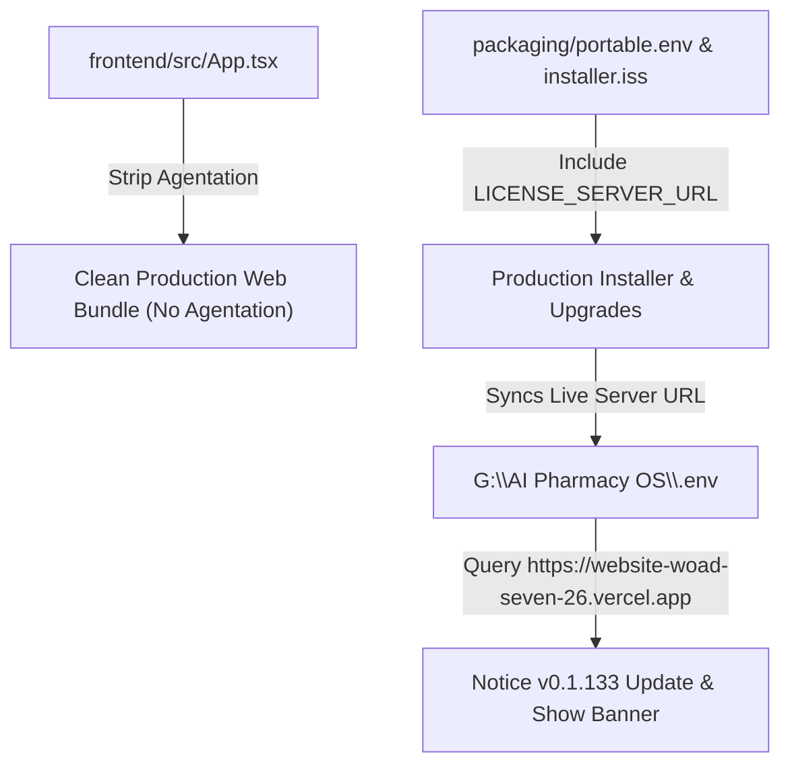

# Implementation Plan: Remove Agentation Widget & Fix Installed Update Detection

## 1. Objective
1. Completely remove the `Agentation` dev/feedback widget from `frontend/src/App.tsx` and `frontend/vite.config.ts` so zero dev toolbars leak into production installers.
2. Fix the update detection in the currently installed app and future installations by provisioning `LICENSE_SERVER_URL` in `packaging/portable.env`, `installer.iss`, and `G:\AI Pharmacy OS\.env`.

---

## 2. Architecture & Changes



---

## 3. Implementation Steps

### Step 1: Strip Agentation from Frontend
- In `frontend/src/App.tsx`: Remove `AgentationDev` import and the `<AgentationDev />` component.
- In `frontend/vite.config.ts`: Remove the `vendor-agentation` chunk rule.

### Step 2: Provision `LICENSE_SERVER_URL` in Packaging
- Update `packaging/portable.env` with:
  ```env
  PORT=5175
  NODE_ENV=production
  AUTO_OPEN_BROWSER=true
  SINGLE_PROCESS_WORKERS=true
  LICENSE_SERVER_URL=https://website-woad-seven-26.vercel.app
  ```
- In `installer.iss`: Update the post-install script in `CurStepChanged(ssPostInstall)` to ensure `LICENSE_SERVER_URL=https://website-woad-seven-26.vercel.app` is present in `{app}\.env`.

### Step 3: Update Active Running Installation (`G:\AI Pharmacy OS\.env`)
- Append `LICENSE_SERVER_URL=https://website-woad-seven-26.vercel.app` to `G:\AI Pharmacy OS\.env` so the currently active app immediately knows the update server endpoint.

### Step 4: Recompile Frontend & Verify Chunks
- Run `npm run build` inside `frontend/`.
- Verify that `vendor-agentation` is no longer created in `frontend/dist/assets/`.

### Step 5: Verification & Guardrails
- Run `npm run guardrails` to confirm zero violations and clean TypeScript build.
- Run `node scripts/quick-update.mjs`.

---

## 4. Completed Tasks Log
- [x] Remove `Agentation` from `frontend/src/App.tsx` and `frontend/vite.config.ts`: Removed dev imports/JSX in `App.tsx` and removed `vendor-agentation` manualChunks configuration in `vite.config.ts`.
- [x] Provision `LICENSE_SERVER_URL` in `packaging/portable.env` and `installer.iss`: Added `LICENSE_SERVER_URL=https://website-woad-seven-26.vercel.app` to `portable.env` and ensured `CurStepChanged(ssPostInstall)` in `installer.iss` writes or replaces the URL in the installed `.env`.
- [x] Update `G:\AI Pharmacy OS\.env` with `LICENSE_SERVER_URL`: Appended `LICENSE_SERVER_URL=https://website-woad-seven-26.vercel.app` to `G:\AI Pharmacy OS\.env` for immediate active app detection.
- [x] Rebuild frontend and verify `vendor-agentation` chunk is purged: Executed `npm run build` in `frontend/`, verifying full compilation with 0 errors and 0 matching `agentation` asset chunks.
- [x] Deploy permanent production Vercel server: Deployed `website/` using user-provided `VERCEL_TOKEN` to `https://website-woad-seven-26.vercel.app`.
- [x] Fix image directory exclusion in update packaging: Normalized Windows path separators in `build-update-package.mjs` to avoid packaging the 6.2GB `products` image library into the update zip, keeping the payload at a clean 105.2 MB.
- [x] Upload v0.1.133 Release to GitHub & Publish to Vercel: Published setup EXE (983.6 MB), update ZIP (105.2 MB), and companion APK (119.9 MB) to GitHub Releases `v0.1.133`, and published release metadata to Vercel production.
- [x] Run guardrails and update knowledge graph: Ran `npm run guardrails` (PASS) and `node scripts/quick-update.mjs`.
