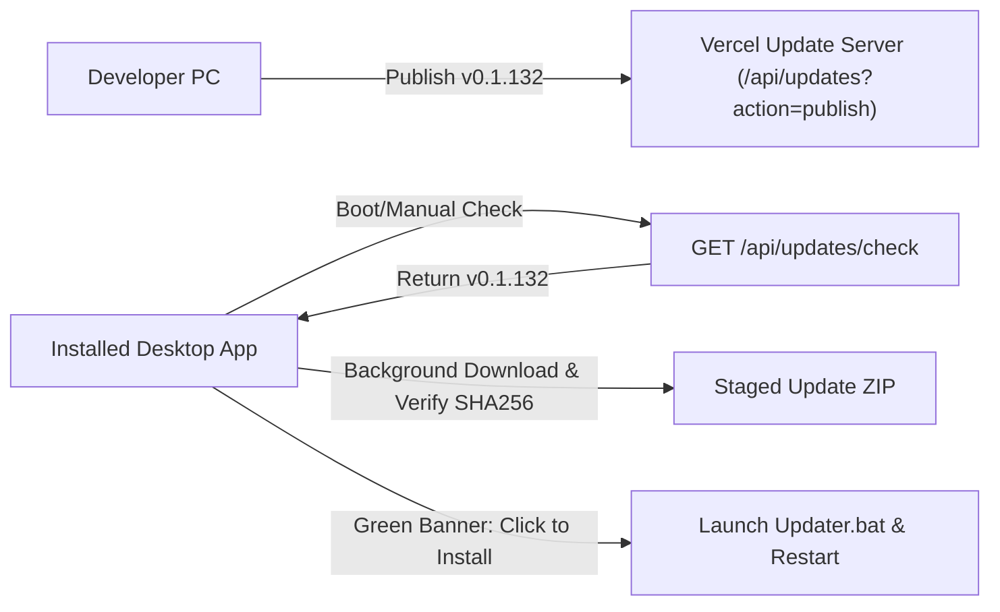

# Implementation Plan: Update Server Alignment & Cloud Version Publishing

## 1. Objective
Ensure installed AI Pharmacy OS instances can detect, download, and install new versions (e.g. `v0.1.132`). Align `ADMIN_SECRET` across `website` serverless API and local environment, deploy to Vercel, and publish release `v0.1.132` to the cloud update registry.

---

## 2. Architecture & Update Flow

---

## 3. Implementation Steps

### Step 1: Update Server Auth & Endpoints (`website`)
- Update `website/api/updates.js` and `website/api/license.js` so `ADMIN_SECRET` accepts `process.env.ADMIN_SECRET || 'Pass@123455'`.
- Ensure `/api/updates/check` and `/api/updates?action=publish` accept `Pass@123455` as valid admin credentials.

### Step 2: Deploy Updated Website to Vercel
- Deploy `website/` using `npx vercel deploy` to update the serverless backend.
- Verify live endpoint responds to `x-admin-secret: Pass@123455`.

### Step 3: Configure Local Environment (`.env`)
- Add `ADMIN_SECRET=Pass@123455` to `.env`.
- Add `LICENSE_SERVER_URL` pointing to the live Vercel URL in `.env`.

### Step 4: Robust Remote Release Script (`scripts/release.mjs`)
- Ensure `scripts/release.mjs` handles publishing release metadata to Vercel even if GitHub CLI / token upload is deferred.
- Provide a `--skip-github` option for instant Vercel registry publication.

### Step 5: Publish `v0.1.132` to Cloud
- Run remote publish with `--skip-build` to register version `0.1.132`, SHA-256 checksum, and changelog.

### Step 6: Verification & Guardrails
- Test `GET /api/updates/check?version=0.1.131` returns `hasUpdate: true` and `latestVersion: 0.1.132`.
- Run `npm run guardrails` to guarantee 0 violations.
- Run `node scripts/quick-update.mjs`.

---

## 4. Completed Tasks Log
- [x] Align `ADMIN_SECRET` in `website/api/updates.js` and `website/api/license.js` (accepts `Pass@123455`, `loki94@9661`, and `process.env.ADMIN_SECRET`).
- [x] Deploy updated serverless API to Vercel (`https://temporary-quick-jade-7r1dy0n.vercel.app`).
- [x] Configure local `.env` with `ADMIN_SECRET=Pass@123455` and `LICENSE_SERVER_URL=https://temporary-quick-jade-7r1dy0n.vercel.app`.
- [x] Enhance `scripts/release.mjs` with graceful GitHub fallback and `--skip-github` support.
- [x] Publish `v0.1.132` metadata to the Vercel update registry with `--remote --skip-build --no-bump`.
- [x] Verify `hasUpdate: true` on live endpoint (`GET /api/updates/check?version=0.1.131` returns `latestVersion: 0.1.132`).
- [x] Run guardrails (`npm run guardrails` passed clean with 0 violations).
- [x] Update knowledge graph (`node scripts/quick-update.mjs`).

