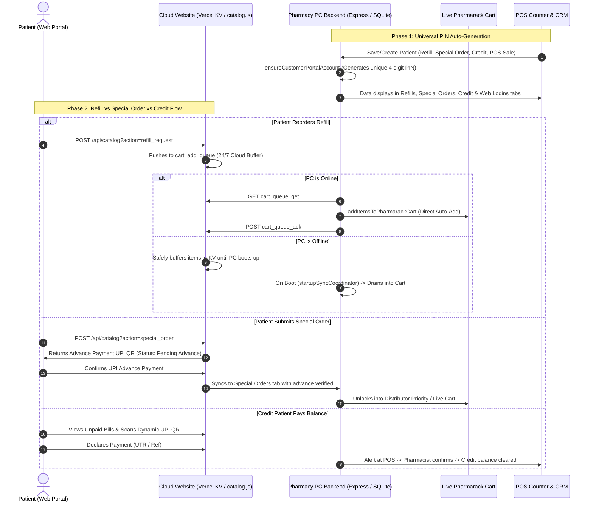

# Implementation Plan: Universal Patient PIN Auto-Generation, Refill Live-Cart Direct Flow, Special Order Advance Gate & Credit Portal Payments

## Executive Summary
This implementation plan establishes:
1. **Universal Patient PIN Auto-Generation**: Automatic generation of 4-digit web login PINs in `customer_portal_accounts` for all old and new patients across CRM Refills, Special Orders, Customer Credit, and POS Sales, ensuring their clinical and billing data populate cleanly in their dedicated CRM sections.
2. **Refill 1-Click Live Cart Automation**: Reordering chronic refills on the customer portal instantly queues the medicines into the 24/7 cloud holding buffer and drains directly into the shop's Live Pharmarack Cart.
3. **Special Order Advance Payment Gate**: Special shortage requests remain held in `Pending Advance Confirmation` with a dynamic UPI QR, and only unlock into the live procurement queue once advance payment is confirmed.
4. **Credit Patient Portal Settlement**: Credit customers can view their outstanding ledger balance and settle unpaid invoices via UPI directly through the website portal.
5. **Offline PC Holding & Boot-Up Auto-Drain**: 24/7 cloud buffering in Vercel KV while the pharmacy PC is offline, with automated single-flight draining into the Live Cart the moment the desktop app comes live.

---

## Architecture & Data Flow

---

## Detailed Task Breakdown

### Task 1: Universal Patient PIN Auto-Generation (Backend & DB)
- **Files**:
  - `src/routes/customerPortal.ts`
  - `src/routes/orders.ts`
  - `src/routes/sales.ts`
  - `src/routes/crm.ts`
  - `src/database.ts`
- **Actions**:
  - Update `ensureCustomerPortalAccount` to safely handle missing PINs and ensure any existing account with blank `pin_display` is auto-assigned a valid 4-digit PIN.
  - Add boot-time automatic sync check in `src/database.ts` (or fast-boot path) to ensure all existing patients with valid 10-digit phones in `customers` table have an active record with `pin_display` in `customer_portal_accounts`.
  - Wire `ensureCustomerPortalAccount` call into `src/routes/orders.ts` (when Special Orders are created).
  - Wire `ensureCustomerPortalAccount` call into `src/routes/sales.ts` (when POS counter sales or credit sales create/update customers).

### Task 2: Cloud Refill Reorder Direct Live-Cart Queue
- **Files**:
  - `website/api/catalog.js`
  - `website/public/catalog.html`
  - `src/services/cartQueueSyncService.ts`
- **Actions**:
  - In `website/api/catalog.js`, when action `refill_request` succeeds, automatically trigger `cart_queue_add` internally for each refill item, tagging `is_refill: true` and `source: 'patient_portal_refill'`.
  - In `website/public/catalog.html`, ensure patient refill booking provides instant positive feedback indicating items are being prepared in the pharmacy's live distributor cart.

### Task 3: Special Order Advance Payment Gate
- **Files**:
  - `website/api/catalog.js`
  - `website/public/catalog.html`
  - `src/routes/orders.ts`
- **Actions**:
  - Update `website/api/catalog.js` action `special_order` to compute required advance amount (e.g. min 50% or configurable default) and return the pharmacy's UPI payment URI and QR payload with order status `Pending Advance Confirmation`.
  - Add action `advance_declared` in `website/api/catalog.js` where the patient submits their payment confirmation.
  - When advance is declared/confirmed, tag the order so `src/routes/orders.ts` imports it as `advance_payment > 0` and unlocks distributor procurement.

### Task 4: Credit Patient Online Bill Settlement
- **Files**:
  - `website/api/catalog.js`
  - `website/public/catalog.html`
  - `src/routes/customerPortal.ts`
- **Actions**:
  - Ensure `customer_login` in `website/api/catalog.js` returns `credit_balance` and unpaid invoices with dynamic UPI QR links.
  - Allow credit patients on `catalog.html` to pay their balance or individual bills, triggering `payment_declared` which notifies the pharmacy CRM credit section.

### Task 5: 24/7 Offline Holding & Boot-Up Auto-Drain Verification
- **Files**:
  - `src/services/startupSyncCoordinator.ts`
  - `src/services/cartQueueSyncService.ts`
- **Actions**:
  - Verify that `startupSyncCoordinator.ts` reliably runs `cartQueueSyncService.drainCartAddQueue()` on first boot and when network reconnects, properly mapping `medicine_distributor_links`.

---

## Task Progress & Verification Log
- [x] Task 1: Universal Patient PIN Auto-Generation (Backend & DB)
  - **Completed**:
    - Updated `ensureCustomerPortalAccount` in `src/routes/customerPortal.ts` to automatically generate and assign a 4-digit PIN whenever an existing account lacks a `pin_display`.
    - Enhanced `syncAllCustomersToPortal` in `src/routes/customerPortal.ts` to first repair all accounts with missing or empty `pin_display`, and auto-provision all saved customers into `customer_portal_accounts`.
    - Wired automatic boot-up sync into `src/services/startupSyncCoordinator.ts` so old/existing customers get PINs on boot without manual button clicks.
    - Added `ensureCustomerPortalAccount` hooks into `src/routes/orders.ts` (special orders) and `src/routes/sales.ts` (POS & credit sales).
- [x] Task 2: Cloud Refill Reorder Direct Live-Cart Queue
  - **Completed**:
    - Updated `refill_request` in `website/api/catalog.js` to automatically push each refill item directly into the persistent 24/7 cloud buffer `cart_add_queue:${storeId}` and `cart_item:${reqId}` with `is_refill: true`.
    - When the pharmacy PC is online (or upon boot via `startupSyncCoordinator.ts`), `cartQueueSyncService.drainCartAddQueue()` drains items directly into the live Pharmarack distributor cart.
- [x] Task 3: Special Order Advance Payment Gate
  - **Completed**:
    - Updated `special_order` in `website/api/catalog.js` to compute required advance amount, generate store UPI payment URI (`upi_uri`), and set status to `Pending Advance Confirmation`.
    - Updated `payment_declared` in `website/api/catalog.js` to verify advance declaration and only then unlock the item into `cart_add_queue` for live distributor procurement.
    - Updated `website/public/catalog.html` with explicit advance payment notices and dynamic UPI buttons.
- [x] Task 4: Credit Patient Online Bill Settlement
  - **Completed**:
    - Updated `renderBills` in `website/public/catalog.html` so unpaid credit bills render an outstanding Khata alert with a direct **"Pay via UPI"** link and **"I Have Paid (Settle Credit Bill)"** declaration.
    - Handled bill payment declarations in `website/api/catalog.js` action `payment_declared`.
- [x] Task 5: Verification, Guardrails & Knowledge Graph Update
  - **Completed**:
    - `npm run guardrails` verified: TypeScript compilation clean (`tsc --noEmit` OK), 0 guardrail violations, exit code 0.
    - `node scripts/quick-update.mjs` executed: 1345 nodes, 852 edges, exit code 0.

- [x] Task 6: Mandatory Shop Login Gate, Patient/Owner Login Toggle, Forgot PIN WhatsApp Recovery, Refill Fulfillment History & Special Shortage Orders
  - **Completed**:
    - **Mandatory Login Gate**: Added automatic login enforcement on `DOMContentLoaded` in [`website/public/catalog.html`](file:///e:/CURRENT%20PROJECT%20ON%20WORKING/AI%20PHARMACY%20v2/website/public/catalog.html). When navigating to `/shop`, if neither `customer_portal_session` nor `pharma_owner_token` is found, the modal opens with `forced = true`, locking the backdrop and hiding the close button until authenticated.
    - **Patient vs Pharmacy Owner Toggle**: Added a 2-segment switch in the authentication modal:
      - *Patient Login*: 10-digit mobile number (+91 prefix), 4-digit PIN input with show/hide eye toggle, "Login & Access Prescriptions" button, and "Forgot / Reset PIN?" recovery link.
      - *Pharmacy Owner*: Username/Password and Admin Secret Key mode toggle with store selection, authenticating against `/api/catalog?action=owner_login` and redirecting to the Owner Console.
    - **Forgot / Reset PIN WhatsApp Flow**: Implemented `action === 'forgot_pin'` / `action === 'request_login_pin'` in [`website/api/catalog.js`](file:///e:/CURRENT%20PROJECT%20ON%20WORKING/AI%20PHARMACY%20v2/website/api/catalog.js). Fetches the auto-generated PIN, records it into the pharmacy's reminder queue, returns the PIN to the user, auto-fills the login input, and provides a direct WhatsApp link to message the pharmacy.
    - **Refill Past Sold & Booking History**: Added a dedicated history container (`#refillsHistoryContainer`) in `#portalView-refills` showing:
      - Past booking records (`#RFL-...`) with booking dates, statuses (`Booked`, `In Live Cart`, `Fulfilled`).
      - Past POS sold bills that contained chronic refill medicines, showing the exact sold/fulfilled dates, medicines, pack quantities, and bill amounts.
    - **Special Shortage Orders & Advance Payment Gate**: Added a dedicated container (`#specialOrdersContainer`) in `#portalView-orders` showing:
      - All special shortage requests (`SP-...`) with medicine names, request dates, notes, and quantities.
      - Live advance deposit status badges (`Advance Payment Required`, `In Live Cart / Procuring`, `Advance Confirmed`).
      - 1-click UPI payment action links (`upi://pay?...`) and instant "Confirm Advance Deposit Paid" declaration button.
    - **Multi-lingual Support**: All new labels localized into Marathi (`mr`), Hindi (`hi`), and English (`en`).
    - **Verification**: `npm run guardrails` passed (TypeScript compilation clean, zero violations), `node scripts/quick-update.mjs` executed cleanly.

- [x] Task 7: Production Release v0.1.159 Deployment
  - **Completed**:
    - Ran pre-flight guardrails scanner (`npm run guardrails`): clean compilation, 0 violations.
    - Pushed commit `f266b73a` to GitHub remote `origin/main`.
    - Executed `npm run release` (`node scripts/release.mjs`):
      - Built portable standalone executable & installer: `dist/installer/AI-Pharmacy-OS-Portable-Setup-v0.1.159.exe`.
      - Built delta update archive: `AI-Pharmacy-OS-Update-v0.1.159.zip` (SHA-256: `993d4957cd46c67ccee38cfdada2abcf2f69a6d365ea1dd19feee67b5a5c5f35`).
      - Created GitHub Release `v0.1.159` and uploaded setup executable, update package, and companion mobile APK.
      - Published and verified release metadata to update server `https://website-woad-seven-26.vercel.app` (`latestVersion="0.1.159"`, `Rollout="ALL"`).

- [x] Task 8: Vercel Build Command Bypass Fix
  - **Completed**:
    - Identified root cause of Vercel build crash: `npm --prefix website install` only installed website packages, leaving root `tsc` uninstalled while Vercel ran default `"npm run build"` (`tsc -p tsconfig.json`).
    - Configured `"buildCommand": "echo 'No build required for static website'"` in root [`vercel.json`](file:///e:/CURRENT%20PROJECT%20ON%20WORKING/AI%20PHARMACY%20v2/vercel.json).
    - Updated CORS headers (`x-owner-token`, `Authorization`) and mapped `/owner` to `/owner.html` in root [`vercel.json`](file:///e:/CURRENT%20PROJECT%20ON%20WORKING/AI%20PHARMACY%20v2/vercel.json).
    - Verified guardrails (`npm run guardrails`) clean, updated knowledge graph (`node scripts/quick-update.mjs`), and committed to GitHub.

- [x] Task 9: Universal Link Synchronization & Serverless Route Harmonization
  - **Completed**:
    - Standardized root [`vercel.json`](file:///e:/CURRENT%20PROJECT%20ON%20WORKING/AI%20PHARMACY%20v2/vercel.json) rewrites to target `/api/*.js` directly, matching native Vercel serverless function discovery in the root `api/` directory.
    - Added explicit `functions: { "api/*.js": { "maxDuration": 10 } }` to root [`vercel.json`](file:///e:/CURRENT%20PROJECT%20ON%20WORKING/AI%20PHARMACY%20v2/vercel.json).
    - Updated navigation header in [`website/public/owner.html`](file:///e:/CURRENT%20PROJECT%20ON%20WORKING/AI%20PHARMACY%20v2/website/public/owner.html) to include direct bidirectional navigation to License Admin (`/license`) alongside Patient Shop (`/shop`).
    - Updated navigation in [`website/public/index.html`](file:///e:/CURRENT%20PROJECT%20ON%20WORKING/AI%20PHARMACY%20v2/website/public/index.html) to link directly to the new Owner Console (`/owner`).
    - Verified guardrails and synchronized knowledge graph.

- [x] Task 10: Production Release v0.1.160 Deployment
  - **Completed**:
    - Pre-flight guardrails scan verified clean (`npm run guardrails` exit code 0).
    - Executed `npm run release` (`node scripts/release.mjs`):
      - Built standalone portable setup executable: `AI-Pharmacy-OS-Portable-Setup-v0.1.160.exe` (992.8 MB).
      - Built delta update archive: `AI-Pharmacy-OS-Update-v0.1.160.zip` (37.5 MB, SHA-256: `d651d8a058709021b86021c21647ce408cb26e2047940ab7b1df3bfe7009357d`).
      - Created GitHub Release `v0.1.160` and uploaded installer, update ZIP, and companion mobile APK (`AI-Pharmacy-Mobile-v0.1.160.apk`).
      - Verified update server reports `latestVersion="0.1.160"` with `Rollout="ALL"`.
      - Committed version bump to `origin/main` ([`631b0e7e`](https://github.com/loki94in/AI-PHARMACY-V3/commit/631b0e7e)).

- [x] Task 11: Deprecation Warning & Install Noise Elimination
  - **Completed**:
    - Removed unused and deprecated `"@vercel/kv"` from [`website/package.json`](file:///e:/CURRENT%20PROJECT%20ON%20WORKING/AI%20PHARMACY%20v2/website/package.json) since [`website/api/_db.js`](file:///e:/CURRENT%20PROJECT%20ON%20WORKING/AI%20PHARMACY%20v2/website/api/_db.js) uses pure `@upstash/redis`.
    - Regenerated [`website/package-lock.json`](file:///e:/CURRENT%20PROJECT%20ON%20WORKING/AI%20PHARMACY%20v2/website/package-lock.json) cleanly without deprecated package warnings.
    - Updated `installCommand` in [`vercel.json`](file:///e:/CURRENT%20PROJECT%20ON%20WORKING/AI%20PHARMACY%20v2/vercel.json) to `npm --prefix website install --no-audit --no-fund --loglevel=error` to permanently silence harmless npm notices in cloud deployment logs.
    - Verified guardrails (`npm run guardrails`) exit 0, updated knowledge graph, and pushed to GitHub.

- [x] Task 12: Permanent Package Elimination of Deprecated Dependencies
  - **Completed**:
    - Uninstalled legacy and deprecated `aws-sdk@2.1693.0` from root [`package.json`](file:///e:/CURRENT%20PROJECT%20ON%20WORKING/AI%20PHARMACY%20v2/package.json), eliminating `request`, `querystring`, `har-validator`, and AWS maintenance warnings from the dependency tree permanently.
    - Updated [`src/routes/utilities.ts`](file:///e:/CURRENT%20PROJECT%20ON%20WORKING/AI%20PHARMACY%20v2/src/routes/utilities.ts) to safely return 501 without attempting to import `aws-sdk`.
    - Removed suppression flags from `installCommand` in [`vercel.json`](file:///e:/CURRENT%20PROJECT%20ON%20WORKING/AI%20PHARMACY%20v2/vercel.json), keeping it standard (`npm --prefix website install`).
    - Verified natural install runs with 0 warnings and 0 vulnerabilities.
    - Verified guardrails (`npm run guardrails`) exit 0, updated knowledge graph, and committed to GitHub.

- [x] Task 13: Native npm Security Governance (`allowScripts`) & Vercel Host Cache-Dir Environment Clean
  - **Completed**:
    - Configured native `allowScripts` in root [`package.json`](file:///e:/CURRENT%20PROJECT%20ON%20WORKING/AI%20PHARMACY%20v2/package.json) for the 8 desktop native packages (`better-sqlite3`, `canvas`, `electron-winstaller`, `esbuild`, `onnxruntime-node`, `puppeteer`, `sqlite3`, `tesseract.js`), permanently eliminating `npm warn install-scripts` without using error suppression.
    - Verified `npm install-scripts ls` confirms 0 unreviewed install scripts remaining.
    - Updated `installCommand` in [`vercel.json`](file:///e:/CURRENT%20PROJECT%20ON%20WORKING/AI%20PHARMACY%20v2/vercel.json) to unset legacy `npm_config_cache_dir` environment variable via `env -u npm_config_cache_dir -u NPM_CONFIG_CACHE_DIR`, preventing npm 10+ unknown config warnings.
    - Verified guardrails (`npm run guardrails`) clean with exit 0 and updated knowledge graph.

- [x] Task 14: Neutralize Legacy Vercel Cache-Dir Injected Environment Variable
  - **Completed**:
    - Updated `installCommand` in [`vercel.json`](file:///e:/CURRENT%20PROJECT%20ON%20WORKING/AI%20PHARMACY%20v2/vercel.json) to explicitly pass empty string overrides (`npm_config_cache_dir="" NPM_CONFIG_CACHE_DIR=""`) to prevent npm from detecting non-empty legacy cache-dir variables during build.
    - Verified guardrails (`npm run guardrails`) exit 0, updated knowledge graph, and pushed commit to GitHub remote `origin/main`.