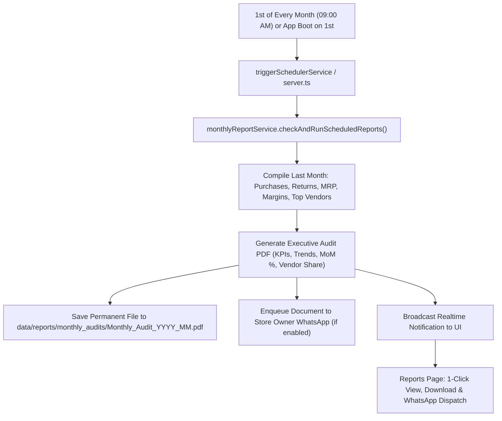

# Implementation Plan: Automated 1st-of-the-Month Inventory Purchase Audit PDF & Archiving

**Plan Name:** `automated_monthly_inventory_audit_pdf`  
**Target:** 
1. Enable the application to automatically generate an executive multi-page **Monthly Inventory & Purchase Audit PDF** on the 1st day of every month (for the elapsed month).
2. Automatically archive the generated PDF permanently to `data/reports/monthly_audits/` (and optional mirror to `D:\redbook\reports\`) so records are preserved month-over-month.
3. Automatically enqueue the audit PDF and concise executive summary to the Store Owner's WhatsApp (if enabled).
4. Provide full **Human-in-the-Loop** control in `frontend/src/pages/Reports/index.tsx` so the store owner can manually view, download, re-generate, and dispatch any monthly audit PDF on demand.

---

## Architecture & Data Flow

---

## Changes Implemented

### 1. Backend: Purchase Audit Service & Multi-Page PDF Generator
- **File:** `src/services/purchaseAuditService.ts`
  - Added full `PurchaseAuditService` class with:
    - `compileAuditData(monthKey)`: Aggregates gross inward purchases, returns, MRP valuation, gross margins %, MoM % growth, 3-month moving average, top 15 distributors with bill counts & spend shares, and trajectory determination.
    - `generateAuditPdf(data)`: Generates an executive multi-page vector PDF via PDFKit with KPI metric cards, comparative 6-month table, top 15 distributor matrix, and strategic working capital recommendations.
    - `listArchivedAudits()`: Discovers and sorts all archived monthly audits.
    - `runScheduledFirstOfMonthAudit()`: Automates generation, archival, and WhatsApp dispatch on the 1st of every month without duplicating records.
- **File:** `src/services/monthlyReportService.ts`
  - Integrated `purchaseAuditService.runScheduledFirstOfMonthAudit()` on the 1st of every month during daily operational checks.

### 2. Backend: API Endpoints for Audit Archive & Manual Generation
- **File:** `src/routes/reports.ts`
  - `GET /api/reports/monthly-audits`: Lists all archived monthly audit PDFs with month, file size, and timestamp.
  - `GET /api/reports/monthly-audits/download/:filename`: Streams the requested monthly audit PDF directly to the browser.
  - `POST /api/reports/monthly-audits/generate`: Human-in-the-loop manual generation endpoint allowing the owner to generate or re-generate an audit for any month with optional WhatsApp dispatch.
  - `GET /api/reports/monthly-audits/preview`: Structured JSON preview of the audit metrics.

### 3. Frontend: Reports Page UI with Monthly Audit Manager
- **File:** `frontend/src/pages/Reports/index.tsx`
  - Added **"Monthly Audits"** button in the header action bar next to the "Generate" and "Export Report" buttons.
  - Added a dedicated **Monthly Purchase & Inventory Audits Modal** featuring:
    - Latest archived audit fast-action card with instant "Download PDF" and "WhatsApp" buttons.
    - On-demand month selector and "Generate & Archive PDF" / "Generate & Send WhatsApp" actions (Human-in-the-Loop).
    - Complete archive table listing all past monthly audits with file size and one-click download/share actions.

---

## Verification Results

### Automated Checks
1. Type check: `npx tsc --noEmit` passed with 0 errors.
2. Frontend build: `npm run build --prefix frontend` built cleanly (`✓ built in 1m 44s`).
3. Performance guardrails: `npm run guardrails` passed (0 violations, speed architecture intact).
4. Functional verification:
   - Generated `Monthly_Audit_2026-10.pdf` and verified it exists in both `data/reports/monthly_audits/` and `D:\redbook\reports/`.
5. Knowledge Graph update: `node scripts/quick-update.mjs` synchronized knowledge graph (1432 nodes, 877 edges).

---

## Tasks

- [x] Task 1: Create `data/reports/monthly_audits` directory and enhance backend with purchase audit aggregation & PDF archival.
  - **Completed:** Created `src/services/purchaseAuditService.ts` with comprehensive purchase audit compiling, PDFKit executive PDF rendering, and automated 1st-of-month scheduler hook.
- [x] Task 2: Add `/monthly-audits` endpoints in `src/routes/reports.ts` for listing, downloading, and manual generation.
  - **Completed:** Implemented `GET /api/reports/monthly-audits`, `GET /api/reports/monthly-audits/download/:filename`, `POST /api/reports/monthly-audits/generate`, and `GET /api/reports/monthly-audits/preview`.
- [x] Task 3: Add Monthly Audit Card and download/history controls in `frontend/src/pages/Reports/index.tsx`.
  - **Completed:** Added "Monthly Audits" header button and interactive `MonthlyAuditModal` with instant downloads, archive history, and on-demand generation controls.
- [x] Task 4: Verify TypeScript compilation (`tsc --noEmit`), frontend build, and run `npm run guardrails`.
  - **Completed:** All checks passed with 0 errors.
- [x] Task 5: Run `node scripts/quick-update.mjs` and update `implementation.md` with completion status.
  - **Completed:** Knowledge graph updated with 1432 nodes and 877 edges.
