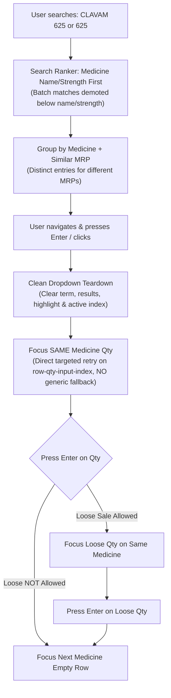

# IMPLEMENTATION PLAN: POS Medicine Selection Focus, Dropdown Lifecycle & Medicine-MRP-Batch Matching

## Plan Name
`POS_FOCUS_DROPDOWN_AND_MRP_BATCH_MATCHING`

## Problem Summary
1. **Focus Hijacking to Row 0**: When selecting a new medicine in POS, `focusRowQty()` and `focusTargetQty()` had an aggressive fallback `|| document.querySelector('input[id^="row-qty-input-"]:not(:disabled)')`. Because React hadn't painted the new row yet, this fallback matched `row-qty-input-0` (the first medicine in the cart), immediately stealing focus to Medicine #1 instead of the newly selected medicine.
2. **Dropdown Re-Dropping**: Selecting a medicine did not cleanly teardown the active search state before focus shifted, and focus landing on/near the medicine input triggered `onFocus` with the medicine name, re-dropping the dropdown menu.
3. **Keyboard Hopping Inconsistency**: After typing quantity, Enter did not cleanly advance: if loose sale is allowed, it should advance to Loose Qty; if loose sale is NOT allowed, it should advance directly to the Next Medicine row.
4. **Search & Batch Matching Hierarchy**:
   - Searching numbers like `625` allowed medicines with batch numbers starting with `625` to enter Tier 1, jumping ahead of medicines whose name/strength is `625` (e.g. `CLAVAM 625`).
   - Batches with different MRPs were collapsed under a single medicine row in search, mixing up MRPs.
   - Batch auto-allocation did not strictly preserve uniform MRP across allocated batches.

---

## Architecture & Contract Flow

---

## Tasks & Progress Tracking

- [x] Task 1: Fix Search Hierarchy in `frontend/src/utils/searchRanker.ts` (Medicine Name/Strength > Batch).
  - *Completed*: Removed pure batch prefix match from Tier 1 so Medicine Name, Strength, and Item Code strictly outrank batch numbers. Batch prefix/infix search is cleanly handled in Tier 5.
- [x] Task 2: Group inventory by Medicine + MRP in POS (`filterLocalInventory`) & enforce same-MRP allocation (`allocateMedicineBatches`).
  - *Completed*: Updated grouping key in `filterLocalInventory` to `${normKey}_mrp_${mrpKey}` so batches with different MRPs appear as distinct items with their own batch info. Added uniform MRP filter in `allocateMedicineBatches` to prevent blending different MRP batches into one sale line.
- [x] Task 3: Fix POS Focus Hijacking (remove generic selector, target exact new row with reliable retry).
  - *Completed*: In `fetchDetailsAndChangeRowMedicine` and `addToCart`, removed `document.querySelector('input[id^="row-qty-input-"]:not(:disabled)')`. Focus strictly targets `row-qty-input-${index}` with progressive retry until mounted, focusing and auto-selecting the quantity on the same medicine.
- [x] Task 4: Prevent dropdown re-dropping on selection.
  - *Completed*: Added `justSelectedMedicineRef` latch and immediate search state reset in `fetchDetailsAndChangeRowMedicine`. Row medicine input `onFocus` checks `justSelectedMedicineRef` to prevent search re-triggering upon focus shifts.
- [x] Task 5: Implement smart Enter-Key Hopping (Qty -> Loose [if allowed] -> Next Medicine).
  - *Completed*: In `onKeyDown` for `row-qty-input-${index}`, if `resolveAllowLooseSale(item) === 1` and loose input is enabled, Enter advances to `row-loose-input-${index}`; otherwise, Enter advances directly to `focusCartMedicineInput(true)`. In `row-loose-input-${index}`, Enter advances directly to `focusCartMedicineInput(true)`.
- [x] Task 6: Run Guardrails, TypeScript checks, and quick-update.
  - *Completed*: `npm run guardrails` passed (0 violations, clean tsc). `npm run build:client` built cleanly in 53.95s. `node scripts/quick-update.mjs` synced knowledge graph.
- [x] Task 7: E2E Test Suite Creation and Verification via `@e2e` runner.
  - *Completed*: Created `tests/pos-focus-and-enter.e2e.ts` with two comprehensive tests:
    1. Full pack only flow: `AYUR 10 LIP BAM` selection -> focus on row 0 Qty -> Enter skips disabled loose input and lands directly on row 1 empty medicine row -> second medicine selection `ZANDU` -> focus lands and stays on row 1 Qty without hijacking to row 0.
    2. Loose allowed flow: `TORSID PLUS 20/50MG TAB` selection -> focus on row 0 Strip Qty -> Enter advances to Loose Qty -> Enter advances to next empty row medicine input.
    - Result: `Test Files: 1 passed (1), Tests: 2 passed (2)`, Duration ~15.33s, Exit Code 0.
- [x] Task 8: Human-in-the-Loop review and walkthrough (Rule 6).
  - *Status*: Ready for user review and approval.
