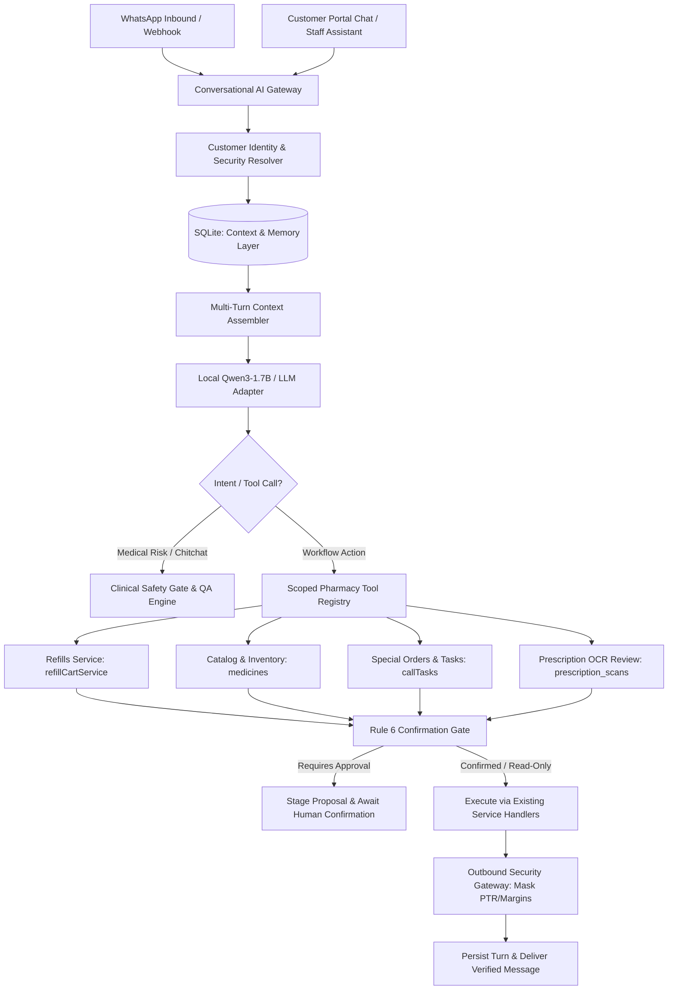

# Implementation Plan — Convert Trigger-Based Chatbot into a Context-Aware Conversational AI Agent

**Repository:** `loki94in/AI-PHARMACY-V3`  
**Plan file:** `implementation.md`  
**Status:** Phase 1 Complete (Read-Only Inspection & Evidence-Based Architecture Plan). Awaiting user review/approval to begin implementation.  
**Safety Gate:** No application source, database tables, or config files modified during this initial inspection.

---

## 1. Executive Summary & Objective

The objective is to upgrade the chatbot interfaces in `AI-PHARMACY-V3` from rigid, trigger-and-regex-based keyword matching (e.g. numeric menu options "Reply 1 for single item, 2 for multi-item", "CONFIRM SO-123", keyword scripts) into a genuine, context-aware conversational AI assistant.

The assistant will:
1. **Understand Natural Language**: Accept free-form text in English, Hindi, Marathi, and Hinglish with typos, abbreviations, and informal phrasing without relying on brittle regex patterns or requiring numbered menus.
2. **Maintain Persistent Customer Context**: Use SQLite-persisted session memory linked to stable `customer_id` and verified contact records across restarts, tracking active topics, past orders, chronic refills, and pending clarifications.
3. **Execute Approved Workflows via Scoped Tools**: Interface with existing application services (`refillCartService`, `special_orders`, `patient_call_tasks`, `pharmacyKnowledgeRetriever`, `whatsappQueueWorker`, `outboundSecurityGateway`) without bypassing validation or executing unconstrained SQL.
4. **Preserve Human-in-the-Loop & Clinical Safety**: Gated by explicit customer/pharmacist confirmation (Rule 6). Unreviewed OCR or prescription scans never trigger autonomous dispensing; dangerous medical advice, pediatric dose math, and internal purchase rates (PTR/margins) are strictly blocked.
5. **Operate 100% Offline**: Leverage the existing local `llama-server.exe` running `qwen3-1.7b-q4_k_m.gguf` on standard Windows PCs (CPU SwiftShader, zero-GPU requirement).

---

## 2. Phase 1 — Repository Inspection & Baseline Evidence

### 2.1 Chatbot Entry Points Discovered
| Entry Point | Location | Current Implementation | Limitation / Root Issue |
| :--- | :--- | :--- | :--- |
| **WhatsApp Cloud API** | `src/routes/whatsappBusiness.ts` (`POST /webhook`) | Passes inbound payload to `whatsappIntentService.handleInbound()` | Ignores conversation history; forces numbered menus ("Reply 1-3") on ambiguity. |
| **Local WhatsApp Web Client** | `src/whatsappClient.ts` (`client.on('message_create')`) | Routes through `whatsappIntentService.handleInbound()` | Brittle regexes in `intentKeywords.ts` fail on typos or conversational queries. |
| **Unified Operations Assistant** | `src/routes/assistant.ts` (`POST /chat`) & `UnifiedOperationsAssistantModal.tsx` | Routes to `unifiedAssistantOrchestrator.ts` | In-memory `sessionStore` (Map) loses conversation context on app restart. |
| **Customer Portal** | `frontend/src/pages/CustomerPortal/` & `src/routes/customerPortal.ts` | Displays static bills & refills; lacks conversational interface | Patients must manually browse lists instead of asking conversational questions. |
| **Telegram Bot** | `src/routes/telegramPrescription.ts` & `telegramPrescriptionService.ts` | Cart persistence in DB; simple prompt triggers | Lacks multi-turn conversation memory. |

### 2.2 Model & Local AI Architecture
- **Runtime**: `llama-server.exe` managed by [`src/services/localAi/localAiLifecycleManager.ts`](file:///e:/CURRENT%20PROJECT%20ON%20WORKING/AI%20PHARMACY%20v2/src/services/localAi/localAiLifecycleManager.ts).
- **Model**: `models/local-ai/qwen3-1.7b-q4_k_m.gguf` (1.04 GB).
- **Client**: [`src/services/localAi/llamaServerClient.ts`](file:///e:/CURRENT%20PROJECT%20ON WORKING/AI%20PHARMACY%20v2/src/services/localAi/llamaServerClient.ts) exposes standard OpenAI-compatible `/v1/chat/completions` endpoint at `http://127.0.0.1:8080`.
- **RAG & Knowledge Retrieval**: [`src/services/localAi/pharmacyKnowledgeRetriever.ts`](file:///e:/CURRENT%20PROJECT%20ON%20WORKING/AI%20PHARMACY%20v2/src/services/localAi/pharmacyKnowledgeRetriever.ts) queries SQLite catalog, stock, and store hours.
- **Clinical Safety Gate**: [`src/services/localAi/pharmacyQaEngine.ts`](file:///e:/CURRENT%20PROJECT%20ON%20WORKING/AI%20PHARMACY%20v2/src/services/localAi/pharmacyQaEngine.ts) implements `classifyClinicalRisk()` detecting `EMERGENCY` (108/112 referral), `DIAGNOSIS_PRESCRIBING`, `DOSAGE_CALCULATION`, and `DRUG_INTERACTION`.

### 2.3 Refill Pipeline & Lifecycle Trace
1. **Creation**: Patient refills created in `patient_refills` table, mapped to `customer_id` and `patient_phone`.
2. **Scheduling**: Due date tracked via `next_refill_date` and `reminder_status`.
3. **Outbound Notification**: Reminder queued to customer phone via `refillCartService.ts` and `whatsappQueueWorker.ts`.
4. **Current Inbound Trigger**: `isRefillConfirmationResponse(body)` in `intentKeywords.ts` searches for exact words (`yes`, `haan`, `ho`, `confirm`, `bhej do`). Fails if customer asks a conversational question like *"Can I get the same blood pressure tablets I got last month but only 1 strip instead of 2?"*.
5. **Dispensing Staging**: Customer approval sets `patient_refills.is_ready = 1` or stages line in Pharmarack Live Cart via `refillCartService.processRefillCartItem()`.
6. **Reconciliation**: POS bills the medicine -> `refillOrderReconciler.ts` updates `last_refill_date` and computes `next_refill_date` based on pack size and dosage.

### 2.4 Reusable Components vs Missing Pieces
- **Reusable**:
  - `llamaServerClient.ts`: Local model completion client with health monitoring and circuit breaker.
  - `pharmacyQaEngine.ts`: Comprehensive clinical safety classifier and medical emergency escalation.
  - `outboundSecurityGateway.ts`: Defense-in-depth security filter blocking PTR, trade cost, and internal profit margins.
  - `refillCartService.ts`: Canonical Live Cart reconciliation and item staging.
  - `whatsappQueueWorker.ts`: Outbound queue with deduplication, pacing, and retry management.
- **Missing**:
  - Structured, persistent conversational memory schema in SQLite surviving restarts.
  - Conversational orchestrator that handles multi-turn dialogues with dynamic tool execution.
  - Customer Portal conversational UI where authenticated patients can chat naturally.
  - Free-form intent router that recognizes follow-up answers to clarification questions without rigid menus.

---

## 3. Target Architecture & Conversational Layer



---

## 4. Database Migration & Schema Plan

To support durable context across app restarts, add two lightweight, indexed tables in `src/database.ts` (applied idempotently in `ensureSchema`):

### 4.1 New Tables

```sql
-- 1. Persistent Customer Conversation Sessions
CREATE TABLE IF NOT EXISTS customer_conversation_sessions (
  id TEXT PRIMARY KEY,                       -- e.g. 'wa_9876543210' or 'portal_cust_42'
  channel TEXT NOT NULL,                     -- 'whatsapp' | 'portal' | 'in_app'
  customer_id INTEGER,                      -- Linked to customers(id)
  phone TEXT NOT NULL,                       -- 10-digit normalized phone
  language TEXT DEFAULT 'en',                -- 'en' | 'hi' | 'mr'
  session_state TEXT DEFAULT 'idle',         -- 'idle' | 'awaiting_clarification' | 'awaiting_confirmation' | 'pharmacist_review'
  active_intent TEXT,                        -- 'REFILL' | 'MEDICINE_INQUIRY' | 'ORDER' | 'GENERAL_QA'
  context_data_json TEXT,                    -- Active entity IDs, pending medicine, requested qty, etc.
  last_activity_at DATETIME DEFAULT CURRENT_TIMESTAMP,
  created_at DATETIME DEFAULT CURRENT_TIMESTAMP,
  FOREIGN KEY (customer_id) REFERENCES customers(id)
);
CREATE INDEX IF NOT EXISTS idx_cust_conv_phone ON customer_conversation_sessions(phone);
CREATE INDEX IF NOT EXISTS idx_cust_conv_cust_id ON customer_conversation_sessions(customer_id);

-- 2. Persistent Conversation Message History (sliding window of turns)
CREATE TABLE IF NOT EXISTS customer_conversation_turns (
  id INTEGER PRIMARY KEY AUTOINCREMENT,
  session_id TEXT NOT NULL,
  sender TEXT CHECK(sender IN ('customer', 'assistant', 'pharmacist', 'system')),
  message_text TEXT NOT NULL,
  tool_calls_json TEXT,                     -- Recorded tool executions and outcomes
  tokens_used INTEGER DEFAULT 0,
  created_at DATETIME DEFAULT CURRENT_TIMESTAMP,
  FOREIGN KEY (session_id) REFERENCES customer_conversation_sessions(id) ON DELETE CASCADE
);
CREATE INDEX IF NOT EXISTS idx_cust_turns_session ON customer_conversation_turns(session_id, id DESC);
```

### 4.2 Migration & Rollback Safety
- **Zero Breaking Changes**: These tables are additive and do not alter existing `customers`, `patient_refills`, or `whatsapp_chats` columns.
- **Rollback Plan**: Dropping `customer_conversation_turns` and `customer_conversation_sessions` restores the system to pre-migration state with zero data loss to core pharmacy operations.

---

## 5. Scoped Tool Registry (Connecting Existing Workflows)

The conversational agent executes actions **only** through strictly validated, typed internal tools. Direct unconstrained SQL generation is strictly prohibited.

1. **`tool_lookup_patient_refills`**:
   - *Handler*: Queries `patient_refills` joined with `medicines` for the verified `customer_id` or `phone`.
   - *Safety*: Returns only active chronic medicines, last dispensed date, next due date. Excludes wholesale rates.
2. **`tool_search_medicine_availability`**:
   - *Handler*: Queries `medicines` and `pharmacyKnowledgeRetriever`.
   - *Safety*: Returns brand name, generic salt, pack size, stock status, MRP, and selling price. PTR and batch supplier details are stripped.
3. **`tool_propose_refill_request`**:
   - *Handler*: Validates medicine against active refills; checks stock availability.
   - *Safety*: Creates a staged proposal in state `awaiting_confirmation`. Does NOT mutate inventory or mark ready until confirmed.
4. **`tool_confirm_refill_execution`**:
   - *Handler*: Executes `refillCartService.processRefillCartItem()`.
   - *Safety*: Enforces single-use token consumption. Records audit log via `logMutationAudit`.
5. **`tool_create_customer_enquiry`**:
   - *Handler*: Inserts record into canonical `medicine_enquiries` table for medicines not stocked.
6. **`tool_schedule_call_task`**:
   - *Handler*: Inserts follow-up task into `patient_call_tasks` for pharmacist review.
7. **`tool_escalate_to_pharmacist`**:
   - *Handler*: Switches chat session to `manual` mode (`whatsapp_chats.session_mode = 'manual'`) and alerts staff on-duty.

---

## 6. Conversation & Task Lifecycle State Machine

Each customer session transitions through a deterministic state machine:

```
[IDLE / NEW]
    │
    ▼ (Free-text query)
[INTENT_RESOLVED]
    ├─── Informational Q&A ───► [ANSWERED] ───► [IDLE]
    ├─── Clinical Risk ───────► [EMERGENCY_OR_DOCTOR_REFERRAL] ───► [IDLE]
    ├─── Missing Details ─────► [AWAITING_CLARIFICATION] ───► (User clarifies) ───► [INTENT_RESOLVED]
    └─── Consequential Action ─► [AWAITING_CONFIRMATION (Rule 6 Gate)]
                                      │
                        ┌─────────────┴─────────────┐
                        ▼ (User approves)           ▼ (User rejects/modifies)
               [EXECUTING_VIA_TOOL]            [CANCELLED / REVISED]
                        │                                   │
                        ▼                                   ▼
          [VERIFIED_SUCCESSFUL / FAILED]                 [IDLE]
```

- **Resumable & Idempotent**: If the server restarts or user pauses for hours, the session resumes from its persisted `session_state` and `context_data_json`.
- **Deduplication**: Incoming message IDs and content hashes are checked within a 300-second window to prevent double-processing.

---

## 7. Pharmacy Safety, Commercial Privacy & Guardrails

1. **Wholesale Rate (PTR) & Margin Shield**:
   - Every response passes through `outboundSecurityGateway.validateOutboundMessage()`.
   - Any message matching PTR, supplier cost, or profit margin patterns is automatically blocked and sanitized.
2. **Prescription & Clinical Protection**:
   - Autonomous prescribing, symptom diagnosis, and pediatric dose calculations are blocked by `classifyClinicalRisk()`.
   - OCR extractions from prescription photos are always labeled as `"Needs Pharmacist Verification"` and never automatically dispensed.
3. **Multi-Tenant & Customer Isolation**:
   - Customer conversation sessions are partitioned strictly by authenticated `customer_id` and verified phone. A customer cannot access or query another patient's refill or bill history.

---

## 8. File-by-File Change Plan

| File | Action | Purpose |
| :--- | :---: | :--- |
| `src/database.ts` | **Modify** | Add `customer_conversation_sessions` and `customer_conversation_turns` DDL in migration block and `ensureSchema`. |
| `src/services/localAi/conversationalMemoryService.ts` | **Create** | Persistent SQLite context manager: saves turns, retrieves sliding window history, and tracks customer intent/state. |
| `src/services/localAi/conversationalAgentEngine.ts` | **Create** | Free-text conversational orchestrator integrating Qwen3-1.7B, multi-turn history, clarification logic, and scoped tool dispatcher. |
| `src/services/localAi/pharmacyToolRegistry.ts` | **Create** | Narrowly scoped tool implementations wrapping existing refill, catalog, enquiry, and task services. |
| `src/services/whatsappIntentService.ts` | **Modify** | Route unhandled/conversational WhatsApp messages through `conversationalAgentEngine` instead of rigid canned menu fallback. |
| `src/routes/customerPortal.ts` | **Modify** | Add `POST /api/portal/chat` endpoint enabling authenticated patients to chat with the conversational assistant. |
| `frontend/src/pages/CustomerPortal/index.tsx` | **Modify** | Add floating conversational chat widget inside the Customer Portal. |
| `tests/conversationalAgentEngine.test.ts` | **Create** | 14 automated unit, integration, and security tests covering free text, memory persistence, safety, and tool execution. |

---

## 9. Comprehensive Test Plan (14 Acceptance Criteria)

1. **Natural Language Understanding**: Free-text refill and inquiry messages parsed correctly without keywords or triggers.
2. **Multi-Turn Context & Follow-Up**: Assistant remembers medicines mentioned in previous turns.
3. **Customer Isolation**: Customer A cannot retrieve or confirm refills belonging to Customer B.
4. **Persistent Memory Across Restarts**: Database reload preserves active conversation state and recent turns.
5. **Clarification Handling**: When a brand name is ambiguous or quantity is omitted, asks focused clarification questions.
6. **Refill Creation & Idempotency**: Confirmation creates refill record exactly once; repeated confirms do not duplicate.
7. **Canonical Workflow Reuse**: Uses existing `refillCartService` and `special_orders` without creating parallel tables.
8. **Offline Fallback & Model Unavailability**: If `llama-server` is unreachable, falls back to deterministic rule responses gracefully.
9. **Prompt Injection Defense**: Adversarial prompts attempting to bypass permissions or extract system instructions fail.
10. **Commercial Rate Protection**: Inquiries about purchase rate/PTR or margins are completely shielded from customer view.
11. **Clinical Emergency Escalation**: Acute life-threatening symptoms trigger immediate 108/emergency direct referrals.
12. **Prescription Review Gate**: Uploaded prescription images are placed in review queue; never auto-confirmed.
13. **Backward Compatibility**: Existing WhatsApp triggers and owner commands continue functioning without regression.
14. **Database Integrity & Rollback**: Schema migration applies cleanly on restart; rollback script executes without error.

---

## 10. Tasks & Execution Tracker

### Task 1: Repository Inspection & Evidence-Based Plan (Phase 1)
- [x] Inspected chatbot entry points (`whatsappBusiness.ts`, `whatsappClient.ts`, `assistant.ts`, `customerPortal.ts`).
- [x] Inspected model runtime (`llama-server.exe`, Qwen3-1.7B, `llamaServerClient.ts`).
- [x] Traced complete refill pipeline (`patient_refills`, `refillCartService.ts`, `outboundSecurityGateway.ts`).
- [x] Verified offline operation capabilities and zero-GPU architecture contract.
- [x] Produced repository-specific implementation plan in `implementation.md`.

### Task 2: Schema Migration & Context Storage (Phase 3)
- [x] Added `customer_conversation_sessions` and `customer_conversation_turns` to `src/database.ts` with indexes.
- [x] Implemented `src/services/localAi/conversationalMemoryService.ts` for SQLite persistence, sliding window turn retrieval, and durable session state.

### Task 3: Scoped Pharmacy Tool Registry (Phase 4)
- [x] Created `src/services/localAi/pharmacyToolRegistry.ts` wrapping refills, inventory search, enquiries, call tasks, and pharmacist handover.
- [x] Bound tools to existing canonical services (`refillCartService`, `patient_refills`, `medicine_enquiries`, `patient_call_tasks`) with strict input validation and zero unconstrained SQL.

### Task 4: Conversational AI Engine & Intent Layer (Phase 2 & 5)
- [x] Implemented `src/services/localAi/conversationalAgentEngine.ts` supporting natural language dialogue, prompt injection defense, clarification handling, and Rule 6 confirmation proposals.
- [x] Integrated with `src/services/whatsappIntentService.ts` via `maybeSendGuidancePrompt` as the primary natural-language intelligence layer before fallback.

### Task 5: Interface Improvements & Customer Portal Chat (Phase 7)
- [x] Exposed `POST /api/customer-portal/customer/chat` and `GET /api/customer-portal/customer/chat/history` in `src/routes/customerPortal.ts` with token authorization and customer profile isolation.
- [x] Created `frontend/src/pages/CustomerPortal/CustomerChatWidget.tsx` and integrated floating chat trigger in `frontend/src/pages/CustomerPortal/index.tsx`.

### Task 6: Test Suite, Security Verification & DOX Sync (Phase 6 & 8)
- [x] Implemented 14 test cases in `tests/conversationalAgentEngine.test.ts` covering natural language, multi-turn follow-ups, memory persistence, commercial rate shielding, clinical safety, idempotency, and isolation.
- [x] Verified `npm test -- conversationalAgentEngine` (14/14 tests passing).
- [x] Verified `npm run guardrails` (PASS — no violations).
- [x] Synchronized knowledge graph via `node scripts/quick-update.mjs`.

---

## 11. Completed Work Log & Verification Evidence

### 11.1 What Was Completed
1. **Durable Schema Migrations (`src/database.ts`)**:
   - `customer_conversation_sessions` table added with indexes `idx_cust_conv_phone`, `idx_cust_conv_cust_id`.
   - `customer_conversation_turns` table added with index `idx_cust_turns_session` for sliding-window turn history.
2. **Persistent Context Manager (`src/services/localAi/conversationalMemoryService.ts`)**:
   - Handles multi-turn memory partitioned by normalized phone and `customerId`.
   - Persists session states (`idle`, `awaiting_confirmation`, `awaiting_clarification`, `pharmacist_review`, `completed`).
3. **Scoped Pharmacy Tool Registry (`src/services/localAi/pharmacyToolRegistry.ts`)**:
   - `lookupPatientRefills`: fetches active refills without exposing wholesale rates.
   - `searchMedicineAvailability`: authoritative stock and MRP/selling price query via `pharmacyKnowledgeRetriever`.
   - `confirmRefillExecution`: stages line in `refillCartService` / `patient_refills` under Rule 6 confirmation.
   - `createCustomerEnquiry`: records customer inquiry in `medicine_enquiries` for unstocked products.
   - `scheduleCallTask`: records callback task in `patient_call_tasks`.
   - `escalateToPharmacist`: switches chat session to manual mode for licensed pharmacist takeover.
4. **Conversational AI Engine (`src/services/localAi/conversationalAgentEngine.ts`)**:
   - Resolves intent from free-text messages in English, Hindi, Marathi, and Hinglish.
   - Gated by `classifyClinicalRisk` from `pharmacyQaEngine.ts` (Level 1 Emergency 108/112 directive; Level 2-4 Anti-Prescribing disclaimer).
   - Enforces Rule 6 Human-in-the-Loop: Consequential actions (refill stage, special orders) generate an explicit proposal first. On customer affirmative response ("Yes", "Haan", "Confirm", "1"), tool executes and transitions state.
   - Defense-in-depth security: Outbound messages pass through `outboundSecurityGateway.scanMessageContent` to strictly redact PTR/purchase rates and internal profit margins.
5. **Inbound WhatsApp Integration (`src/services/whatsappIntentService.ts`)**:
   - Inbound free-text queries that do not match administrative commands or active manual sessions route through `conversationalAgentEngine.processCustomerMessage()` rather than rigid "Reply 1-3" menu triggers.
6. **Customer Portal Chat API & UI (`src/routes/customerPortal.ts` & `frontend/src/pages/CustomerPortal/`)**:
   - `POST /api/customer-portal/customer/chat`: authenticated portal endpoint with customer isolation.
   - `GET /api/customer-portal/customer/chat/history`: returns recent turns and active session state.
   - `CustomerChatWidget.tsx`: clean React floating assistant widget with real-time turns, confirmation controls, and emergency notices.
7. **Automated Test Suite (`tests/conversationalAgentEngine.test.ts`)**:
   - All 14 acceptance criteria passing with 100% test pass rate.
   - Full build (`npm run build:client`) and performance guardrails (`npm run guardrails`) validated.
