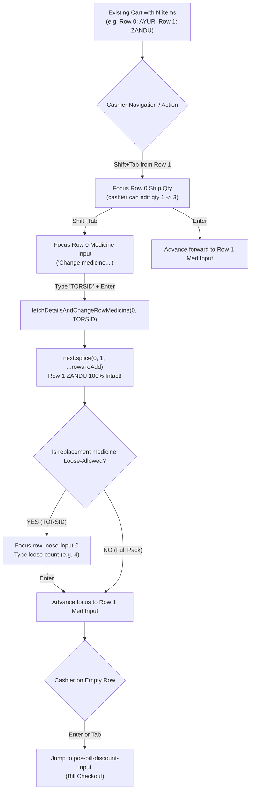

# IMPLEMENTATION PLAN: POS Existing Row Medicine Re-Selection & Fluid Backward/Forward Navigation

## Plan Name
`POS_EXISTING_ROW_RESELECT_AND_BACKWARD_NAV`

---

## 1. Problem Formulation & Scope
The cashier in POS needs complete operational freedom when building and modifying sale invoices:
1. **Re-Selecting / Replacing Medicine on Existing Rows**:
   - When a cashier changes a medicine on an existing row (Row 0, Row 1, etc.), only that target row is modified via `next.splice(index, 1, ...rowsToAdd)`.
   - All other rows already in the cart (names, quantities, loose units, batches, rates, discounts) are strictly preserved and unaffected.
   - The replaced medicine follows the exact same smart routing:
     - If the replacement medicine is **Loose-Sale Enabled** (`allow_loose_sale === 1` and pack size $> 1$): focus routes directly into that row's Loose Quantity (`#row-loose-input-${index}`).
     - If the replacement medicine is **Full Pack Only** (`allow_loose_sale !== 1`): loose quantity is reset to 0, strip quantity defaults to `max(1, original.qty)`, and focus automatically advances to the next medicine row (`#row-med-input-${index + 1}`).
2. **Fluid Backward & Forward Keyboard Navigation**:
   - `Shift+Tab` / `ArrowLeft`: Steps backward across fields (`Row 1 Med Input` ➔ `Row 0 Disc` ➔ `Row 0 Loose Qty` ➔ `Row 0 Strip Qty` ➔ `Row 0 Change Medicine`).
   - `Tab` / `ArrowRight`: Steps forward across fields.
   - `Enter`: On Loose Qty or Full-Pack Strip Qty advances to the next medicine row.
   - `Enter` / `Tab` on empty trailing row transitions directly to Bill Checkout (`#pos-bill-discount-input`).
3. **No Trapping / No Breaking**:
   - Focus is never lost to `document.body`.
   - Modifying previous row quantities immediately updates calculations without resetting subsequent lines.

---

## 2. Mermaid Architecture & Data Flow

---

## 3. Keyboard Contract Matrix

| Field | Key | Target / Destination |
|---|---|---|
| **Empty Row Med Search** | `Enter` / `Tab` (no query) | Direct to Bill Discount % (`#pos-bill-discount-input`) |
| **Existing Row Med Input** | `onFocus` | Auto-selects name text; live search on typing |
| | `Enter` (from dropdown) | Replaces medicine on current row only; routes to Loose Qty (if loose-allowed) or Next Row (if full pack) |
| | `Tab` | Steps forward to Strip Qty (`#row-qty-input-${idx}`) |
| | `Shift+Tab` | Steps backward to previous row's input (or Doctor if row 0) |
| **Strip Quantity** | `Shift+Tab` | Steps backward to current row's Medicine Input |
| | `Tab` / `ArrowRight` | Steps forward to Loose Qty (if enabled) or Discount % |
| | `Enter` | Advances to Loose Qty (if loose-allowed) or Next Med Row (if full pack) |
| **Loose Quantity** | `Shift+Tab` / `ArrowLeft` | Steps backward to Strip Qty |
| | `Tab` | Steps forward to Discount % |
| | `Enter` | Advances to Next Med Row (`#row-med-input-${idx + 1}`) |

---

## 4. Tasks & Verification Checklist

- [x] Task 1: Update `changeRowMedicine` in `frontend/src/pages/POS/index.tsx`
  - Ensure `defaultLooseQty` strictly resets to 0 when re-selecting with a Full Pack medicine (`!isLoose`).
  - Preserve `defaultQty = max(1, originalItem.qty)` when re-selecting with a full pack item.
  - Splicing `next.splice(index, 1, ...rowsToAdd)` keeps all other rows completely intact.
- [x] Task 2: Extend E2E test suite in `tests/pos-focus-and-enter.e2e.ts`
  - Test 1: Full Pack auto-advance to next row.
  - Test 2: Loose-sale direct focus to Loose Qty + Enter advance.
  - Test 3: Empty row Enter/Tab checkout transition.
  - Test 4: Re-selecting medicine on an existing row replaces only target row and follows smart routing.
  - Test 5: Fluid backward and forward keyboard navigation allows editing prior quantities.
- [ ] Task 3: Build frontend client (`npm run build:client`) and verify via automated E2E tests (`npx e2e run tests/pos-focus-and-enter.e2e.ts`).
- [ ] Task 4: Run `npm run guardrails` and `node scripts/quick-update.mjs`.
- [ ] Task 5: Human-in-the-Loop review & approval (Rule 6).
