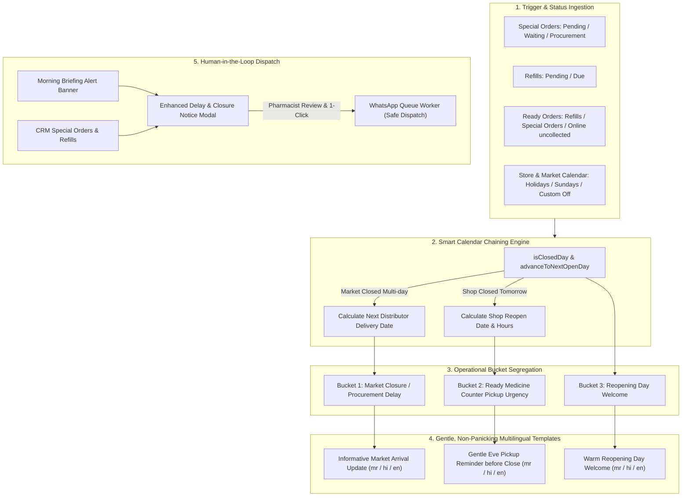

# Smart Market & Shop Closure Reminder Pipeline Implementation Plan

## Overview
Implement a comprehensive, calm, informative smart reminder pipeline that coordinates wholesale distributor closures (market off) and pharmacy store closures (shop off). The system evaluates chained multi-day holidays via `pharmacyCalendar.ts`, separates procurement-delay orders from ready-at-counter pickup orders, provides gentle/no-panic multilingual templates (Marathi, Hindi, English), and surfaces 1-click Human-in-the-Loop broadcasting in both the Morning Briefing Dashboard and CRM.

---

## Architecture & Flow

---

## User Review Required

> [!NOTE]
> All messages strictly obey user rule 6 (Human-in-the-Loop): messages are drafted, previewed, and adjusted automatically, but require pharmacist 1-click confirmation before being dispatched to patients via WhatsApp.

---

## Proposed Changes

### 1. Backend Engine Enhancements
#### [crm.ts](file:///e:/CURRENT%20PROJECT%20ON%20WORKING/AI%20PHARMACY%20v2/src/routes/crm.ts)
- Extend `GET /api/crm/delay-notice-candidates` to:
  - Check today's market status and tomorrow's shop closure status using `isClosedDay` and `advanceToNextOpenDay`.
  - Include both **Procurement Delay** candidates (`Pending`, `Ordered`, `Waiting`) and **Ready Pickup** candidates (`Ready`, `Staged`, uncollected online orders).
  - Compute dynamic template placeholders: `next_working_date`, `next_shop_open_date`, `tomorrow_day`, `close_time`, `open_time`, `closure_reason`.
  - Return calendar metadata in response: `is_today_market_closed`, `is_tomorrow_shop_closed`, `reopen_date_formatted`.
- Extend `POST /api/crm/broadcast-delay-notices` to:
  - Interpolate `{next_working_date}`, `{next_shop_open_date}`, `{close_time}`, `{open_time}`, `{closure_reason}`, `{tomorrow_day}` in addition to existing patient/medicine tags.
  - Automatically advance order schedule to verified open day using `advanceToNextOpenDay`.

### 2. Frontend Modal & Dashboard Enhancements
#### [DelayNoticeModal.tsx](file:///e:/CURRENT%20PROJECT%20ON%20WORKING/AI%20PHARMACY%20v2/frontend/src/components/DelayNoticeModal.tsx)
- Add new gentle, informative presets:
  - `market_multi_day` (घाऊक बाजार सुट्टी / Wholesale Market Holiday - informative arrival date).
  - `ready_shop_closed_tomorrow` (दुकान उद्या बंद / औषध आज किंवा पुढील दिवशी सवडीने घ्या - gentle eve pickup).
  - `shop_reopened` (दुकान आज सुरू आहे - warm welcome).
- Add Category Filter tab: `All` | `Procurement Delay (Market Off)` | `Ready for Pickup (Shop Off Tomorrow)`.
- Show calendar badge highlighting detected market / store closure status.
- Add tag inserter buttons for `{next_working_date}`, `{close_time}`, `{open_time}`.

#### [MorningBriefingDashboard.tsx](file:///e:/CURRENT%20PROJECT%20ON%20WORKING/AI%20PHARMACY%20v2/frontend/src/components/MorningBriefingDashboard.tsx)
- Add smart alert header when:
  - Market is closed today OR Shop is closed tomorrow OR there are pending delayed/ready uncollected orders.
- Provide a 1-click action: **"Review & Send Closure Notices"** which opens the `DelayNoticeModal` directly from the Morning Briefing.

### 3. Verification & Guardrails
- Create comprehensive automated test suite `tests/marketAndShopClosurePipeline.test.ts`.
- Run `npm run guardrails` to guarantee strict compliance with DOX, no-GPU, and semantic tokens.
- Run `node scripts/quick-update.mjs` to keep the knowledge graph synchronized.

---

## Verification Plan

### Automated Tests
1. Test calendar date calculation across multiple days (e.g. Saturday holiday -> Sunday off -> Monday open).
2. Test candidate aggregation: distinguishes procurement delay orders from ready pickup orders.
3. Test template tag replacement: `{next_working_date}`, `{close_time}`, `{open_time}`, `{patient_name}`, `{medicine_name}`.
4. Test WhatsApp dispatch queueing and schedule advance.
5. Command: `npx tsx tests/marketAndShopClosurePipeline.test.ts`.

### Manual / Frontend Verification
1. Open Morning Briefing Dashboard -> verify alert banner renders when market or shop is closed.
2. Click "Review & Send Closure Notices" -> verify `DelayNoticeModal` opens with correct candidates and presets.
3. Test switching languages (Marathi / Hindi / English) and verify calm, non-panicking wording.

---

## Task Completion Log

1. **Backend Calendar & Candidate Segregation**:
   - Enhanced `GET /api/crm/delay-notice-candidates` in `src/routes/crm.ts` to evaluate multi-day chained closures using `isClosedDay` and `advanceToNextOpenDay`.
   - Aggregated both **Procurement Delay** items (`Pending`, `Ordered`, `Waiting`) and **Ready Pickup** items (`Ready` special orders, staged refills).
   - Injected full `calendar_context` (`is_today_market_closed`, `is_tomorrow_shop_closed`, `next_working_date`, `open_time`, `close_time`, `tomorrow_day_name`).
   - Enhanced `POST /api/crm/broadcast-delay-notices` to dynamically interpolate `{next_working_date}`, `{close_time}`, `{open_time}`, `{tomorrow_day}`, and `{closure_reason}` in safe WhatsApp message templates.

2. **Frontend Delay & Closure Modal Enhancements**:
   - Updated `DelayNoticeModal.tsx` with calm, polite, informative templates in Marathi, Hindi, and English (Wholesale Market Off, Ready Medicine + Shop Closed Tomorrow, Shop Reopened Welcome).
   - Added category filter tabs (`All`, `Market Delay`, `Ready for Pickup`).
   - Added live calendar badges in the modal header highlighting detected wholesale market off or shop off tomorrow.
   - Added 1-click tag chips for inserting `{next_working_date}`, `{close_time}`, `{open_time}`, `{tomorrow_day}`.

3. **Morning Briefing Integration**:
   - Integrated the **Smart Calendar & Closure Notice Banner** directly into `MorningBriefingDashboard.tsx`.
   - Displays real-time status of wholesale market closures and tomorrow shop off-days with candidate counts.
   - Provides a 1-click **"Review & Send Closure Notices"** button opening the modal directly from the dashboard.

4. **Automated Verification & DOX Compliance**:
   - Created test suite `tests/marketAndShopClosurePipeline.test.ts` verifying calendar date chaining, candidate categorization, and dynamic tag interpolation. All 3 tests passed.
   - Added test to `jest.config.js`.
   - Verified with `npm run guardrails` (passed cleanly, zero violations).
   - Updated knowledge graph via `node scripts/quick-update.mjs` (1506 nodes, 891 edges).

